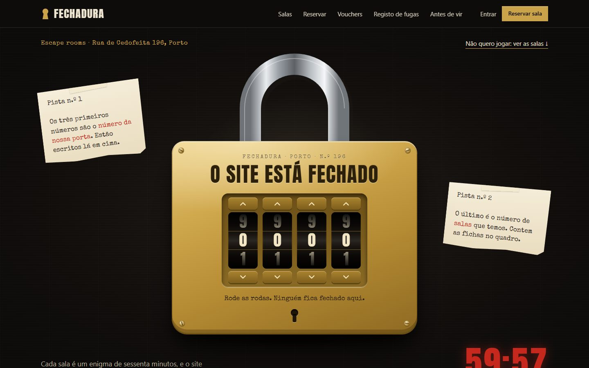
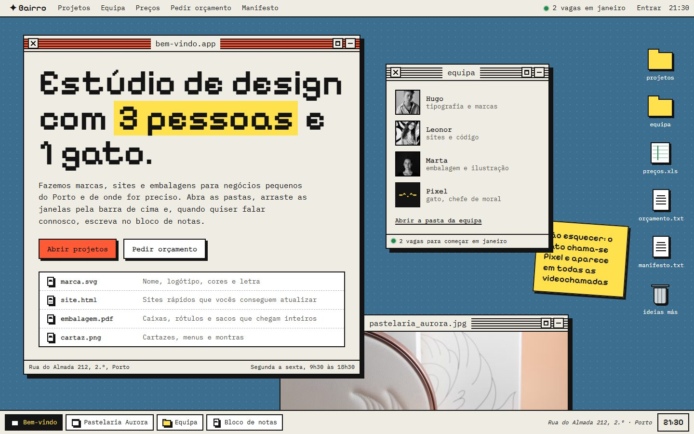
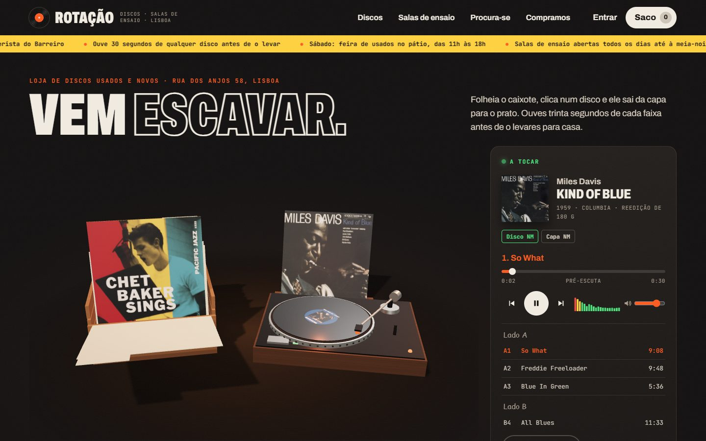
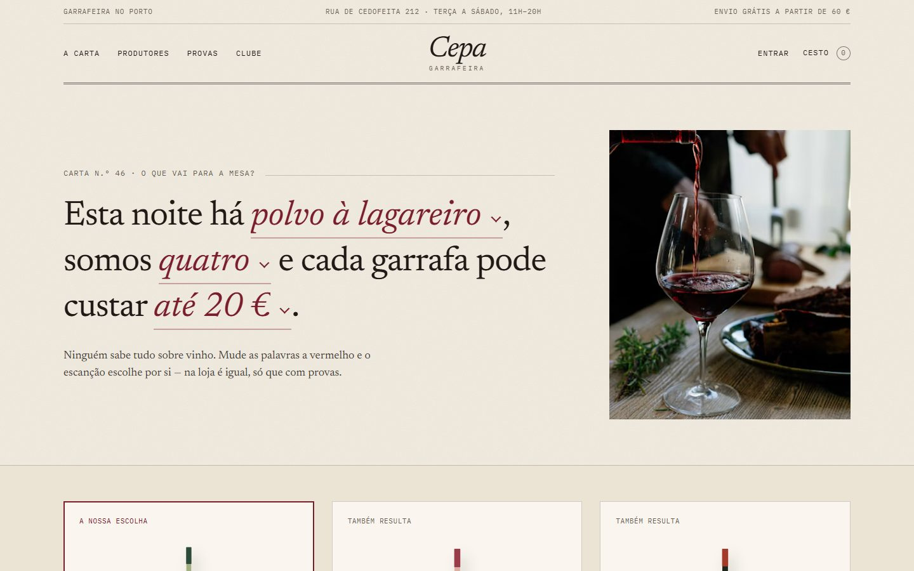
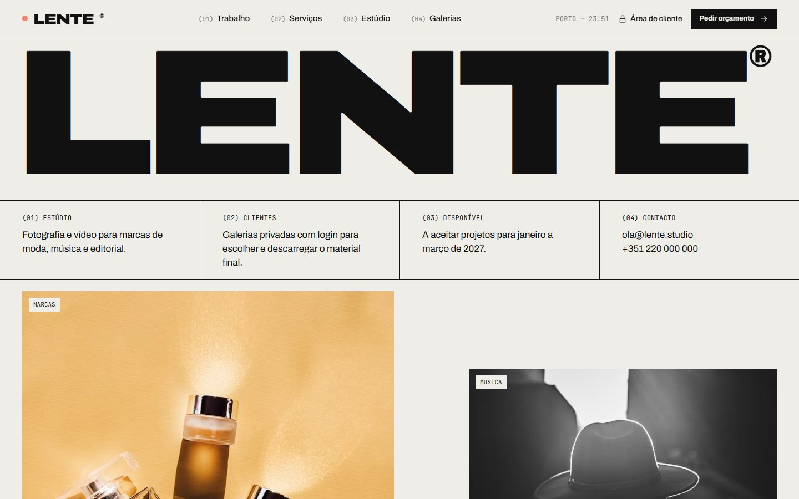
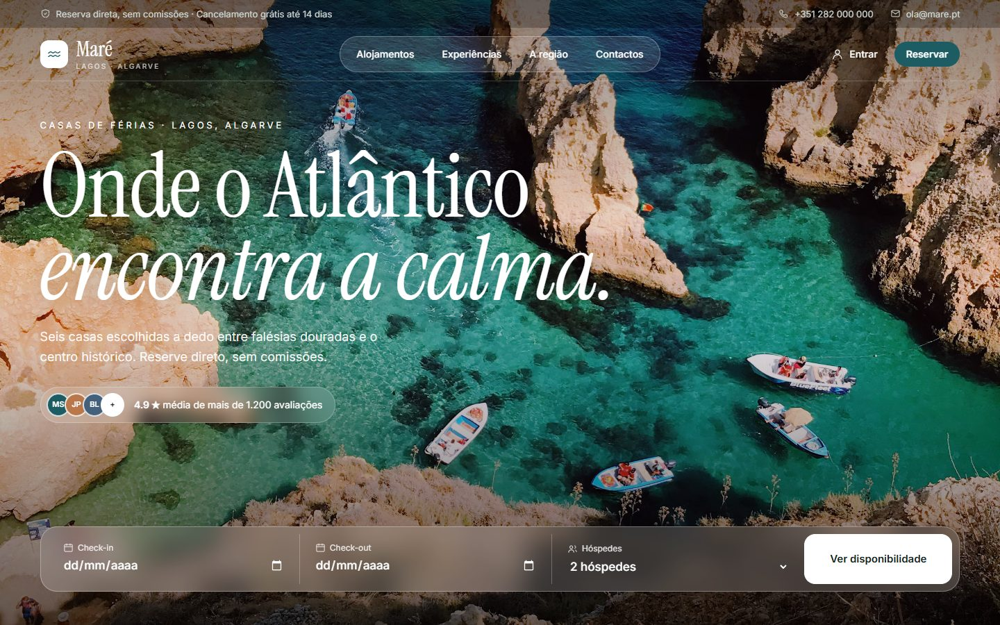

<div align="center">

# Sites do dia

**Um site completo de cada vez, cada um com a data em que foi feito. Meta: 3 sites por semana.**


</div>

<br>

Cada site é um negócio inventado, com um design pensado para esse negócio e não um modelo repetido. Todos trazem backend completo (login com JWT, rotas, validação e permissões por perfil) e funcionam sem base de dados: os dados ficam em memória com exemplos, prontos a trocar por uma base de dados real. Cada pasta tem o seu `README.md` com capturas, funcionalidades e como pôr a correr.

## 🎯 Meta semanal

Três sites por semana, de segunda a domingo.

| Semana | Sites | Meta | Estado |
|---|---|:---:|---|
| 16 a 22 nov 2026 | Bairro, Fechadura | 2 / 3 | ⏳ Em curso |
| 9 a 15 nov 2026 | Maré, Lente Studio, Cepa, Rotação | 4 / 3 | ✅ Cumprida |

## 📅 Diário

O mais recente primeiro.

<table>
  <tr>
    <td width="50%"><a href="fechadura/"></a></td>
    <td>
      <p>📅 <strong>Quarta, 18 nov 2026</strong></p>
      <h3><a href="fechadura/">Fechadura</a></h3>
      <p>Escape rooms no Porto com um site que abre trancado: para entrar resolve-se um cadeado (ou usa-se o atalho). Salas num quadro de cortiça com fio vermelho, dossier de cada sala com agenda, ficha de reserva, vouchers em envelopes lacrados, registo de fugas, área de cliente e painel do game master.</p>
    </td>
  </tr>
  <tr>
    <td width="50%"><a href="bairro/"></a></td>
    <td>
      <p>📅 <strong>Terça, 17 nov 2026</strong></p>
      <h3><a href="bairro/">Bairro</a></h3>
      <p>Estúdio de design no Porto com o site feito como um ambiente de trabalho antigo: janelas que se arrastam, explorador de projetos, assistente de como trabalhamos, folha de preços que faz a conta, orçamento no bloco de notas, área de cliente para aprovar provas e gestor de tarefas do estúdio.</p>
    </td>
  </tr>
  <tr>
    <td width="50%"><a href="rotacao/"></a></td>
    <td>
      <p>📅 <strong>Domingo, 15 nov 2026</strong></p>
      <h3><a href="rotacao/">Rotação</a></h3>
      <p>Loja de discos e salas de ensaio em Lisboa: caixote para folhear num gira-discos 3D (three.js), pré-escuta de 30 s de cada faixa de álbuns famosos, discoteca pessoal, salas marcadas numa mesa de mistura, parede da procura e painel.</p>
    </td>
  </tr>
  <tr>
    <td width="50%"><a href="cepa/"></a></td>
    <td>
      <p>📅 <strong>Quinta, 12 nov 2026</strong> · ajustes a 13 nov</p>
      <h3><a href="cepa/">Cepa</a></h3>
      <p>Garrafeira no Porto desenhada como uma carta de vinhos impressa: sugestão de vinho para o jantar, carta com filtros, garrafas desenhadas em SVG, clube mensal, provas com reserva, cesto e painel.</p>
    </td>
  </tr>
  <tr>
    <td width="50%"><a href="lente/"></a></td>
    <td>
      <p>📅 <strong>Quarta, 11 nov 2026</strong> · ajustes a 12 nov</p>
      <h3><a href="lente/">Lente Studio</a></h3>
      <p>Estúdio de fotografia e vídeo no Porto, com portefólio, pedidos de orçamento, galerias privadas para clientes com favoritas e download, e painel do estúdio.</p>
    </td>
  </tr>
  <tr>
    <td width="50%"><a href="mare/"></a></td>
    <td>
      <p>📅 <strong>Quarta, 11 nov 2026</strong> · ajustes a 12 nov</p>
      <h3><a href="mare/">Maré</a></h3>
      <p>Casas de férias em Lagos, com reservas diretas, calendário de disponibilidade, experiências extra, área do hóspede e painel de gestão.</p>
    </td>
  </tr>
</table>

### ⏳ Próximo

Ainda por escolher. Faltam 2 para cumprir a meta desta semana.

## 🧰 Base comum

| | Tecnologia |
|---|---|
| ⚙️ Servidor | Node.js 22+ e Express 5 |
| 🔐 Autenticação | JWT (access token + refresh token) e `bcryptjs` |
| 🛡️ Segurança | `helmet`, `cors` e `express-rate-limit` |
| ✅ Validação | `express-validator` |
| 🎨 Frontend | HTML, CSS e JavaScript sem build, servido pelo Express |

## 🚀 Como correr um site

```bash
cd <pasta-do-site>
npm install
cp .env.example .env
npm run dev
```

Depois abrir o endereço que aparece no terminal (a porta de cada site está no `.env.example` da pasta).
