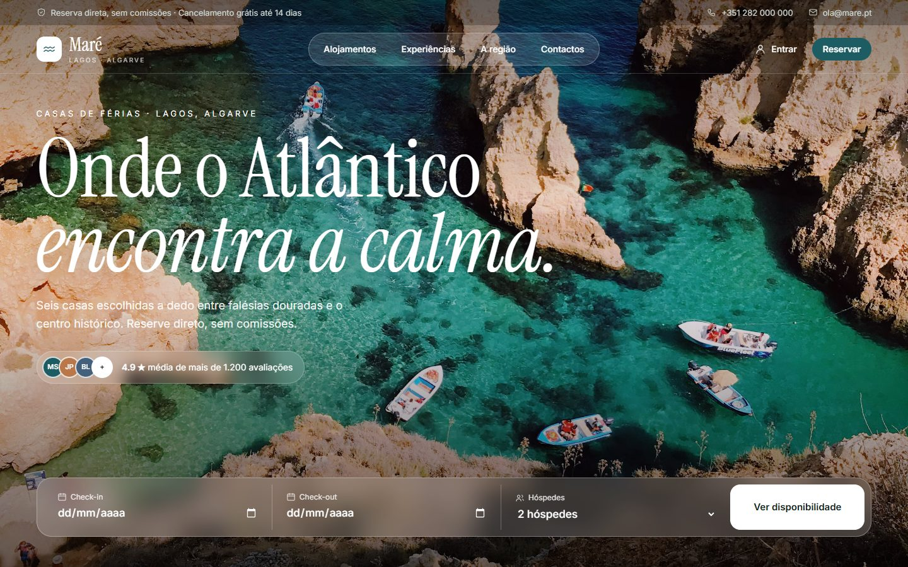

<div align="center">

# Sites

**Sites prontos a usar, com backend completo e sem base de dados**


</div>

<br>

Cada site vive na sua própria pasta e já traz login com JWT, rotas, validação e permissões por perfil. Os dados ficam em memória com exemplos, prontos a trocar por uma base de dados real quando for preciso. Cada pasta tem o seu `README.md` com capturas, funcionalidades e como pôr a correr.

## 🗂️ Sites

<table>
  <tr>
    <td width="50%"><a href="mare/"></a></td>
    <td>
      <h3><a href="mare/">Maré</a></h3>
      <p>Casas de férias em Lagos, com reservas diretas, calendário de disponibilidade, experiências extra, área do hóspede e painel de gestão.</p>
      <p>✅ <strong>Pronto</strong></p>
    </td>
  </tr>
</table>

### ⏳ Lista de espera

| # | Site | Tipo |
|---|---|---|
| 1 | **Lente Studio** | Portefólio de fotografia com galerias privadas para clientes |

## 🧰 Base comum

| | Tecnologia |
|---|---|
| ⚙️ Servidor | Node.js 22+ e Express 5 |
| 🔐 Autenticação | JWT (access token + refresh token) e `bcryptjs` |
| 🛡️ Segurança | `helmet`, `cors` e `express-rate-limit` |
| ✅ Validação | `zod` |
| 🎨 Frontend | HTML, CSS e JavaScript sem build, servido pelo Express |

## 🚀 Como correr um site

```bash
cd <pasta-do-site>
npm install
cp .env.example .env
npm run dev
```

Depois abrir **<http://localhost:3000>**.
