<div align="center">


# Amparo

**Plataforma de doações entre pessoas em Portugal: quem precisa pede ajuda para uma conta concreta (renda, luz, água, comida, saúde, transportes ou escola) e quem pode paga uma parte. A mesma conta serve para as duas coisas.**


[Funcionalidades](#-funcionalidades) · [Privacidade](#-privacidade-e-segurança) · [Antes do lançamento](#-antes-do-lançamento) · [O design](#-o-design) · [Capturas](#-capturas) · [Tecnologias](#-tecnologias) · [Como pôr a correr](#-como-pôr-a-correr) · [API](#-api)

</div>

<br>

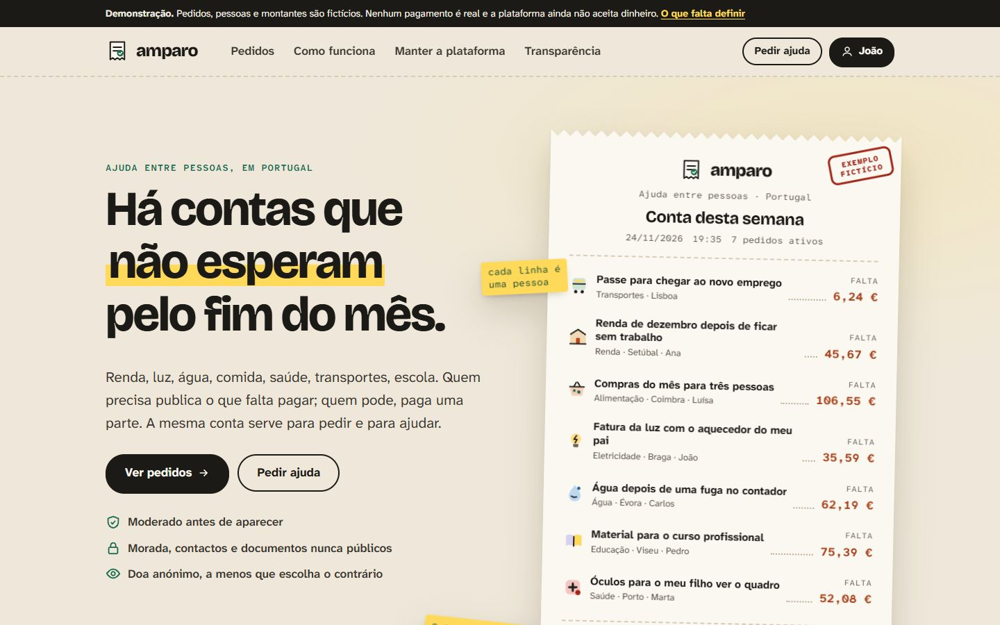

## 🧾 Sobre o projeto

Uma plataforma para pessoas em Portugal pedirem ajuda com despesas do dia a dia e para outras pessoas ajudarem a pagá-las. Não há contas de “beneficiário” e contas de “doador”: **qualquer conta normal pode criar pedidos, doar, contribuir para manter a plataforma e pedir mais informação sobre um pedido.** A gestão é completamente separada: o dono tem credenciais próprias e cria credenciais individuais, com permissões escolhidas, para cada pessoa da equipa.

**É uma demonstração.** Pessoas, pedidos e montantes são fictícios e estão marcados como exemplo. Não há prestador de pagamentos ligado: o passo de pagamento é uma página que diz claramente *“Isto não é um pagamento”*, não pede cartão e regista a doação como **simulada**, nunca como paga. Não se simula nenhuma verificação de identidade nem transferência. Funciona **sem base de dados**: os dados vivem em memória, com repositórios prontos a trocar por uma base de dados real.

## ✨ Funcionalidades

<table>
  <tr>
    <th width="33%">Para quem pede ajuda</th>
    <th width="33%">Para quem doa</th>
    <th width="33%">Para o dono e a equipa</th>
  </tr>
  <tr valign="top">
    <td>
      • Pedido com motivo, montante, prazo opcional e uma de sete categorias<br>
      • Escolhe o que fica visível: nome, distrito, prazo, provas verificadas e lista de quem doou<br>
      • Aviso enquanto escreve se o texto tiver telefone, email, IBAN, NIF, morada ou código postal<br>
      • Provas opcionais (fotografia ou PDF) em armazenamento privado, sem metadados<br>
      • Imagem pública só com autorização explícita, que pode retirar a qualquer momento<br>
      • Nota privada só para a moderação<br>
      • Responde, partilha uma prova só com uma pessoa, ou recusa os pedidos de informação<br>
      • Atualizações no pedido, editar (volta à moderação) e fechar<br>
      • Descarregar os seus dados e pedir a eliminação da conta
    </td>
    <td>
      • Lista de pedidos como um extrato: pedido, recebido e o que falta<br>
      • Filtros por despesa e distrito, pesquisa e ordem (recentes, falta menos, prazo)<br>
      • Resumo antes de confirmar: montante, destino, comissões e condições<br>
      • Opção de acrescentar a comissão para o pedido receber o valor inteiro<br>
      • Anónimo por defeito; o nome só aparece se escolher<br>
      • Comprovativo de cada doação<br>
      • Perguntar dentro da plataforma, sem trocar contactos (são retirados das mensagens)<br>
      • Denunciar um pedido, mesmo sem conta<br>
      • Contribuir à parte para manter a plataforma
    </td>
    <td>
      • Login próprio em <code>/gestao</code>, fora do registo, do menu e do sitemap<br>
      • O dono cria credenciais e escolhe permissões: moderar, ver provas, denúncias, fundos, custos, dados, registos<br>
      • Moderação com verificação obrigatória de três pontos antes de aprovar<br>
      • Abrir uma prova privada fica sempre registado<br>
      • Denúncias com prioridade para dados pessoais expostos<br>
      • Entregas de dinheiro por pedido e despesas da plataforma<br>
      • Pedidos de eliminação de dados<br>
      • Registo de ações só de leitura, com quem fez o quê<br>
      • Lançamento: comissões, custos mensais e a lista do que falta definir
    </td>
  </tr>
</table>

### Manter a plataforma

Há uma forma de contribuir só para os custos (alojamento, domínio, segurança e manutenção), **separada do dinheiro dos pedidos** em repositórios diferentes. O exemplo tem uma meta de **40 € por mês**, mostra o recebido este mês, o saldo e quantos meses de funcionamento cobre: com 40 € por mês, 120 € são cerca de três meses. Os custos são definidos pelo dono na gestão e o cálculo atualiza depois de cada contribuição. A página explica onde é gasto cada euro e lista as despesas pagas.

### Transparência

Totais agregados sem identificar ninguém: recebido para pedidos, entregue, por entregar, comissões pagas, valores por tipo de despesa e por mês, e o fundo da plataforma à parte.

## 🔒 Privacidade e segurança

- **Público e privado separados no código.** Um pedido só chega ao público através de `publicView`, que deixa passar os campos escolhidos por quem pediu e nunca inclui o dono, a nota privada, as notas da moderação nem os ficheiros das provas.
- **Só os dados necessários.** Para criar conta: nome, email e palavra-passe. Não se pede morada, telefone, NIF, cartão de cidadão nem dados bancários. A página de privacidade diz, dado a dado, para quê, quem vê e durante quanto tempo.
- **Provas privadas.** Guardadas fora da pasta pública com nome aleatório; o tipo é verificado pelos primeiros bytes do ficheiro; os metadados (EXIF com GPS, XMP, IPTC, texto do PNG) são retirados de JPEG, PNG e WebP; são servidas com `no-store`, `noindex` e uma CSP `sandbox`, só ao dono, a quem ele partilhou numa conversa, ou à equipa com permissão (e fica registado).
- **Conversas sem contactos.** Telefones, emails, IBAN, números de identificação, moradas e códigos postais são retirados das mensagens; ninguém vê o email do outro.
- **Gestão separada.** Credenciais noutro repositório, JWT com outro segredo e outra audiência, a conta é relida em cada pedido (uma permissão retirada deixa logo de funcionar), sessão de 30 minutos só no separador, bloqueio de 15 minutos depois de 5 tentativas falhadas.
- **Contas.** bcrypt, token de acesso de 15 minutos e refresh token numa cookie `httpOnly` `SameSite=Strict`, rodado em cada uso (um refresh repetido termina todas as sessões), a palavra-passe é sempre comparada com um hash, mesmo quando o email não existe, para não revelar que contas existem.
- **Ataques comuns.** helmet com CSP sem scripts inline, HSTS e redirecionamento para HTTPS em produção, `frame-ancestors 'none'`, validação de todas as entradas, texto sempre escapado, limites de tentativas no login, registo, denúncias, mensagens e envio de ficheiros, campo-armadilha e tempo mínimo no registo contra robôs.
- **Direitos.** Descarregar os dados num ficheiro, corrigir, apagar provas, retirar a autorização de uma imagem e pedir a eliminação (provas, mensagens e pedidos apagados; doações sem nome).
- **Prazos.** Provas apagadas automaticamente 90 dias depois de o pedido fechar e mensagens 365 dias depois de a conversa fechar (proposta, a confirmar).

Nenhuma plataforma é totalmente segura: o próprio site diz que a segurança exige manutenção contínua.

## 📋 Antes do lançamento

O site não inventa garantias legais, fiscais nem financeiras. O que ainda não está decidido aparece como **por definir** na página de transparência, nas condições e no resumo de cada doação:

| Ponto | Estado na demonstração |
| --- | --- |
| Quem gere os fundos e o seu enquadramento legal | Por definir |
| Prestador de pagamentos autorizado em Portugal | Por definir (só existe o prestador `demo`) |
| Como o dinheiro chega à despesa (ex.: pagar a fatura diretamente) | Por definir; não se diz que é entregue à pessoa |
| Comissões reais | Valores de exemplo (1,4 % + 0,25 €), marcados como tal |
| Reembolsos e reclamações | Por definir |
| Enquadramento fiscal | Por definir; não se diz que as doações são dedutíveis |
| Responsável pelo tratamento de dados e prazos | Por definir |
| Termos e privacidade revistos por um jurista | Por definir |
| Verificação de identidade | Não existe; os pedidos são moderados, não verificados |
| Revisão de segurança (testes, cópias cifradas, 2FA da equipa) | Por definir |

O dono marca cada ponto na gestão com a decisão tomada, que passa a aparecer no site. O servidor recusa arrancar com um `PAYMENT_PROVIDER` diferente de `demo` enquanto a lista tiver pontos por definir (e enquanto não houver um prestador real implementado).

## 🧭 O design

- **Uma conta para pagar.** O site é desenhado como um talão: papel com as bordas recortadas em zigue-zague, linhas com pontos até ao valor, totais em letra mono e um código de barras. A página inicial é a *conta desta semana*: cada pedido é uma linha com o que falta, e o total por pagar no fim.
- **Notas na margem.** Post-its amarelos e carimbos (“Revisto pela moderação”, “Exemplo fictício”, “Simulação”) explicam a página sem caixas de texto a mais.
- **Livro de contas.** “Deve e haver” explica as duas maneiras de usar a mesma conta; a lista de pedidos é um extrato; as categorias são teclas de caixa registadora.
- **Sem fotografias de pessoas.** De propósito: num site sobre necessidade, a dignidade e a privacidade de quem pede vêm primeiro. As sete despesas têm ícones desenhados a duas cores.
- **Letra para todos.** Atkinson Hyperlegible Next e Mono (desenhadas para leitores com baixa visão) no texto e nos números, Bricolage Grotesque nos títulos.
- **Telemóvel.** Menu em ecrã inteiro e, na página de um pedido, uma barra fixa com o que falta e o botão para doar.

## 📸 Capturas

<table>
  <tr>
    <td width="50%">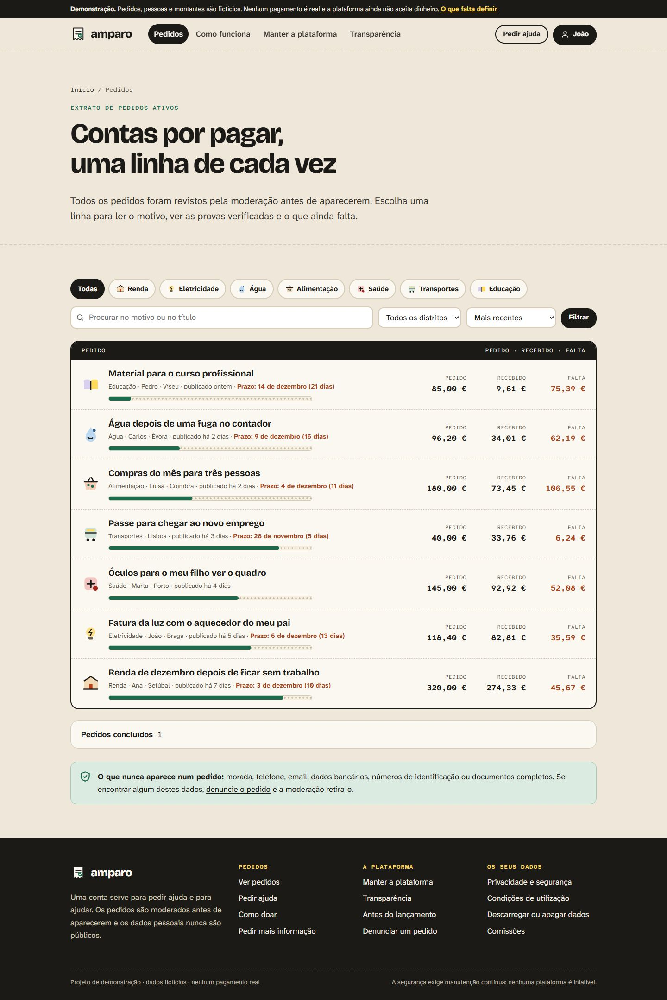<br><sub><b>Pedidos</b> · o extrato com filtros, pedido, recebido e falta</sub></td>
    <td width="50%">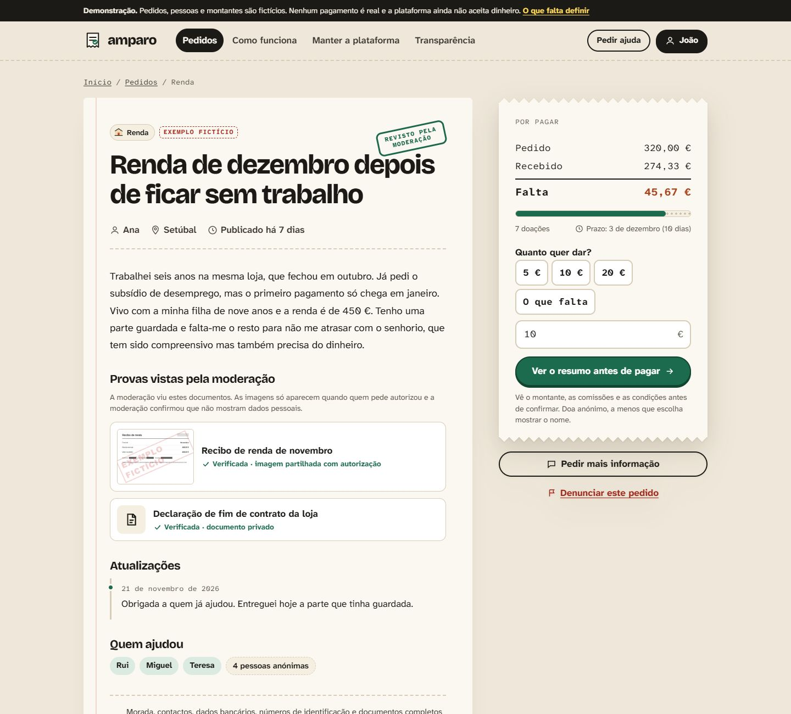<br><sub><b>Um pedido</b> · a folha com o motivo e as provas verificadas, e a caixa para doar</sub></td>
  </tr>
  <tr>
    <td>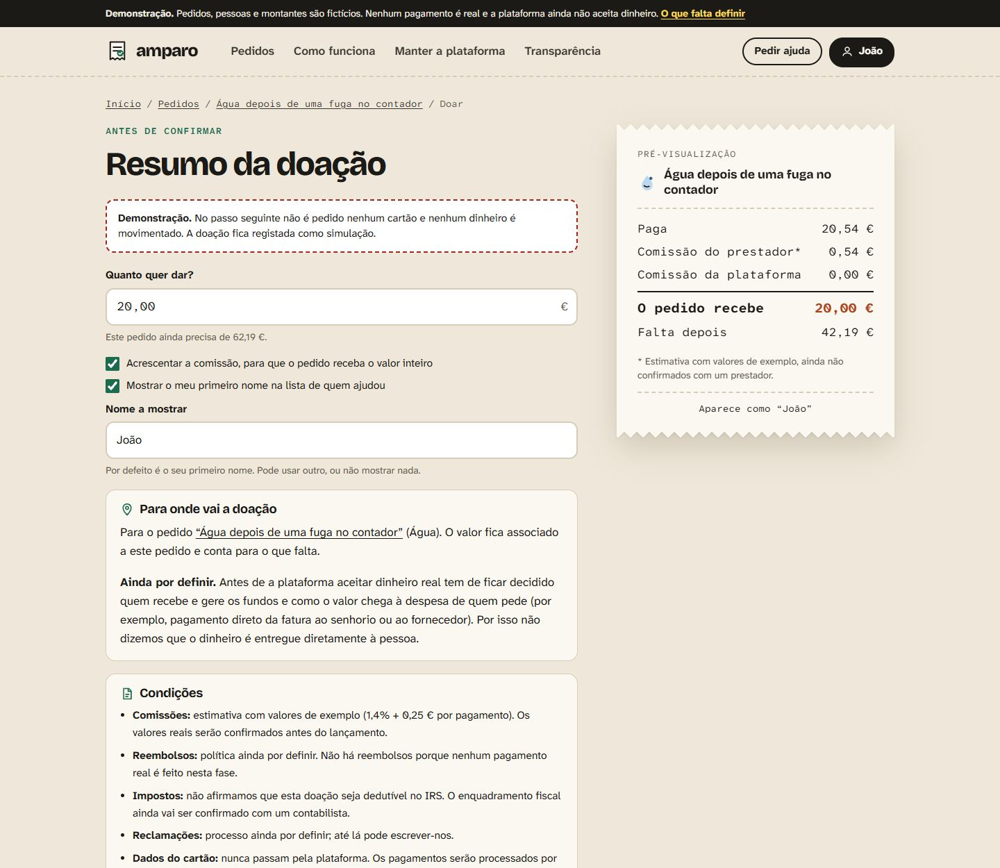<br><sub><b>Doar</b> · montante, destino, comissões e condições antes de confirmar</sub></td>
    <td>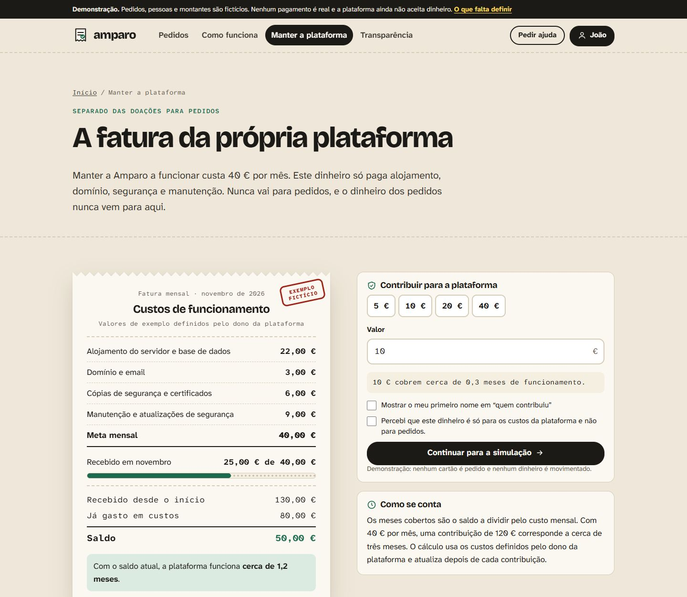<br><sub><b>Manter a plataforma</b> · a fatura de 40 €/mês e os meses cobertos</sub></td>
  </tr>
  <tr>
    <td>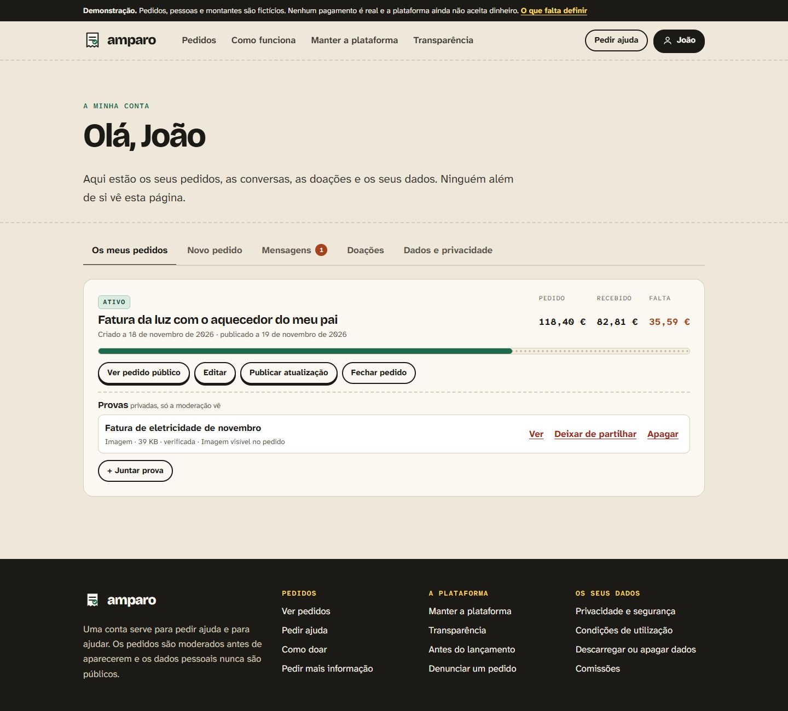<br><sub><b>A minha conta</b> · pedidos, provas privadas e autorização de imagem</sub></td>
    <td>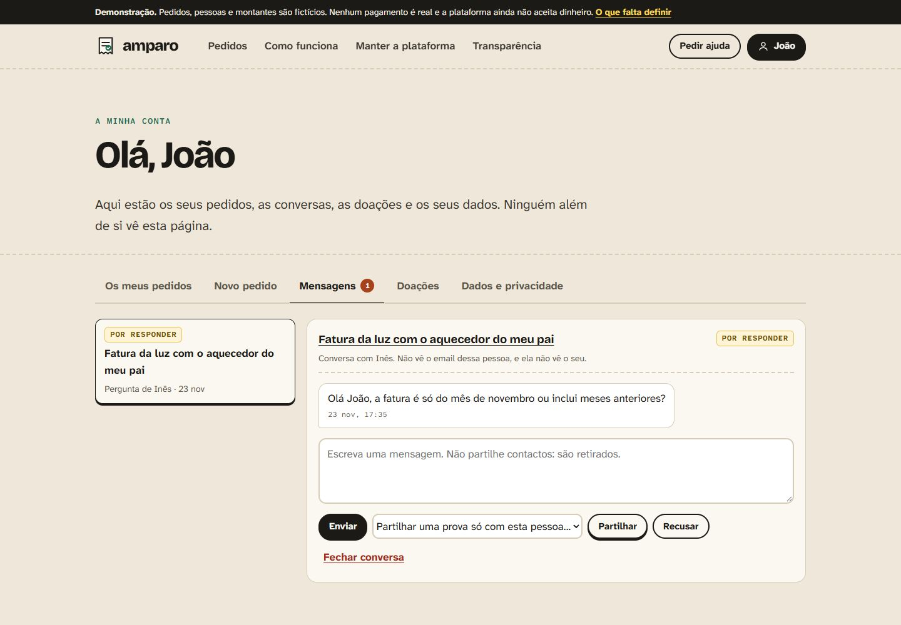<br><sub><b>Pedidos de informação</b> · responder, partilhar uma prova ou recusar</sub></td>
  </tr>
  <tr>
    <td>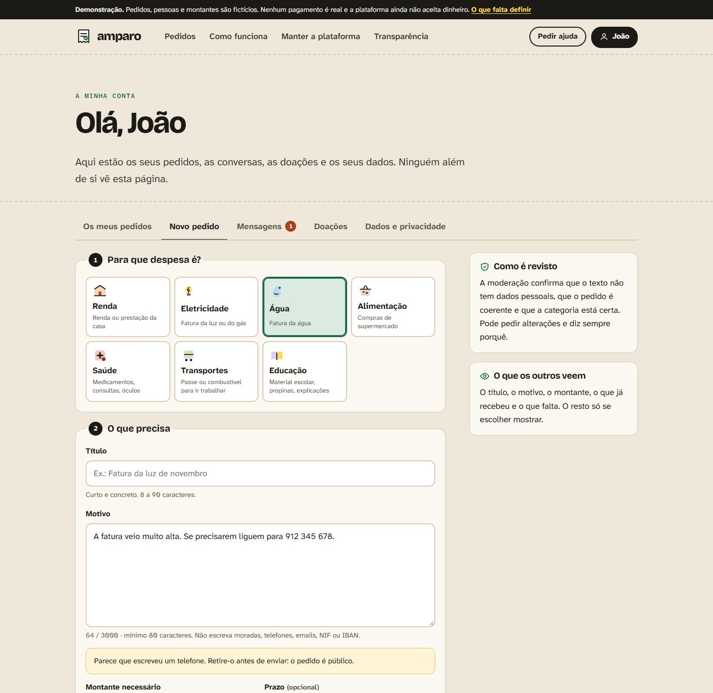<br><sub><b>Novo pedido</b> · aviso quando o texto tem um telefone</sub></td>
    <td>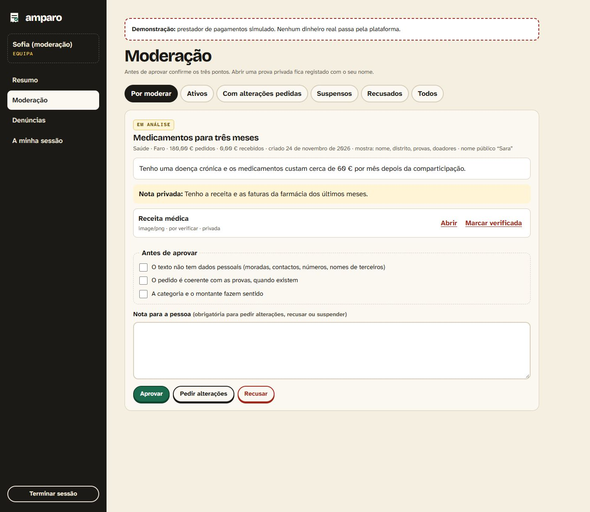<br><sub><b>Moderação</b> · a moderadora só vê as funções que lhe foram dadas</sub></td>
  </tr>
  <tr>
    <td>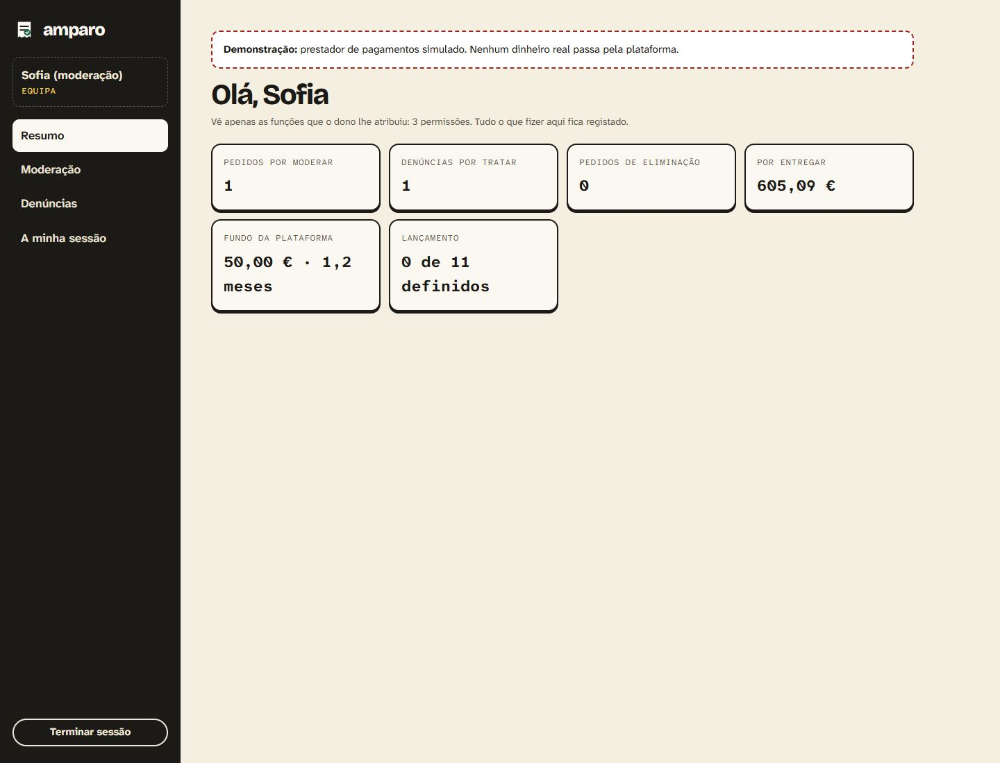<br><sub><b>Equipa</b> · credenciais individuais e permissões</sub></td>
    <td><br><sub><b>Lançamento</b> · comissões, custos e o que falta decidir</sub></td>
  </tr>
  <tr>
    <td colspan="2">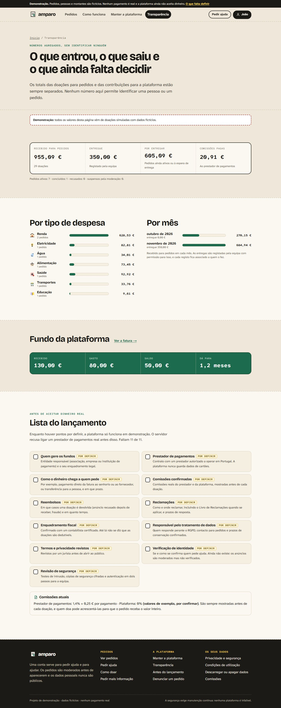<br><sub><b>Transparência</b> · totais agregados e lista do lançamento</sub></td>
  </tr>
</table>

<p align="center">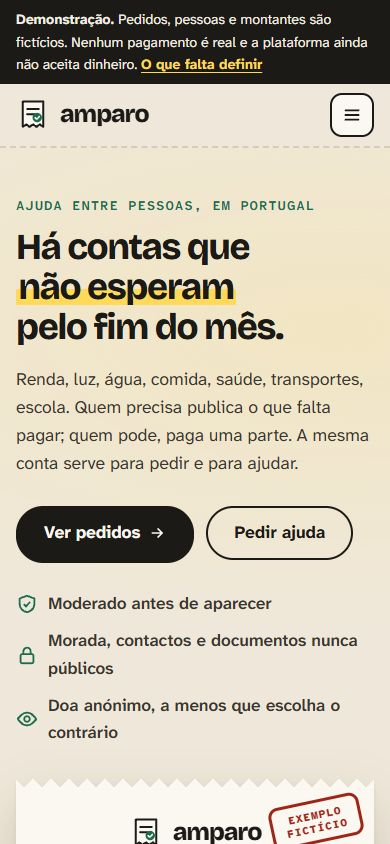 </p>

## 🛠️ Tecnologias

| | |
| --- | --- |
| **Servidor** | Node.js 22+ e Express 5, páginas públicas geradas no servidor |
| **Sessão** | JWT com audiências separadas para contas (`conta`) e equipa (`gestao`), refresh token rodado numa cookie `httpOnly` |
| **Validação** | express-validator em todas as entradas, com o erro junto a cada campo |
| **Ficheiros** | multer em memória, tipo pelos primeiros bytes, metadados retirados à mão (sem bibliotecas de imagem) |
| **Segurança** | helmet (CSP, HSTS), express-rate-limit, bcryptjs |
| **Pagamentos** | Interface de prestador (`createCheckout`) com um prestador `demo` que só simula |
| **Browser** | JavaScript em módulos ES, um por página, sem frameworks |
| **Dados** | Repositórios em memória com a interface de uma base de dados (`findAll`, `findById`, `create`, `update`, `remove`) |

## 🚀 SEO e desempenho

| Página (telemóvel) | Desempenho | Acessibilidade | Boas práticas | SEO |
| --- | :-: | :-: | :-: | :-: |
| Início | 99 | 100 | 100 | 100 |
| Pedidos | 99 | 100 | 100 | 100 |
| Um pedido | 99 | 100 | 100 | 100 |
| Manter a plataforma | 99 | 100 | 100 | 100 |
| Transparência | 99 | 100 | 100 | 100 |
| Como funciona | 99 | 100 | 100 | 100 |
| Privacidade | 99 | 100 | 100 | 100 |

- Título, descrição, canonical, Open Graph com imagem própria e Twitter Card; `robots.txt` e `sitemap.xml` com os pedidos ativos
- JSON-LD: `WebSite`, `Organization`, `FAQPage`, `BreadcrumbList` e `WebPage` para cada pedido (sem nome nem localização)
- Conta, doação, comprovativos e gestão com `noindex` e `no-store`; listas filtradas com `noindex`
- Fontes locais com `font-display: swap` e letras de reserva com medidas aproximadas; um só CSS, comprimido em produção

## ▶️ Como pôr a correr

```bash
npm install
cp .env.example .env
npm run dev
```

Abre em `http://localhost:3009`. Contas fictícias para experimentar:

| Perfil | Email | Palavra-passe |
| --- | --- | --- |
| Pede ajuda (renda) e tem uma conversa | `ana@exemplo.pt` | `amparo2026` |
| Já doou e perguntou | `rui@exemplo.pt` | `amparo2026` |
| Tem um pedido de informação por responder | `joao@exemplo.pt` | `amparo2026` |
| Gestão · dono | `dono@exemplo.pt` em `/gestao` | `amparo-dono-2026` |
| Gestão · moderação | `moderacao@amparo.exemplo` | `amparo-equipa-2026` |
| Gestão · contas | `contas@amparo.exemplo` | `amparo-equipa-2026` |

Em produção o dono vem de `OWNER_EMAIL` e `OWNER_PASSWORD` no `.env`, o `SITE_URL` tem de ser `https://` e todos os segredos são obrigatórios.

## 🔌 API

| Método | Rota | Quem | O que faz |
| --- | --- | --- | --- |
| `GET` | `/api/anuncios` · `/anuncios/:slug` | todos | Pedidos públicos (só os campos escolhidos) |
| `GET` | `/api/anuncios/:slug/provas/:id` | todos | Imagem autorizada e aprovada |
| `POST` | `/api/anuncios/:id/denuncias` | todos | Denunciar |
| `POST` | `/api/anuncios/:id/pedidos-info` | conta | Pedir mais informação |
| `POST` | `/api/doacoes/orcamento` · `/api/doacoes` | todos · conta | Resumo com comissões e início da doação |
| `GET` `POST` | `/api/pagamentos/:tipo/:id` · `/simular` | conta | Comprovativo e simulação (só em modo demo) |
| `GET` `POST` | `/api/plataforma` · `/plataforma/contribuicoes` | todos · conta | Fundo da plataforma |
| `GET` | `/api/transparencia` | todos | Totais agregados |
| `POST` | `/api/auth/register` · `login` · `refresh` · `logout` | todos | Sessão |
| `GET` `PATCH` | `/api/auth/me` · `/me/password` | conta | Dados da conta |
| `GET` `POST` `PUT` | `/api/conta/resumo` · `/anuncios` · `/anuncios/:id` | conta | Os meus pedidos |
| `POST` `PATCH` `DELETE` | `/api/conta/anuncios/:id/provas` · `/provas/:id` | conta | Provas privadas |
| `GET` `POST` | `/api/conta/conversas/:id` · `/mensagens` · `/partilhar` · `/recusar` · `/fechar` | conta | Conversas |
| `GET` `POST` | `/api/conta/dados` · `/dados/eliminacao` | conta | Exportar e pedir eliminação |
| `POST` | `/api/gestao/entrar` | equipa | Sessão da gestão |
| `GET` `POST` | `/api/gestao/anuncios` · `/:id/decisao` | moderar | Moderação |
| `GET` `PATCH` | `/api/gestao/documentos/:id` | documentos · moderar | Ver (registado) e rever provas |
| `GET` `POST` | `/api/gestao/denuncias` · `/:id/resolver` | denuncias | Denúncias |
| `GET` `POST` | `/api/gestao/doacoes` · `/entregas` | fundos | Doações e entregas |
| `GET` `POST` | `/api/gestao/plataforma` · `/despesas` | plataforma | Custos |
| `GET` `POST` | `/api/gestao/pedidos-dados` · `/:id/concluir` | utilizadores | Eliminação de dados |
| `GET` | `/api/gestao/registos` | registos | Registo de ações |
| `GET` `POST` `PATCH` | `/api/gestao/equipa` · `/lancamento` | dono | Credenciais, permissões, comissões, custos e lista do lançamento |
