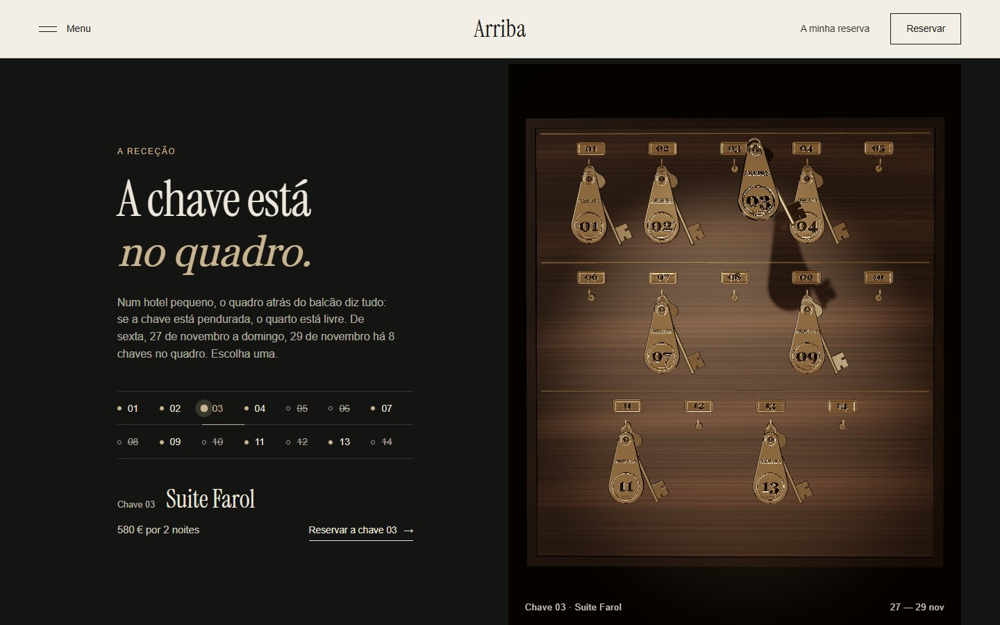
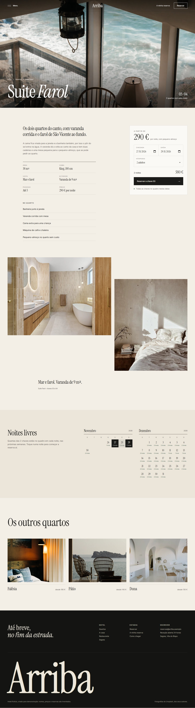
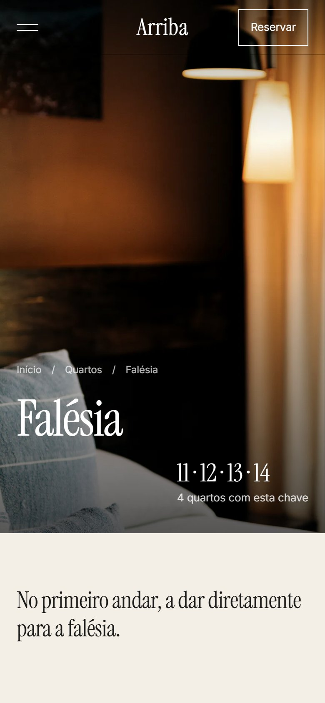
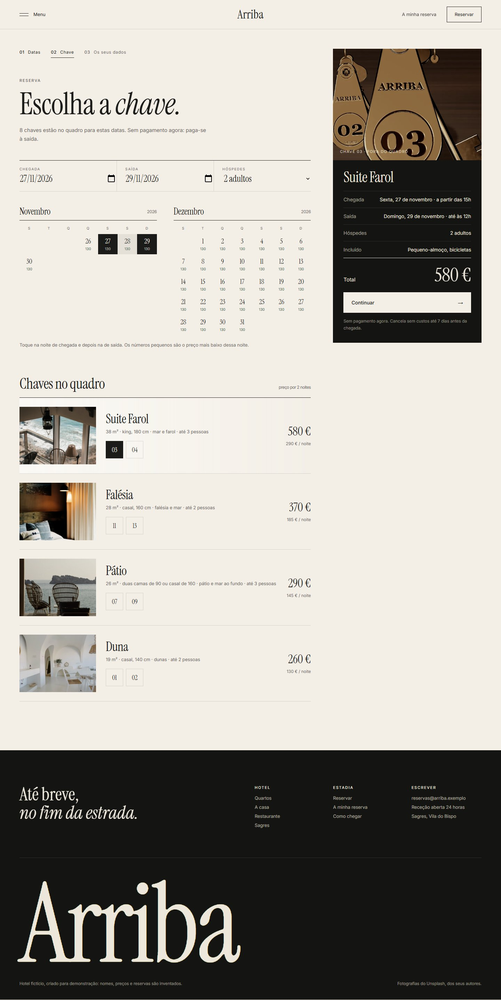
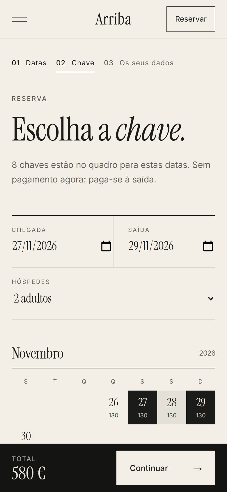
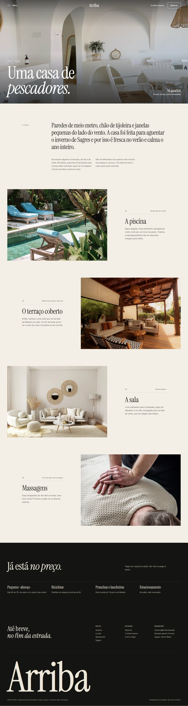
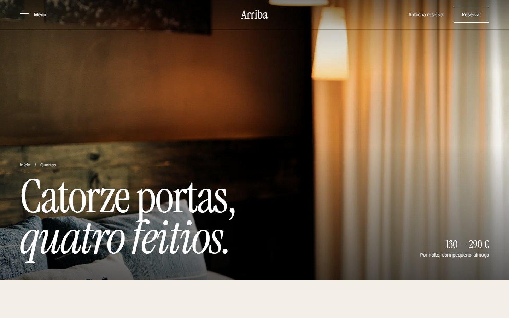
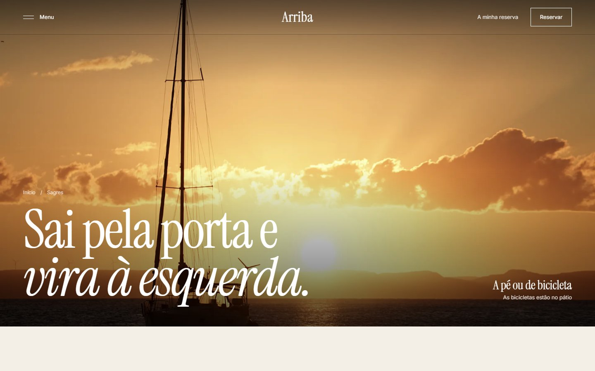
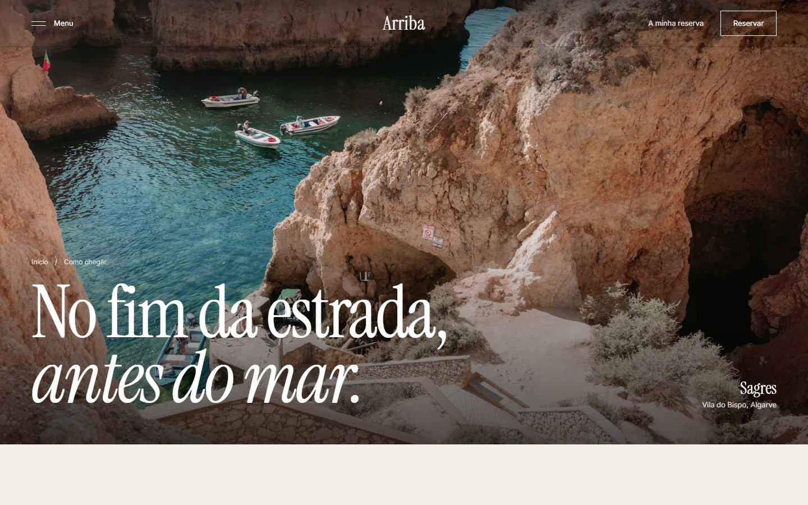
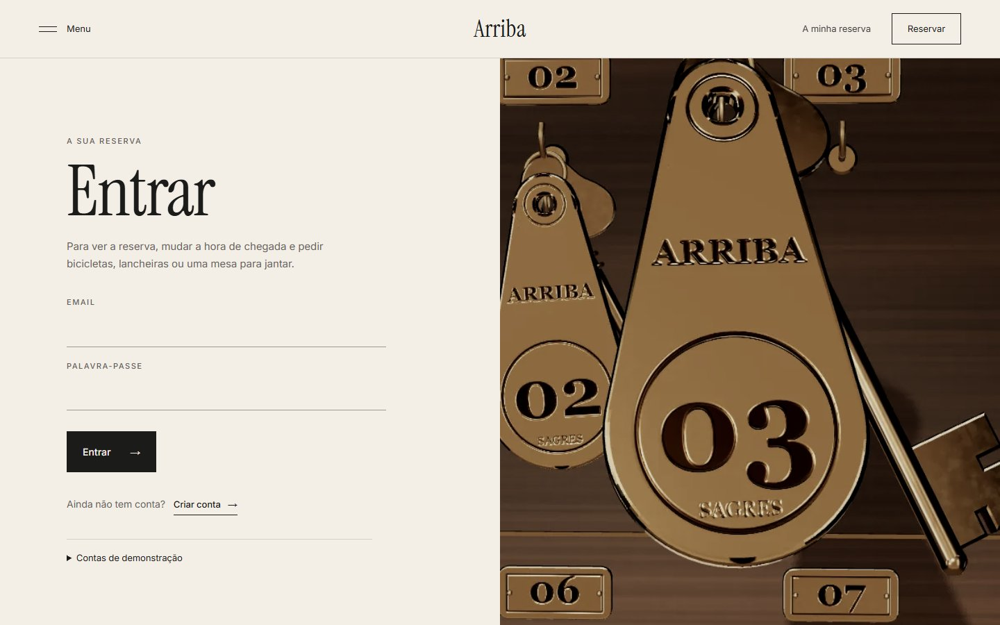

<div align="center">


# Arriba

**Hotel de 14 quartos em Sagres (fictício). Um site com ar de revista de viagens: fotografia grande e tratada, tipografia contida e, na receção, um quadro de chaves em 3D onde as chaves penduradas são os quartos livres.**


[Funcionalidades](#-funcionalidades) · [O design](#-o-design) · [Capturas](#-capturas) · [Tecnologias](#-tecnologias) · [Lighthouse](#-seo-e-desempenho) · [Como pôr a correr](#-como-pôr-a-correr) · [API](#-api)

</div>

<br>


## 🔑 Sobre o projeto

O Arriba é um hotel inventado: uma casa de pescadores à beira da falésia, em Sagres, com 14 quartos de quatro tipos (Suite Farol, Falésia, Pátio e Duna), um restaurante e uma piscina de água salgada. As pessoas, as reservas, os preços e os contactos são fictícios. As fotografias são do [Unsplash](https://unsplash.com/license) e pertencem aos seus autores.

## ✨ Funcionalidades

**Quem visita**
- Página inicial com a barra das datas sobre a fotografia: ao mudar as datas, o número de chaves livres atualiza logo.
- Na secção da receção, o quadro de chaves em 3D mostra os quartos livres nessas datas. Tirar uma chave (no quadro ou na fila de números, também com teclado) mostra o quarto e o preço total.
- Página de cada quarto com texto, características, galeria e um calendário de dois meses com as chaves livres em cada noite. O cartão de reserva ao lado acompanha as datas e o preço.
- Páginas próprias para a casa (piscina, terraço, sala, massagens e o que está incluído), Sagres à volta, como chegar e o restaurante com a ementa do dia.
- Reserva em três passos:
  1. Datas: um calendário com o preço mais baixo de cada noite, onde se toca na chegada e depois na saída.
  2. Chave: as chaves livres, agrupadas por tipo de quarto.
  3. Os seus dados: entrar ou criar conta e voltar ao mesmo passo.

  No telemóvel, o total e o botão de continuar ficam numa barra fixa em baixo.

**Hóspede (com conta)**
- Vê as estadias como porta-chaves, com código, total e estado.
- Muda a hora de chegada e deixa uma nota para a receção.
- Faz pedidos para um dia da estadia: bicicletas, lancheira, massagem, saída de barco ou mesa para jantar.
- Cancela sem custos até 7 dias antes da chegada.

**Receção**
- Vê o quadro desta noite, as chegadas, as saídas, quem está em casa e os pedidos por tratar.
- Dá entrada e fecha a conta. Os estados só andam para a frente: confirmada → em casa → terminada, ou confirmada → cancelada.
- Vê todas as reservas com filtro por estado e marca os pedidos como feitos.
- Escreve a ementa do dia, que aparece logo no site, e muda o preço por noite de cada tipo de quarto.

## 🎨 O design

**Conceito: um hotel pequeno à beira do Atlântico, contado como uma revista de viagens.**
- **Fotografia primeiro.** Poucas fotografias, grandes, todas com o mesmo tratamento de cor (menos saturação, um pouco de sépia), como se fossem do mesmo fotógrafo. O tratamento é feito ao descarregar (`npm run fotos`), não no browser.
- **Tipografia contida.** Instrument Serif nos títulos, em tamanhos grandes com itálico para uma palavra, e Inter pequena no texto. Muito espaço em branco e uma grelha de 12 colunas com as imagens em tamanhos e alturas diferentes.
- **Cores:** papel (`#f3efe7`), tinta (`#1b1b19`) e noite (`#141513`), com areia (`#c9b48f`) só nas secções escuras.
- **O quadro de chaves.** A ideia da receção mantém-se: se a chave está pendurada, o quarto está livre.
  - O quadro é 3D a sério (three.js): chaves de palhetão de latão com porta-chaves gravados, presas a ganchos numa tábua de nogueira, com sombras de um candeeiro.
  - As chaves balançam ao passar o rato, e a escolhida sai do quadro e vem para a frente.
  - O latão segue o mesmo tratamento de cor das fotografias.
- **Movimento.**
  - O cabeçalho fica transparente sobre a fotografia, ganha fundo depois dela, esconde-se ao descer e volta ao subir.
  - O menu abre em ecrã inteiro.
  - Ao rolar, os textos sobem e as fotografias assentam.
  - Tudo isto respeita `prefers-reduced-motion`.
- **3D leve.**
  - Só carrega quando a secção se aproxima (no computador) ou com um toque (no telemóvel).
  - Usa resolução e sombras limitadas e só desenha quando alguma chave se mexe.
  - Até lá vê-se uma imagem da chave 03 feita a partir do próprio 3D (`npm run quadro`).

## 📸 Capturas



| Computador | Telemóvel |
| --- | --- |
|  |  |
|  |  |
|  |  |
|  |  |
|  |  |
|  |  |

## 🛠️ Tecnologias

| | |
| --- | --- |
| **Servidor** | Node.js 22+ e Express 5 em ES Modules, páginas públicas geradas no servidor |
| **Sessão** | JWT de 15 minutos e refresh token numa cookie `httpOnly` `SameSite=Strict`, rodado a cada uso (um refresh repetido termina todas as sessões da conta) |
| **Perfis** | `hospede` e `rececao`, com o perfil relido em cada pedido; o hóspede só vê as suas reservas |
| **Validação** | express-validator em todas as entradas (datas, quartos, horas, pedidos, ementa, preços), com o erro junto a cada campo |
| **Segurança** | helmet (CSP sem scripts inline, HSTS em produção), express-rate-limit, bcryptjs, campo-armadilha e tempo mínimo no registo |
| **3D** | three.js, só com as peças usadas (`npm run vendor` gera `public/vendor/three.min.js`, 147 kB com gzip), carregado só quando é preciso |
| **Browser** | JavaScript em módulos ES, um por página, sem frameworks |
| **Dados** | Repositórios em memória (`findAll`, `findById`, `create`, `update`, `remove`), com as reservas de exemplo calculadas a partir de hoje: o próximo fim de semana tem sempre 8 chaves no quadro |
| **Imagens** | webp em 480, 800 e 1200 px (e 1920 nas de ecrã inteiro) com `srcset`, medidas reservadas e preload da principal |
| **Fontes** | Instrument Serif e Inter locais, com `font-display: optional` e fontes de recurso com medidas parecidas |
| **Testes** | `node:test` com os fluxos principais (`npm test`) |

## 🚀 SEO e desempenho

- Cada página tem título, descrição, canonical, Open Graph e Twitter Card.
- JSON-LD:
  - `Hotel` na página inicial, com quartos, horas de entrada e saída, preços e comodidades.
  - `HotelRoom` com oferta em cada quarto.
  - `Restaurant` com a ementa do dia.
  - `AboutPage`, `ItemList` e `BreadcrumbList`.
- `robots.txt` e `sitemap.xml` deixam de fora as páginas privadas (reservar, entrar, área do hóspede e receção). Essas páginas também levam `noindex`.

Resultados do Lighthouse 12, em desempenho · acessibilidade · boas práticas · SEO. No telemóvel, a rede é 4G lenta simulada. Medido com o servidor em modo de produção.

| Página | Telemóvel | Computador |
| --- | :-: | :-: |
| Início | 95 · 100 · 100 · 100 | 99 · 100 · 100 · 100 |
| Quartos | 98 · 100 · 100 · 100 | 100 · 100 · 100 · 100 |
| Um quarto | 98 · 100 · 100 · 100 | 100 · 100 · 100 · 100 |
| A casa | 98 · 100 · 100 · 100 | 100 · 100 · 100 · 100 |
| Sagres | 98 · 100 · 100 · 100 | 100 · 100 · 100 · 100 |
| Como chegar | 98 · 100 · 100 · 100 | 99 · 100 · 100 · 100 |
| Restaurante | 96 · 100 · 100 · 100 | 100 · 100 · 100 · 100 |

## ▶️ Como pôr a correr

```bash
cd arriba
npm install
npm run dev        # http://localhost:3012
npm test           # testes dos fluxos principais
```

Para produção, copiar `.env.example` para `.env` e definir `SITE_URL` (com https) e os dois segredos JWT.

Contas de teste:

| Perfil | Email | Palavra-passe |
| --- | --- | --- |
| Hóspede (uma reserva futura, que ainda se pode cancelar, e uma estadia passada) | `hospede@arriba.exemplo` | `arriba-hospede-2026` |
| Receção | `rececao@arriba.exemplo` | `arriba-rececao-2026` |

## 🔌 API

| Método | Rota | Quem | O que faz |
| --- | --- | --- | --- |
| `POST` | `/api/auth/registar` | Público | Criar conta de hóspede e entrar |
| `POST` | `/api/auth/login` | Todos | Entrar; devolve o token e põe o refresh token na cookie |
| `POST` | `/api/auth/refresh` | Com cookie | Renova a sessão e roda o refresh token |
| `POST` | `/api/auth/logout` | Com cookie | Termina a sessão |
| `GET` | `/api/auth/me` | Com sessão | Dados da conta |
| `PATCH` | `/api/auth/me/password` | Com sessão | Mudar a palavra-passe (termina as outras sessões) |
| `GET` | `/api/disponibilidade?chegada=&saida=&hospedes=` | Público | Chaves livres, preço por noite e total de cada quarto |
| `GET` | `/api/calendario?desde=&dias=&hospedes=&tipo=` | Público | Noite a noite: quantas chaves estão livres e o preço mais baixo |
| `GET` | `/api/ementa` | Público | Ementa do dia |
| `GET` | `/api/hospede/reservas` | Hóspede | As suas reservas, com pedidos e prazo de cancelamento |
| `POST` | `/api/hospede/reservas` | Hóspede | Reservar uma chave (409 se já saiu do quadro) |
| `PATCH` | `/api/hospede/reservas/:id` | Hóspede | Mudar a hora de chegada e a nota |
| `POST` | `/api/hospede/reservas/:id/cancelar` | Hóspede | Cancelar (só até 7 dias antes) |
| `POST` | `/api/hospede/reservas/:id/pedidos` | Hóspede | Fazer um pedido para um dia da estadia |
| `GET` | `/api/rececao/hoje` | Receção | Quadro desta noite, chegadas, saídas, em casa e pedidos por tratar |
| `GET` | `/api/rececao/reservas?estado=` | Receção | Todas as reservas, filtráveis por estado |
| `PATCH` | `/api/rececao/reservas/:id/estado` | Receção | Dar entrada, fechar conta ou cancelar |
| `GET` | `/api/rececao/pedidos` | Receção | Todos os pedidos |
| `PATCH` | `/api/rececao/pedidos/:id` | Receção | Marcar como feito ou reabrir |
| `GET` `PUT` | `/api/rececao/ementa` | Receção | Ler e publicar a ementa de hoje |
| `GET` | `/api/rececao/precos` | Receção | Preço por noite de cada tipo |
| `PATCH` | `/api/rececao/precos/:slug` | Receção | Mudar o preço por noite |

<br>

<sub>Hotel fictício, criado para demonstração. Fotografias do Unsplash, dos seus autores. Fontes Instrument Serif e Inter com licença SIL Open Font License.</sub>
