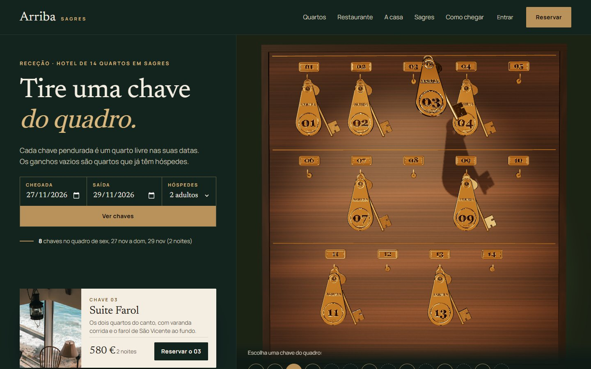
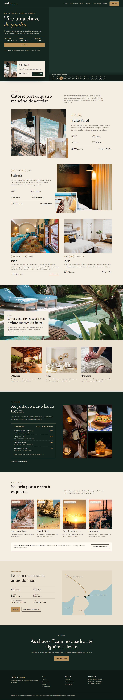
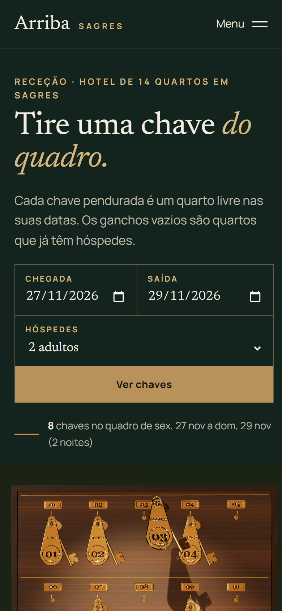
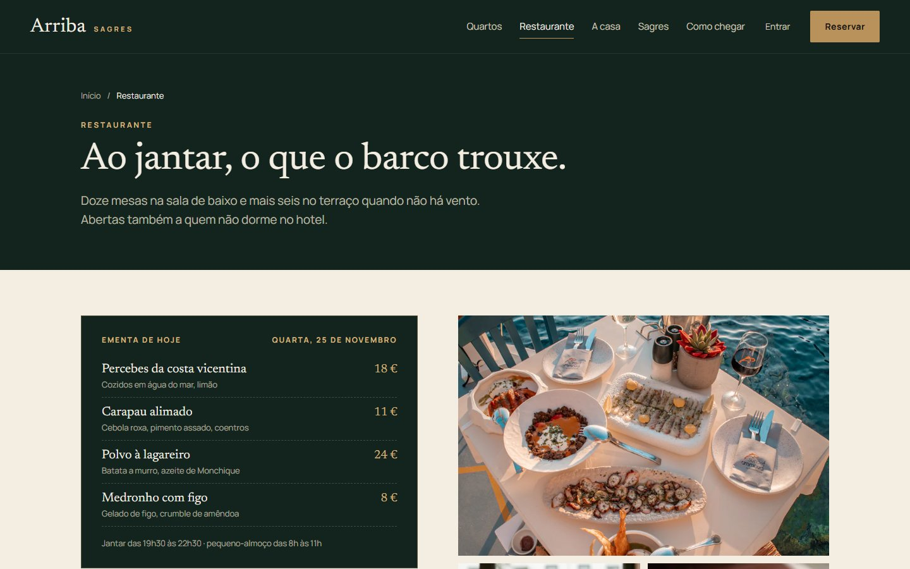

<div align="center">


# Arriba

**Hotel de 14 quartos em Sagres (fictício). A página inicial é o quadro de chaves da receção em 3D: as chaves de latão penduradas são os quartos livres nas datas escolhidas, e tirar uma do quadro é escolher o quarto.**


[Funcionalidades](#-funcionalidades) · [O design](#-o-design) · [Capturas](#-capturas) · [Tecnologias](#-tecnologias) · [Lighthouse](#-seo-e-desempenho) · [Como pôr a correr](#-como-pôr-a-correr) · [API](#-api)

</div>

<br>



## 🔑 Sobre o projeto

O Arriba é um hotel inventado: uma casa de pescadores à beira da falésia, em Sagres, com 14 quartos de quatro tipos (Suite Farol, Falésia, Pátio e Duna), um restaurante e uma piscina de água salgada. As pessoas, as reservas, os preços e os contactos são fictícios. As fotografias são do [Unsplash](https://unsplash.com/license) e pertencem aos seus autores.

## ✨ Funcionalidades

**Quem visita**
- Escolhe as datas e o número de pessoas e vê logo quais as chaves que estão no quadro. Os ganchos vazios são quartos ocupados, e os que não cabem o número de pessoas também ficam vazios.
- Ao tirar uma chave do quadro (com o rato, com o dedo ou com o teclado na fila de números por baixo), aparece a ficha do quarto com o preço total e o botão para reservar.
- As datas mudam sem recarregar a página: as chaves ocupadas saem do quadro e as livres voltam aos ganchos. O endereço fica com as datas para se poder partilhar.
- Vê os quatro tipos de quarto, cada um com galeria, características e um calendário das próximas cinco semanas com quantos quartos estão livres em cada noite.
- Vê o restaurante com a ementa do dia, que é a receção que escreve.
- Para reservar, escolhe a chave e a hora de chegada. Se não tem conta, entra ou cria uma e volta à mesma reserva.

**Hóspede (com conta)**
- Vê as reservas como porta-chaves, com o código, o total e o estado.
- Muda a hora de chegada e deixa uma nota para a receção.
- Faz pedidos para um dia da estadia: bicicletas, lancheira, massagem, saída de barco ou mesa para jantar.
- Cancela sem custos até 7 dias antes da chegada. Depois disso o botão dá lugar a uma explicação.

**Receção**
- Vê o dia de hoje: um quadro pequeno com as 14 chaves (no quadro, reservada ou com o hóspede em casa), as chegadas, as saídas e os pedidos por tratar.
- Dá entrada e fecha a conta. Os estados só andam para a frente: confirmada → em casa → terminada, ou confirmada → cancelada.
- Vê todas as reservas com filtro por estado.
- Marca os pedidos como feitos.
- Escreve a ementa do dia, que aparece logo no site, e muda o preço por noite de cada tipo de quarto (só conta para reservas novas).

## 🎨 O design

**Conceito: a receção à noite.** Num hotel pequeno, a primeira coisa que se vê ao chegar é o quadro das chaves atrás do balcão. Se a chave está pendurada, o quarto está livre. O site usa esse gesto antigo como motor de reserva.

- **O quadro é 3D a sério** (three.js). Cada chave é feita de geometria: a chave de palhetão com argola trilobada, a argola, o elo e o porta-chaves em forma de pera com o número gravado, presa a um gancho de latão. O latão reflete um estúdio de luzes desenhado para isso, a madeira de nogueira é gerada em código, e um candeeiro de cima faz as sombras das chaves na tábua. As chaves balançam ao passar o rato, e a chave escolhida sai do quadro e vem para a frente.
- **Cores da receção:** verde-garrafa (`#13241f`), papel (`#f3ede2`) e latão (`#b8925a`). Os títulos são em Newsreader e o texto em Manrope.
- **As chaves aparecem por todo o site:** etiquetas com os números em cada tipo de quarto (riscadas quando estão ocupadas), as reservas do hóspede como porta-chaves, e o painel da receção com um quadro pequeno.
- **Leve e acessível:**
  - O 3D só carrega quando é preciso: no computador ao primeiro movimento do rato; no telemóvel só com um toque em “Ligar o quadro 3D”.
  - Até lá vê-se uma imagem do quadro feita a partir do próprio 3D (`npm run quadro`).
  - A fila de números por baixo do quadro faz o mesmo que as chaves, com teclado e leitor de ecrã.

## 📸 Capturas

| Computador | Telemóvel |
| --- | --- |
|  |  |
|  |  |
|  |  |
|  |  |
|  | |

## 🛠️ Tecnologias

| | |
| --- | --- |
| **Servidor** | Node.js 22+ e Express 5 em ES Modules, páginas públicas geradas no servidor |
| **Sessão** | JWT de 15 minutos e refresh token numa cookie `httpOnly` `SameSite=Strict`, rodado a cada uso (um refresh repetido termina todas as sessões da conta) |
| **Perfis** | `hospede` e `rececao`, com o perfil relido em cada pedido; o hóspede só vê as suas reservas |
| **Validação** | express-validator em todas as entradas (datas, quartos, horas, pedidos, ementa, preços), com o erro junto a cada campo |
| **Segurança** | helmet (CSP sem scripts inline, HSTS em produção), express-rate-limit, bcryptjs, campo-armadilha e tempo mínimo no registo |
| **3D** | three.js, só com as peças usadas (`npm run vendor` gera `public/vendor/three.min.js`, 147 kB com gzip), carregado só na página inicial |
| **Browser** | JavaScript em módulos ES, um por página, sem frameworks |
| **Dados** | Repositórios em memória (`findAll`, `findById`, `create`, `update`, `remove`), com as reservas de exemplo calculadas a partir de hoje: o próximo fim de semana tem sempre 8 chaves no quadro |
| **Imagens** | webp em 480, 800 e 1200 px com `srcset`, medidas reservadas e preload da principal (`npm run fotos` descarrega-as do Unsplash) |
| **Fontes** | Newsreader e Manrope locais, com `font-display: optional` e fontes de recurso com as mesmas medidas |
| **Testes** | `node:test` com os fluxos principais (`npm test`) |

## 🚀 SEO e desempenho

- Cada página tem título, descrição, canonical, Open Graph e Twitter Card.
- JSON-LD:
  - `Hotel` na página inicial, com quartos, horas de entrada e saída, preços e comodidades.
  - `HotelRoom` com oferta em cada quarto.
  - `Restaurant` com a ementa do dia.
  - `ItemList` e `BreadcrumbList`.
- `robots.txt` e `sitemap.xml` deixam de fora as páginas privadas (reservar, entrar, área do hóspede e receção). Essas páginas também levam `noindex`.

Resultados do Lighthouse 12, em desempenho · acessibilidade · boas práticas · SEO. No telemóvel, a rede é 4G lenta simulada. Medido com o servidor em modo de produção.

| Página | Telemóvel | Computador |
| --- | :-: | :-: |
| Início (quadro de chaves) | 98 · 100 · 100 · 100 | 100 · 100 · 100 · 100 |
| Quartos | 98 · 100 · 100 · 100 | 100 · 100 · 100 · 100 |
| Um quarto | 97 · 100 · 100 · 100 | 100 · 100 · 100 · 100 |
| Restaurante | 96 · 100 · 100 · 100 | 100 · 100 · 100 · 100 |

## ▶️ Como pôr a correr

```bash
cd arriba
npm install
npm run dev        # http://localhost:3012
npm test           # testes dos fluxos principais
```

Para produção, copiar `.env.example` para `.env` e definir `SITE_URL` (com https) e os dois segredos JWT.

Contas de teste:

| Perfil | Email | Palavra-passe |
| --- | --- | --- |
| Hóspede (uma reserva futura, que ainda se pode cancelar, e uma estadia passada) | `hospede@arriba.exemplo` | `arriba-hospede-2026` |
| Receção | `rececao@arriba.exemplo` | `arriba-rececao-2026` |

## 🔌 API

| Método | Rota | Quem | O que faz |
| --- | --- | --- | --- |
| `POST` | `/api/auth/registar` | Público | Criar conta de hóspede e entrar |
| `POST` | `/api/auth/login` | Todos | Entrar; devolve o token e põe o refresh token na cookie |
| `POST` | `/api/auth/refresh` | Com cookie | Renova a sessão e roda o refresh token |
| `POST` | `/api/auth/logout` | Com cookie | Termina a sessão |
| `GET` | `/api/auth/me` | Com sessão | Dados da conta |
| `PATCH` | `/api/auth/me/password` | Com sessão | Mudar a palavra-passe (termina as outras sessões) |
| `GET` | `/api/disponibilidade?chegada=&saida=&hospedes=` | Público | Chaves livres, preço por noite e total de cada quarto |
| `GET` | `/api/ementa` | Público | Ementa do dia |
| `GET` | `/api/hospede/reservas` | Hóspede | As suas reservas, com pedidos e prazo de cancelamento |
| `POST` | `/api/hospede/reservas` | Hóspede | Reservar uma chave (409 se já saiu do quadro) |
| `PATCH` | `/api/hospede/reservas/:id` | Hóspede | Mudar a hora de chegada e a nota |
| `POST` | `/api/hospede/reservas/:id/cancelar` | Hóspede | Cancelar (só até 7 dias antes) |
| `POST` | `/api/hospede/reservas/:id/pedidos` | Hóspede | Fazer um pedido para um dia da estadia |
| `GET` | `/api/rececao/hoje` | Receção | Quadro desta noite, chegadas, saídas, em casa e pedidos por tratar |
| `GET` | `/api/rececao/reservas?estado=` | Receção | Todas as reservas, filtráveis por estado |
| `PATCH` | `/api/rececao/reservas/:id/estado` | Receção | Dar entrada, fechar conta ou cancelar |
| `GET` | `/api/rececao/pedidos` | Receção | Todos os pedidos |
| `PATCH` | `/api/rececao/pedidos/:id` | Receção | Marcar como feito ou reabrir |
| `GET` `PUT` | `/api/rececao/ementa` | Receção | Ler e publicar a ementa de hoje |
| `GET` | `/api/rececao/precos` | Receção | Preço por noite de cada tipo |
| `PATCH` | `/api/rececao/precos/:slug` | Receção | Mudar o preço por noite |

<br>

<sub>Hotel fictício, criado para demonstração. Fotografias do Unsplash, dos seus autores. Fontes Newsreader e Manrope com licença SIL Open Font License.</sub>
