<div align="center">


# Cepa

**Garrafeira no Porto — carta de vinhos portugueses, clube mensal e provas com os produtores**


[Funcionalidades](#-funcionalidades) · [Capturas](#-capturas) · [Tecnologias](#-tecnologias) · [SEO e desempenho](#-seo-e-desempenho) · [Como pôr a correr](#-como-pôr-a-correr) · [API](#-api)

</div>

<br>

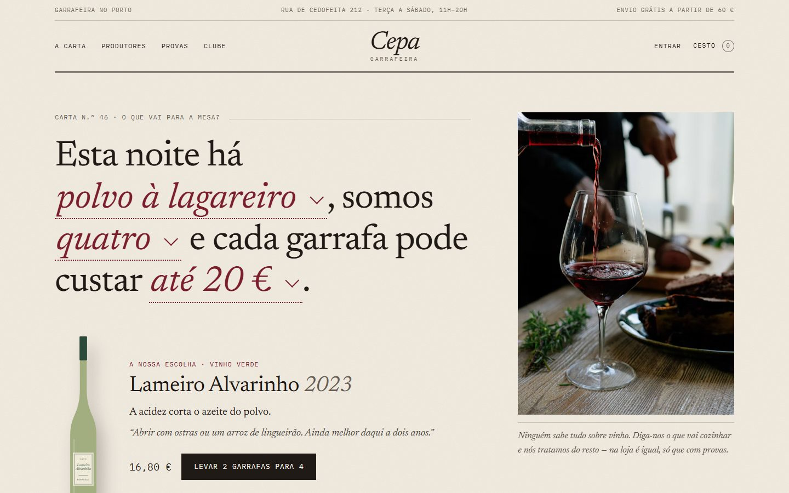

## 🍷 Sobre o projeto

A Cepa é a loja online de uma **garrafeira no Porto** que só vende vinho português de pequenos produtores. Tem a carta completa com notas de prova, a história de cada produtor, um **clube de subscrição** com uma caixa por mês e **provas** na loja com lugares contados.

A página inicial não começa com uma fotografia, começa com uma pergunta: *“Esta noite há polvo à lagareiro, somos quatro e cada garrafa pode custar até 20 €.”* Cada parte da frase é um menu, e a sugestão do escanção muda à medida que se escolhe — com a razão de cada vinho e quantas garrafas levar.

O design parte de uma **carta de vinhos impressa**: papel com grão, nome e preço ligados por pontinhos, régua dupla nos cabeçalhos, tipografia de rótulo (Newsreader e IBM Plex Mono) e um único tom de vinho. As garrafas não são fotografias: são **desenhadas em SVG** a partir dos dados de cada vinho — formato da garrafa, cor do vidro e rótulo próprio com nome e colheita.

Funciona **sem base de dados**: os dados vivem em memória e já trazem 24 vinhos, 7 produtores, provas, encomendas e contas de exemplo, mas o backend está completo — login com JWT, maioridade verificada no registo, stock, descontos de sócio, reservas e painel de gestão.

## ✨ Funcionalidades

<table>
  <tr>
    <th width="33%">Para quem visita</th>
    <th width="33%">Para o cliente</th>
    <th width="33%">Para a garrafeira</th>
  </tr>
  <tr valign="top">
    <td>
      • Sugestão de vinho para o jantar<br>
      • Carta com filtros por tipo, região, prato e preço<br>
      • Vista em carta ou em prateleira<br>
      • Página de cada vinho com contrarrótulo<br>
      • Produtores contados como capítulos<br>
      • Provas com os lugares à vista<br>
      • Clube com a caixa do mês<br>
      • Newsletter
    </td>
    <td>
      • Criar conta (só maiores de 18)<br>
      • Cesto com preços do servidor<br>
      • Envio ou levantamento na loja<br>
      • Desconto automático de sócio<br>
      • Histórico e cancelamento de encomendas<br>
      • Reservar e cancelar lugares nas provas<br>
      • Aderir, pausar ou mudar o plano do clube<br>
      • Dados e morada de entrega
    </td>
    <td>
      • Resumo de vendas e stock a acabar<br>
      • Mudar o estado das encomendas<br>
      • Editar preços e stock na própria tabela<br>
      • Escolher a carta da semana<br>
      • Lista de convidados de cada prova<br>
      • Sócios do clube e respetivos planos
    </td>
  </tr>
</table>

## 📸 Capturas

| A carta | Um vinho |
|---|---|
| 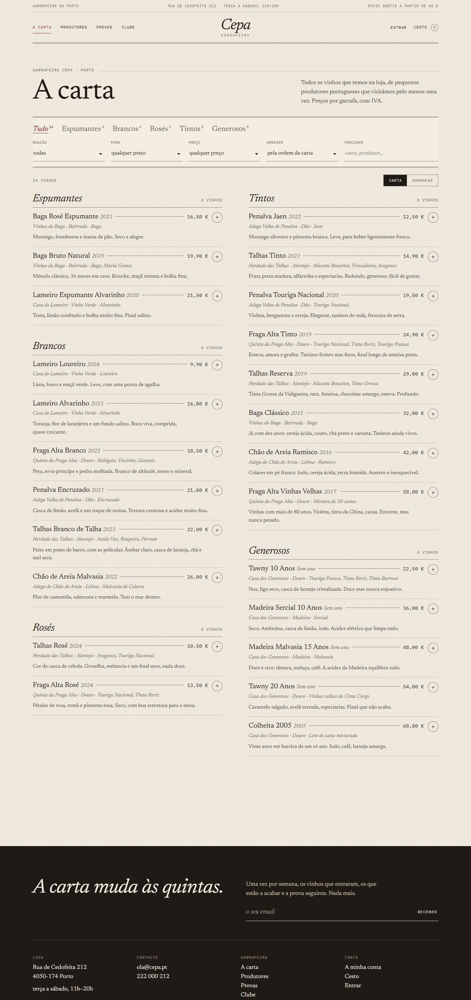 | 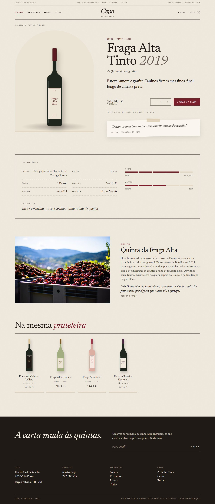 |
| **Provas** | **Clube** |
| 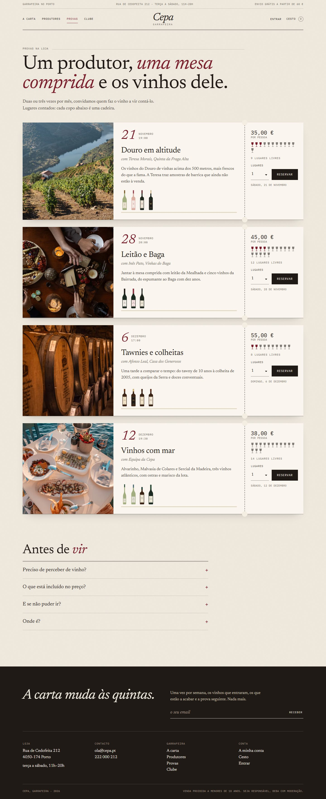 | 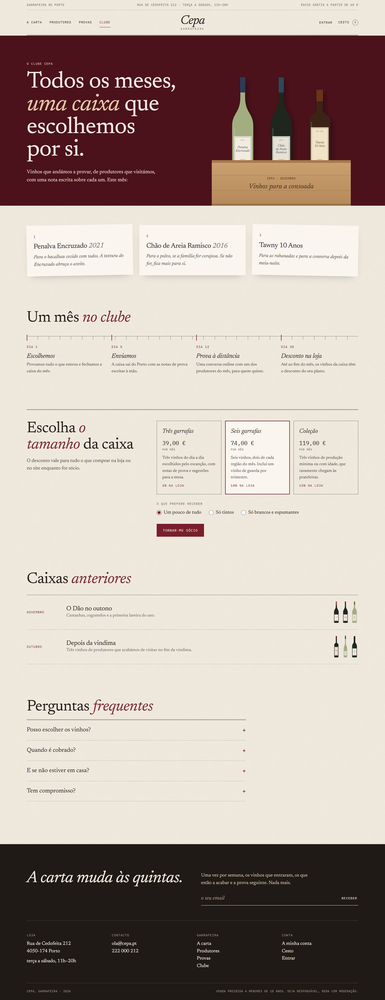 |
| **Cesto** | **Entrar** |
| 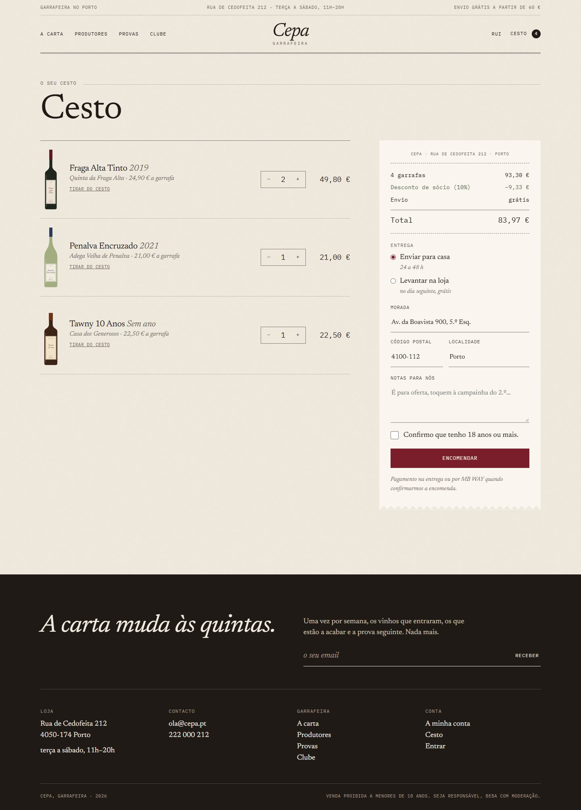 | 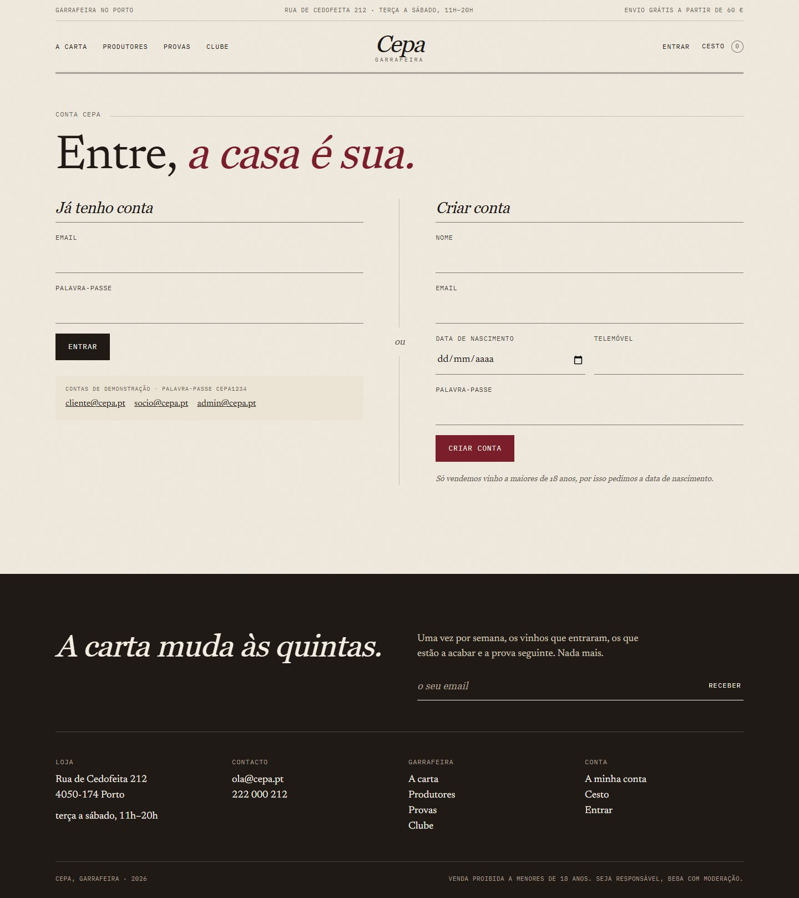 |
| **A minha conta** | **Painel da garrafeira** |
| 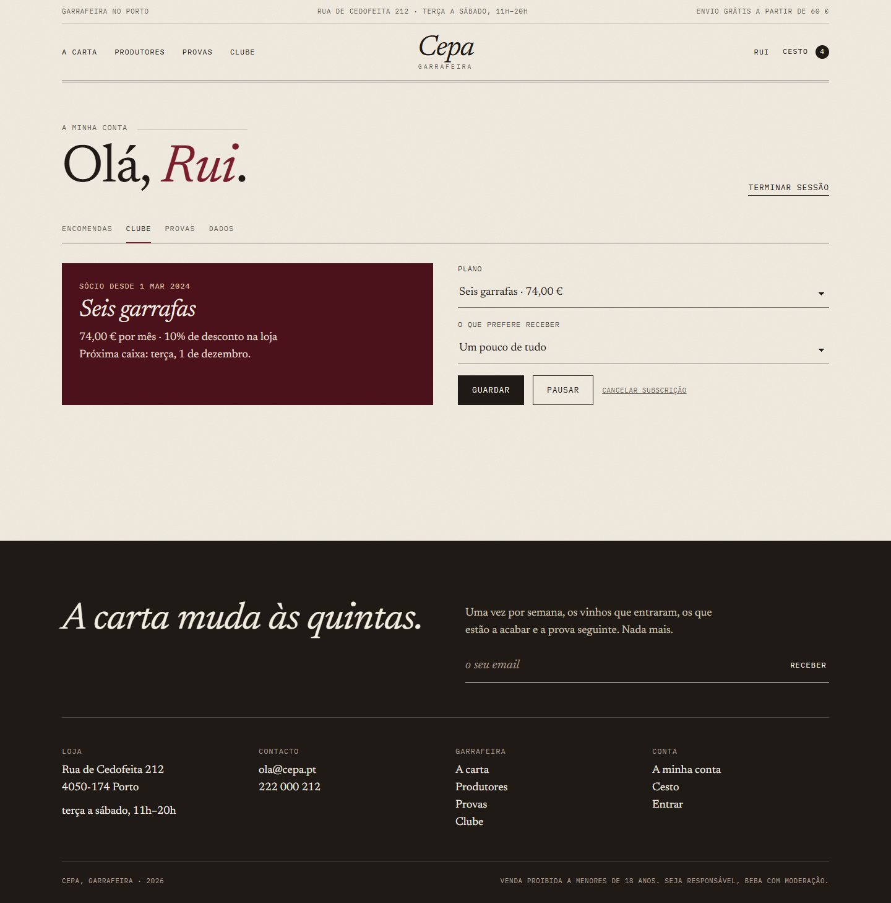 | 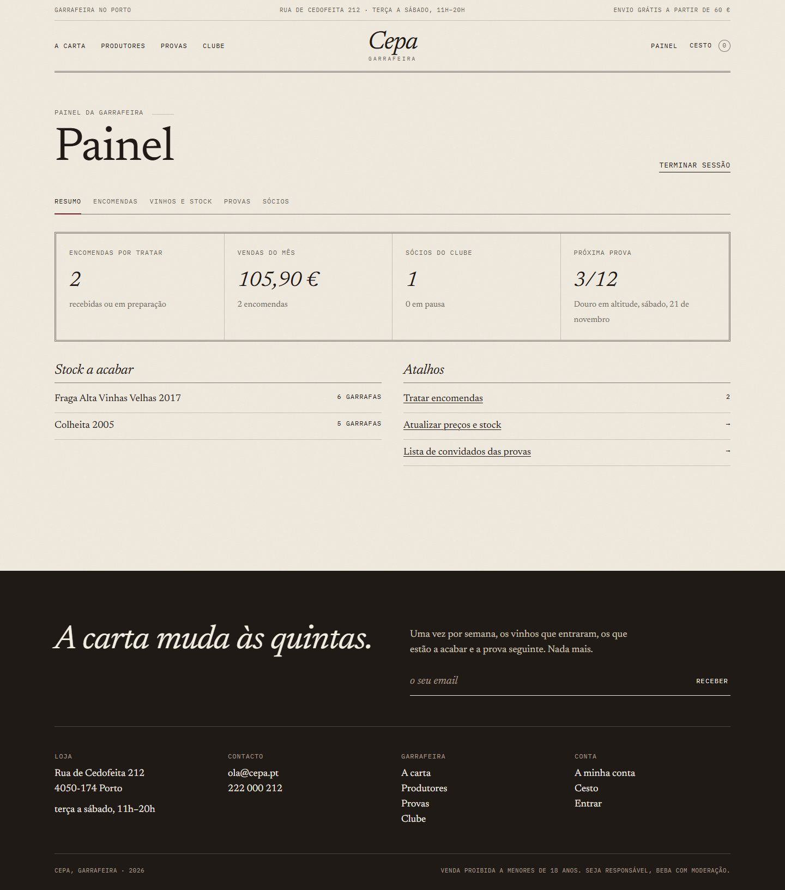 |
| **Produtores** | **Página inicial completa** |
| 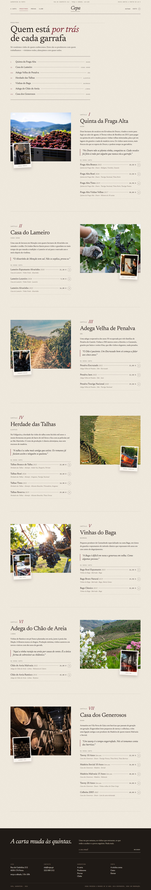 | 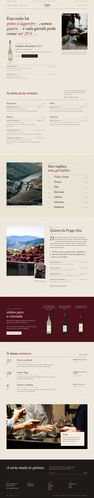 |

### 📱 No telemóvel

Todas as páginas são responsivas (testadas de 360 px a 1920 px). No telemóvel o menu abre como uma folha de papel por cima da página.

<p align="center">
  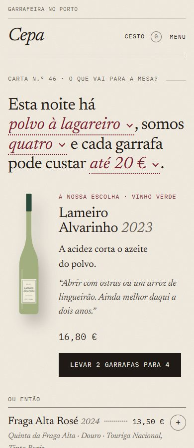
  &nbsp;&nbsp;
  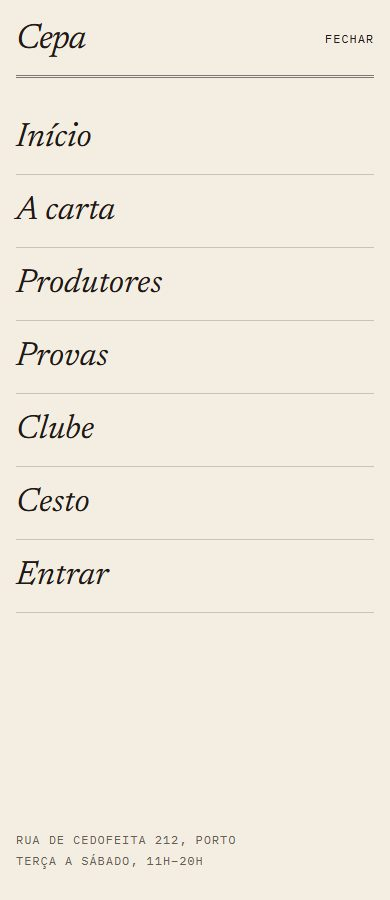
</p>

## 🧰 Tecnologias

| | Tecnologia | Para quê |
|---|---|---|
| ⚙️ | **Node.js 22+** e **Express 5** | Servidor, API e páginas desenhadas no servidor |
| 🔐 | **jsonwebtoken** e **bcryptjs** | Login com access token e refresh token, palavras-passe cifradas |
| 🛡️ | **helmet**, **express-rate-limit**, **cors** | Cabeçalhos de segurança, CSP e limite de tentativas |
| ✅ | **express-validator** | Validação de todos os pedidos, com mensagens em português |
| 🎨 | **HTML, CSS e JavaScript** | Frontend sem build; os mesmos módulos desenham a carta no servidor e no browser |
| 🍾 | **SVG** | Garrafas e rótulos gerados a partir dos dados de cada vinho |
| 🗜️ | **compression** | Respostas comprimidas com gzip |
| 🔤 | **Newsreader** e **IBM Plex Mono** | Tipografia, servida pelo próprio site |

## 📈 SEO e desempenho

Resultados do Lighthouse 12 (telemóvel com rede 4G lenta simulada / computador):

| Página | Desempenho | Acessibilidade | Boas práticas | SEO |
|---|:---:|:---:|:---:|:---:|
| Início | 100 / 100 | 100 | 100 | 100 |
| A carta | 100 / 100 | 100 | 100 | 100 |
| Vinho | 100 / 100 | 100 | 100 | 100 |
| Produtores | 100 / 100 | 100 | 100 | 100 |
| Provas | 97 / 100 | 100 | 100 | 100 |
| Clube | 100 / 100 | 100 | 100 | 100 |

**SEO**

- Todas as páginas públicas são desenhadas no servidor: a carta, os vinhos e os produtores chegam completos no HTML.
- Título, descrição, `canonical`, Open Graph e Twitter Card para cada página e para cada vinho. A carta filtrada por tipo ou região (`/carta?tipo=tinto&regiao=douro`) tem título próprio — “Tintos do Douro”.
- Dados estruturados (JSON-LD): `LiquorStore`, `Product` com preço e disponibilidade para cada vinho, `Event` para cada prova, `FAQPage` e `BreadcrumbList`.
- Cada garrafa existe também como imagem própria em `/carta/<vinho>/garrafa.svg`.
- `/sitemap.xml` gerado a partir da carta e `/robots.txt` que deixa de fora a API, o cesto, a conta e o painel.
- O endereço público vem de `SITE_URL` no `.env`.

**Desempenho e acessibilidade**

- CSS comum e da página juntos num só pedido, com cache longa em produção.
- Fontes servidas pelo site, só no peso usado (cerca de 60 KB no total), com `preload` e fontes de reserva com as mesmas medidas.
- Imagens com `srcset`, `sizes` e dimensões; a primeira imagem é pré-carregada.
- Filtros da carta funcionam sem JavaScript (formulário normal) e com JavaScript (sem recarregar a página).
- Contraste AA, navegação por teclado, foco visível e respeito por `prefers-reduced-motion`.

## 🚀 Como pôr a correr

Precisa do [Node.js](https://nodejs.org) 22 ou mais recente.

```bash
cd cepa
npm install
cp .env.example .env
npm run dev
```

Abrir **<http://localhost:3000>**. O `npm run dev` reinicia o servidor sempre que um ficheiro muda; em produção usar `npm start`.

### Contas de demonstração

Todas com a palavra-passe `cepa1234` (também aparecem na página de entrar).

| Email | Perfil | Para ver |
|---|---|---|
| `cliente@cepa.pt` | Cliente | Encomendas e reservas em provas |
| `socio@cepa.pt` | Cliente e sócio do clube | Desconto de 10% no cesto e gestão da subscrição |
| `admin@cepa.pt` | Garrafeira | Painel |

> [!NOTE]
> Os dados estão em memória, por isso tudo volta ao estado inicial quando o servidor reinicia.

## 🔌 API

Todas as rotas começam por `/api`. As marcadas com 🔒 precisam do cabeçalho `Authorization: Bearer <accessToken>`.

<details>
<summary><strong>Autenticação</strong></summary>

| Método | Rota | Descrição |
|---|---|---|
| POST | `/auth/register` | Criar conta (com data de nascimento, só maiores de 18) |
| POST | `/auth/login` | Entrar |
| POST | `/auth/refresh` | Novo access token a partir do cookie de refresh |
| POST | `/auth/logout` | Terminar sessão |
| GET / PATCH | `/auth/me` 🔒 | Ver e editar dados e morada |
| PATCH | `/auth/me/password` 🔒 | Mudar a palavra-passe |

</details>

<details>
<summary><strong>Carta</strong></summary>

| Método | Rota | Descrição |
|---|---|---|
| GET | `/catalog` | Tipos, regiões e pratos, com contagens |
| GET | `/wines?tipo&regiao&prato&ate&q&ordem` | Lista de vinhos com filtros |
| GET | `/wines/pairing?prato&pessoas&orcamento` | Sugestão de vinhos para um prato |
| GET | `/wines/:slug` | Detalhe, produtor e vinhos relacionados |
| GET | `/producers` | Produtores |

</details>

<details>
<summary><strong>Encomendas</strong></summary>

| Método | Rota | Descrição |
|---|---|---|
| POST | `/orders/quote` | Calcular o cesto (com desconto de sócio se houver sessão) |
| GET | `/orders` 🔒 | As minhas encomendas |
| POST | `/orders` 🔒 | Encomendar (verifica stock e maioridade) |
| POST | `/orders/:id/cancel` 🔒 | Cancelar enquanto ainda não foi preparada |

</details>

<details>
<summary><strong>Provas e clube</strong></summary>

| Método | Rota | Descrição |
|---|---|---|
| GET | `/tastings` | Próximas provas com lugares livres |
| GET | `/tastings/mine` 🔒 | As minhas reservas |
| POST | `/tastings/:id/reservations` 🔒 | Reservar até 4 lugares |
| DELETE | `/tastings/reservations/:id` 🔒 | Cancelar reserva |
| GET | `/club` | Planos, caixa do mês e caixas anteriores |
| GET | `/club/me` 🔒 | A minha subscrição |
| POST | `/club` 🔒 | Aderir ao clube |
| PATCH | `/club/me` 🔒 | Mudar plano ou preferência, pausar, retomar ou cancelar |
| POST | `/newsletter` | Subscrever a newsletter |

</details>

<details>
<summary><strong>Painel</strong> (perfil <code>admin</code>)</summary>

| Método | Rota | Descrição |
|---|---|---|
| GET | `/admin/overview` 🔒 | Resumo de vendas, stock, sócios e próxima prova |
| GET | `/admin/orders?estado` 🔒 | Encomendas com cliente |
| PATCH | `/admin/orders/:id` 🔒 | Mudar o estado (cancelar devolve o stock) |
| GET | `/admin/wines` 🔒 | Vinhos com stock |
| PATCH | `/admin/wines/:id` 🔒 | Preço, stock, carta da semana e nota do escanção |
| GET | `/admin/tastings` 🔒 | Provas com lista de convidados |
| DELETE | `/admin/reservations/:id` 🔒 | Cancelar uma reserva |
| GET | `/admin/members` 🔒 | Sócios do clube |

</details>

Os erros de validação respondem com `400` e a lista de campos:

```json
{
  "error": "Há campos por corrigir",
  "details": [{ "field": "birthDate", "message": "Só vendemos vinho a maiores de 18 anos" }]
}
```
