<div align="center">


# Fechadura

**Escape rooms no Porto, com um site que abre fechado: para entrar é preciso descobrir o código do cadeado (ou carregar no atalho, que está sempre à vista)**


[Funcionalidades](#-funcionalidades) · [O design](#-o-design) · [Capturas](#-capturas) · [Tecnologias](#-tecnologias) · [SEO e desempenho](#-seo-e-desempenho) · [Como pôr a correr](#-como-pôr-a-correr) · [API](#-api)

</div>

<br>

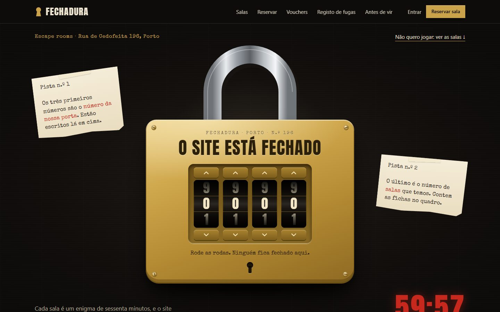

## 🔐 Sobre o projeto

A Fechadura tem **quatro escape rooms em Cedofeita, no Porto**: um banco que faliu em 1932, um farol que se apagou numa noite de tempestade, um hotel com um quarto de onde ninguém fez o check-out e a cave de uma avó que levou a receita do doce para o túmulo.

O site é o primeiro enigma. A página inicial abre com um **cadeado de quatro algarismos** e duas pistas em papel rasgado: os três primeiros números são o número da porta e o último é o número de salas no quadro. Quem não quer jogar tem um atalho logo em cima, e as salas estão sempre lá em baixo, no HTML, para quem procura no Google ou usa um leitor de ecrã.

Depois do cadeado, cada página é um objeto do mundo das salas: as salas estão num **quadro de cortiça com fio vermelho**, o arquivo é uma **gaveta de pastas de processo**, cada sala abre num **dossier confidencial** com a agenda ao lado, a reserva é uma **ficha de entrada** com o bilhete a preencher-se, os vouchers são **envelopes lacrados**, o registo de fugas é um **livro de registos** e as regras vêm numa **carta do game master**.

Funciona **sem base de dados**: os dados vivem em memória e são gerados a partir do dia de hoje, por isso há sempre sessões ocupadas e livres nas próximas semanas e dois meses de fugas no registo. O backend está completo: login com JWT, horários livres calculados no servidor, reservas com voucher, cancelamentos até 24 horas antes e o painel do game master.

## ✨ Funcionalidades

<table>
  <tr>
    <th width="33%">Para quem visita</th>
    <th width="33%">Para o cliente</th>
    <th width="33%">Para o game master</th>
  </tr>
  <tr valign="top">
    <td>
      • Cadeado de entrada com pistas (setas, teclado ou roda do rato)<br>
      • Quadro das salas com a próxima sessão livre e o recorde<br>
      • Arquivo com filtros: para estrear, para 6, sem degraus, difíceis<br>
      • Dossier de cada sala com história, provas e ficha técnica<br>
      • Agenda de 14 dias com as sessões livres de cada sala<br>
      • Ficha de reserva com o bilhete a preencher-se<br>
      • Voucher num envelope lacrado, com mensagem<br>
      • Registo de fugas por mês e por sala<br>
      • Regras e perguntas frequentes
    </td>
    <td>
      • Criar conta (as reservas e vouchers com o mesmo email aparecem logo)<br>
      • Próximas sessões em bilhetes<br>
      • Mudar o número de pessoas ou cancelar até 24 horas antes<br>
      • Histórico de fugas com o tempo e as pistas<br>
      • Vouchers oferecidos e o seu estado<br>
      • Dados pessoais
    </td>
    <td>
      • Grelha do dia: salas × horas, com reservas, jogos e bloqueios<br>
      • Registar o resultado de cada sessão (entra no registo de fugas)<br>
      • Bloquear e desbloquear sessões com um clique<br>
      • Cancelar reservas<br>
      • Procurar reservas por código, nome ou equipa<br>
      • Marcar vouchers como pagos
    </td>
  </tr>
</table>

## 🗝️ O design

- **O site abre trancado.** O cadeado é feito com CSS e SVG: corpo de latão com parafusos, letras gravadas e fechadura, aro de aço com reflexos e uma janela afundada com quatro rodas. Cada roda é uma fita de algarismos que rola (setas, teclado, roda do rato ou arrastar com o dedo), com sombra de cilindro.
- **Animações do cadeado**: cai no sítio quando a página abre, tem um brilho que passa pelo latão de tempos a tempos e uma lanterna que segue o rato. Com o código errado abana e as pistas mexem-se; com o certo o aro salta, o corpo dá um estalo, saltam faíscas de latão e a página desce até às salas. Tudo respeita `prefers-reduced-motion`. O relógio no canto conta 60 minutos desde que a página abriu.
- **Ninguém fica fechado.** O atalho "Não quero jogar" está sempre à vista, o conteúdo está todo no HTML e as rodas funcionam com teclado e leitor de ecrã.
- **Quadro de cortiça**: os casos estão presos com alfinetes, e o fio vermelho entre eles é desenhado em SVG a partir da posição real de cada alfinete, um pouco descaído, por isso acompanha qualquer largura de ecrã.
- **Sombras em camadas**: cada papel tem uma sombra curta e escura junto à superfície e outra larga e suave, como se estivesse mesmo pousado; os cartões levantam-se ao passar o rato.
- **Mapa dobrado** de Cedofeita, desenhado em SVG: quarteirões, jardim, rosa dos ventos, escala, vincos do papel e o caminho a pé desde o metro da Trindade, com o pino da porta a pulsar.
- **Cada sala tem a sua cor** (latão, azul de farol, vermelho de alcatifa, verde de garrafa), que aparece no separador da pasta, na agenda, no bilhete e no livro de registos.
- **Letras**: Anton para os títulos, como os carimbos e as etiquetas de arquivo, e Special Elite, uma letra de máquina de escrever, para tudo o que é papel.
- **No telemóvel** as pistas passam para baixo do cadeado, os cartões deixam de estar tortos e o fio vermelho desaparece.

## 📸 Capturas

| Cadeado aberto | Quadro das salas |
|---|---|
| 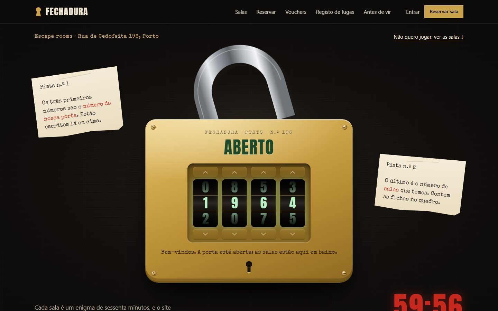 | 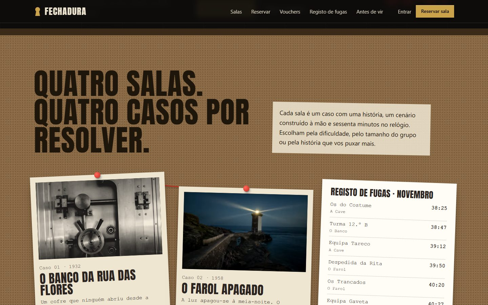 |
| **Preços e vouchers** | **Onde fica** |
| 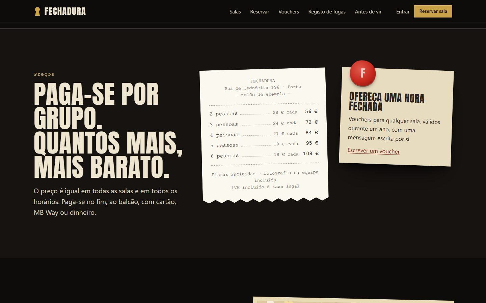 | 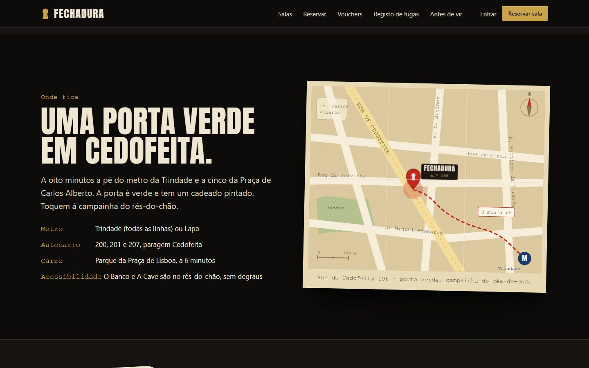 |
| **Arquivo das salas** | **Dossier de uma sala** |
| 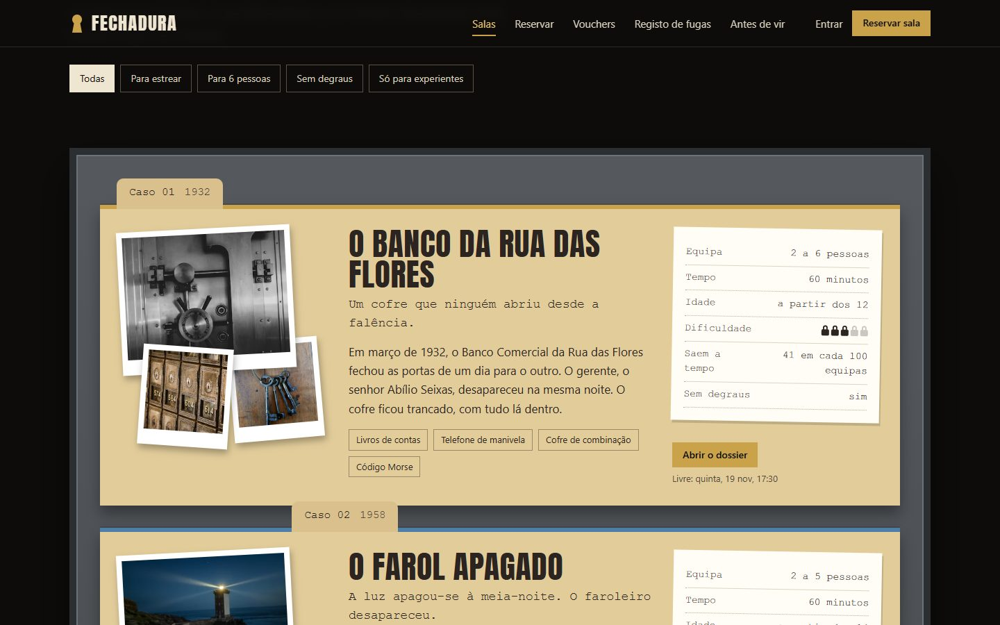 | 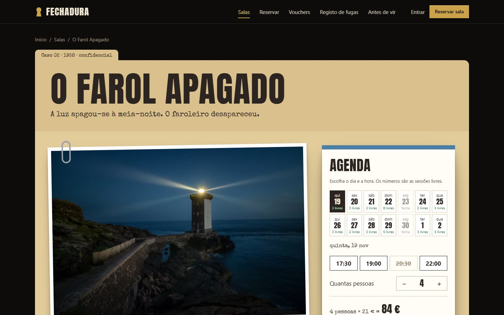 |
| **O caso e as provas** | **Ficha de reserva** |
| 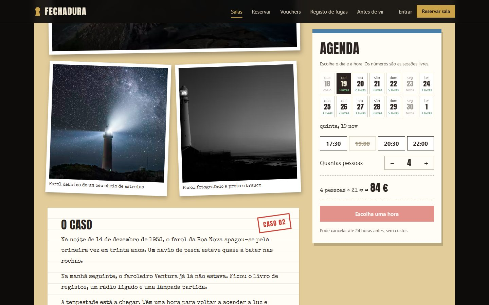 | 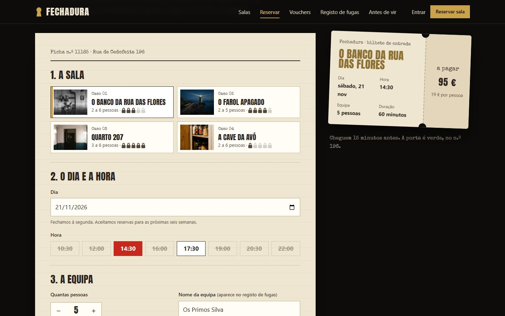 |
| **Voucher** | **Registo de fugas** |
| 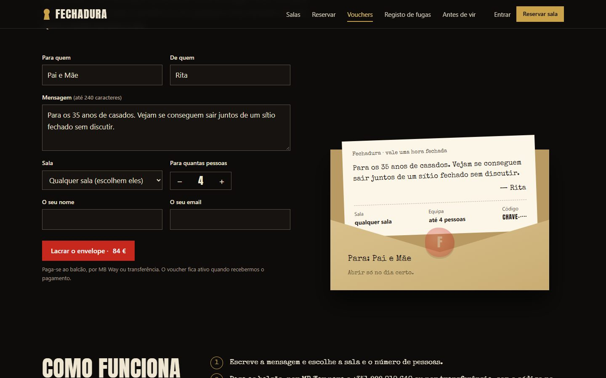 | 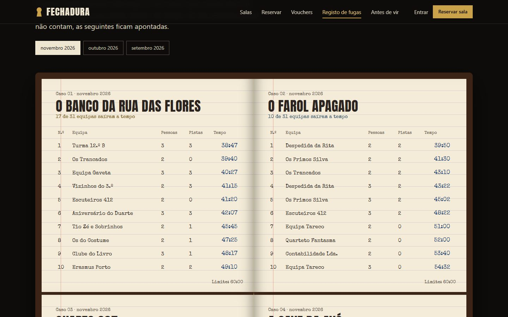 |
| **Antes de vir** | **Cartão de acesso** |
| 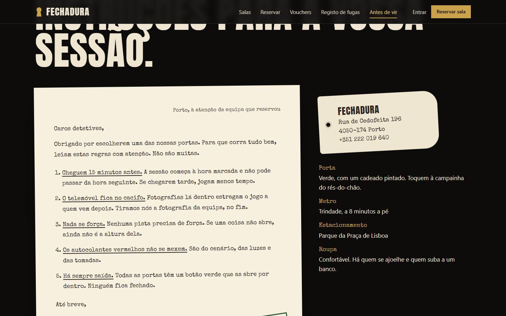 | 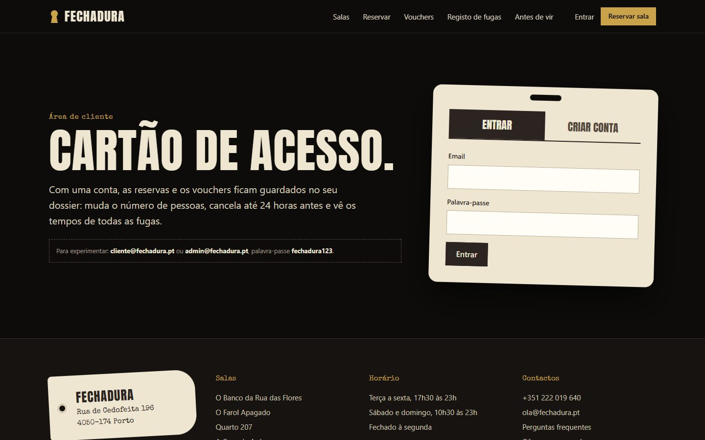 |
| **O meu dossier** | **Painel do game master** |
| 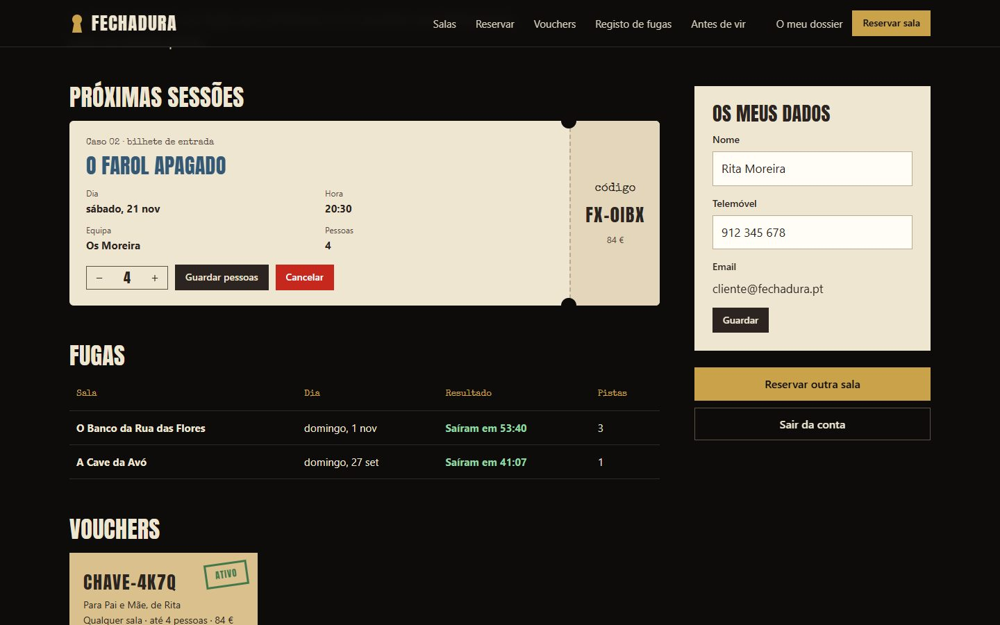 | 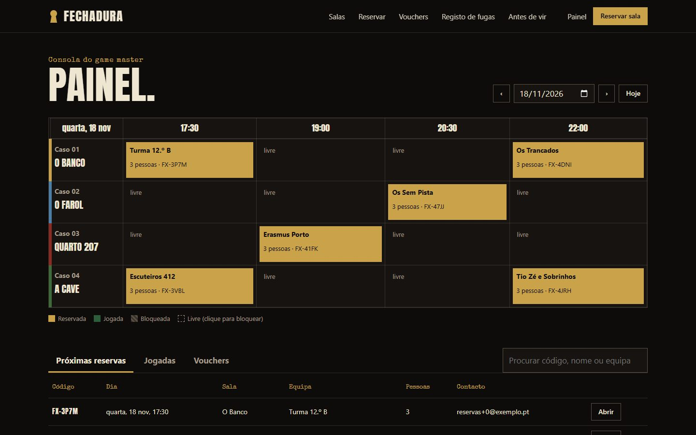 |
| **Página não encontrada** | |
| 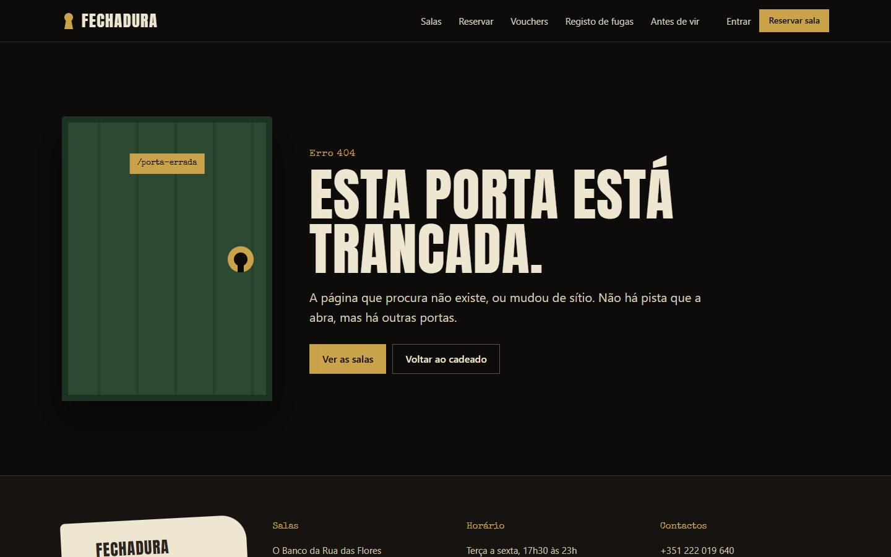 | |

### 📱 No telemóvel

Todas as páginas são responsivas (testadas de 360 px a 1920 px).

<p align="center">
  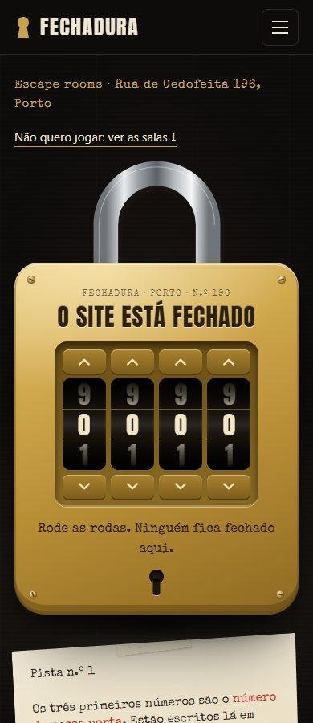
  &nbsp;
  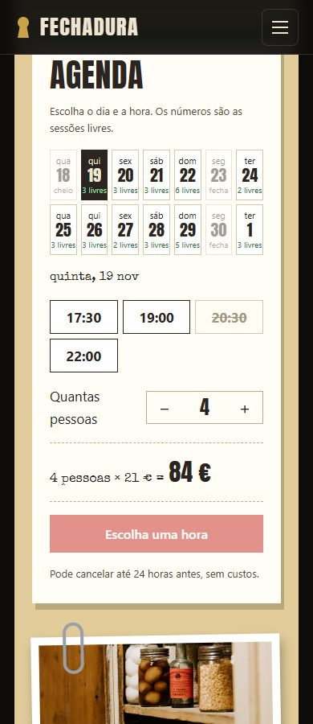
</p>

## 🧰 Tecnologias

| | Tecnologia | Para quê |
|---|---|---|
| ⚙️ | **Node.js 22+** e **Express 5** | Servidor, API e páginas desenhadas no servidor |
| 🔐 | **jsonwebtoken** e **bcryptjs** | Login com access token e refresh token, palavras-passe cifradas |
| 🛡️ | **helmet**, **express-rate-limit**, **cors** | Cabeçalhos de segurança, CSP e limite de tentativas, reservas e vouchers |
| ✅ | **express-validator** | Validação de todos os pedidos, com mensagens em português |
| 🎨 | **HTML, CSS e JavaScript** | Frontend sem build; a tabela de preços é o mesmo módulo no servidor e no browser |
| 🗜️ | **compression** | Respostas comprimidas com gzip |
| 🔤 | **Anton** e **Special Elite** | Tipografia, servida pelo próprio site (só os caracteres latinos) |

## 📈 SEO e desempenho

Resultados do Lighthouse 12 (telemóvel com rede 4G lenta simulada / computador):

| Página | Desempenho | Acessibilidade | Boas práticas | SEO |
|---|:---:|:---:|:---:|:---:|
| Início | 99 / 100 | 100 | 100 | 100 |
| Salas | 99 | 100 | 100 | 100 |
| Uma sala | 99 / 100 | 100 | 100 | 100 |
| Reservar | 99 | 100 | 100 | 100 |
| Vouchers | 99 | 100 | 100 | 100 |
| Registo de fugas | 100 | 100 | 100 | 100 |
| Antes de vir | 100 | 100 | 100 | 100 |

**SEO**

- Todas as páginas públicas são desenhadas no servidor. O `h1` da página inicial está no cadeado, com o nome e a descrição para quem não vê o ecrã.
- Título, descrição, `canonical`, Open Graph e Twitter Card em cada página; cada sala usa a sua fotografia como imagem de partilha.
- Dados estruturados (JSON-LD): `EntertainmentBusiness` com morada, horário, preços e o catálogo das salas, `Product` com `AggregateOffer` e as características de cada sala, `ItemList`, `FAQPage` e `BreadcrumbList`.
- `/sitemap.xml` com as salas e `/robots.txt` que deixa de fora a API, a área de cliente e o painel.
- O endereço público vem de `SITE_URL` no `.env`.

**Desempenho e acessibilidade**

- Um só ficheiro de CSS, com cache longa em produção.
- Duas fontes com `font-display: optional`, `preload` da letra dos títulos e fonte de reserva com as mesmas medidas, para o texto não saltar.
- Fotografias com `srcset`, `sizes` e dimensões; só a do dossier de cada sala é pré-carregada.
- Contraste AA, navegação por teclado (rodas do cadeado, agenda, separadores), foco visível e `prefers-reduced-motion`.

## 🚀 Como pôr a correr

Precisa do [Node.js](https://nodejs.org) 22 ou mais recente.

```bash
cd fechadura
npm install
cp .env.example .env
npm run dev
```

Abrir **<http://localhost:3006>**. O `npm run dev` reinicia o servidor sempre que um ficheiro muda; em produção usar `npm start`.

O código do cadeado é **1964**.

### Contas de demonstração

Todas com a palavra-passe `fechadura123`.

| Email | Perfil | Para ver |
|---|---|---|
| `cliente@fechadura.pt` | Cliente | Uma sessão no Farol no sábado, duas fugas e um voucher oferecido |
| `admin@fechadura.pt` | Game master | Painel com a grelha do dia, reservas e vouchers |

Há também um voucher ativo para experimentar na reserva: `CHAVE-4K7Q` (até 4 pessoas, qualquer sala).

> [!NOTE]
> Os dados estão em memória, por isso tudo volta ao estado inicial quando o servidor reinicia.

## 🔌 API

Todas as rotas começam por `/api`. As marcadas com 🔒 precisam do cabeçalho `Authorization: Bearer <accessToken>`.

<details>
<summary><strong>Autenticação</strong></summary>

| Método | Rota | Descrição |
|---|---|---|
| POST | `/auth/register` | Criar conta (junta as reservas e vouchers feitos com o mesmo email) |
| POST | `/auth/login` | Entrar |
| POST | `/auth/refresh` | Novo access token a partir do cookie de refresh |
| POST | `/auth/logout` | Terminar sessão |
| GET / PATCH | `/auth/me` 🔒 | Ver e editar nome e telefone |
| PATCH | `/auth/me/password` 🔒 | Mudar a palavra-passe |

</details>

<details>
<summary><strong>Salas, reservas e vouchers</strong></summary>

| Método | Rota | Descrição |
|---|---|---|
| GET | `/salas` | Todas as salas |
| GET | `/salas/:slug` | Uma sala |
| GET | `/salas/:slug/calendario` | Sessões livres por dia, nas próximas semanas |
| GET | `/salas/:slug/horarios?data=AAAA-MM-DD` | Horas de um dia, livres ou ocupadas |
| POST | `/reservas` | Reservar (com sessão iniciada, fica na conta); aceita um código de voucher |
| POST | `/vouchers` | Pedir um voucher (fica por pagar) |
| GET | `/vouchers/:code` | Confirmar um voucher antes de reservar |
| GET | `/registo?mes=AAAA-MM` | Registo de fugas do mês, por sala |

</details>

<details>
<summary><strong>Área de cliente</strong> 🔒</summary>

| Método | Rota | Descrição |
|---|---|---|
| GET | `/conta` | Reservas e vouchers do cliente |
| PATCH | `/conta/reservas/:id` | Mudar o número de pessoas (até 24 horas antes) |
| POST | `/conta/reservas/:id/cancelar` | Cancelar (até 24 horas antes; o voucher volta a ficar ativo) |

</details>

<details>
<summary><strong>Painel</strong> 🔒 (só game master)</summary>

| Método | Rota | Descrição |
|---|---|---|
| GET | `/admin/dia?data=AAAA-MM-DD` | Grelha do dia: salas, horas, reservas e bloqueios |
| GET | `/admin/reservas?estado=&q=` | Próximas, jogadas ou canceladas, com procura |
| POST | `/admin/reservas/:id/resultado` | Registar se saíram, o tempo e as pistas |
| POST | `/admin/reservas/:id/cancelar` | Cancelar uma reserva |
| POST | `/admin/bloqueios` | Bloquear ou desbloquear uma sessão ou um dia |
| GET | `/admin/vouchers` | Todos os vouchers |
| PATCH | `/admin/vouchers/:id` | Marcar como pago (ativo) |

</details>

---

<div align="center">

As salas, as histórias e as equipas do registo são inventadas. As fotografias são do [Unsplash](https://unsplash.com).

</div>
