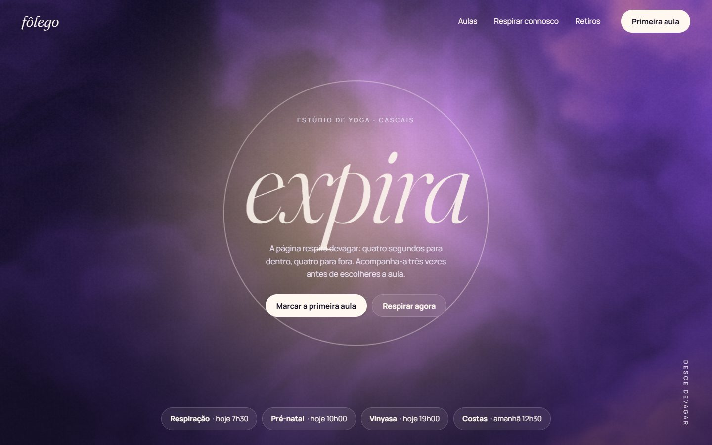
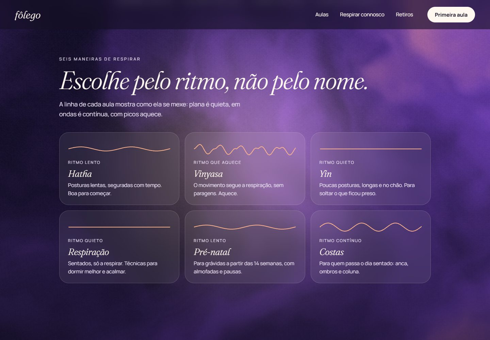
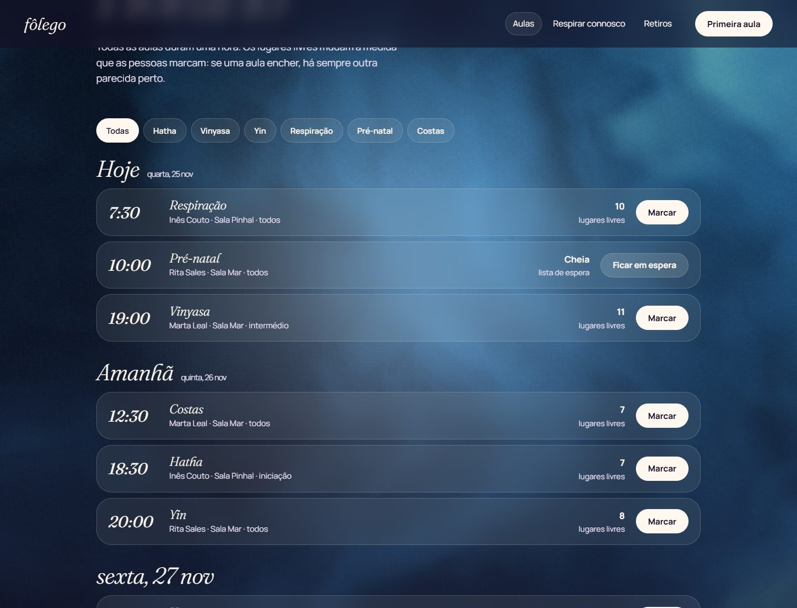
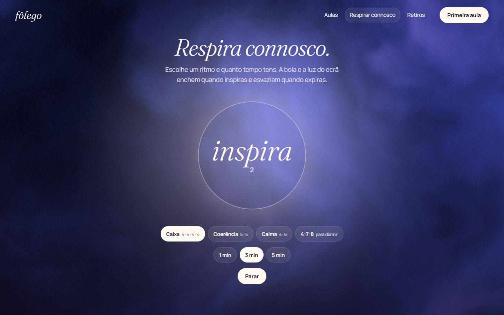
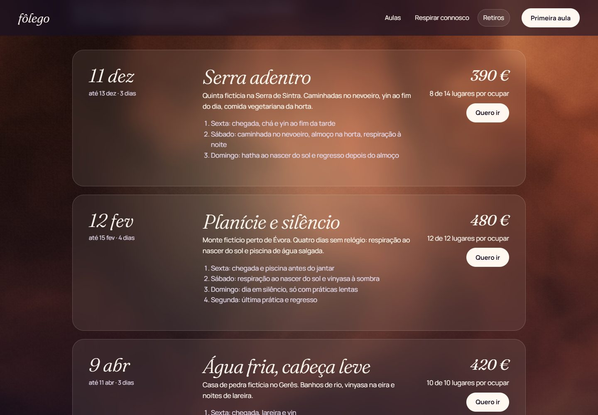
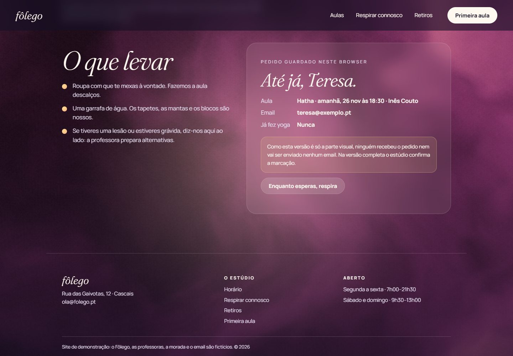
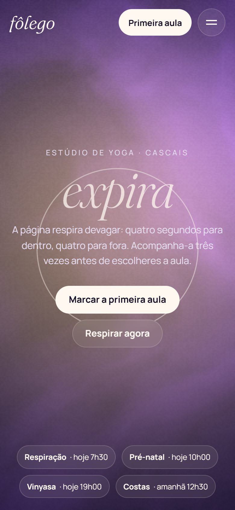
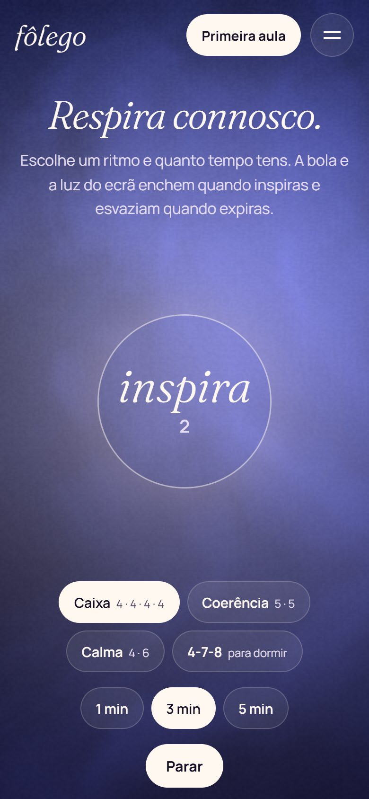
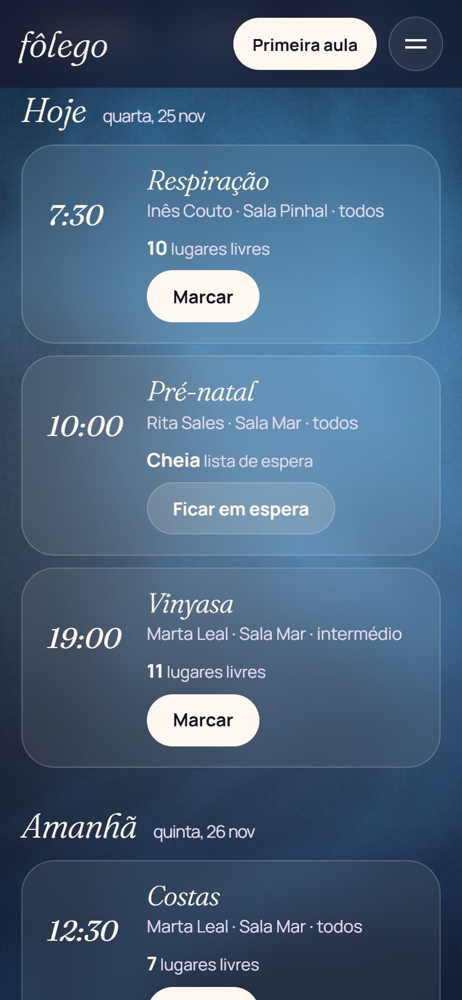

<div align="center">

# Fôlego

**Estúdio de yoga e respiração em Cascais (fictício). O site respira contigo: quatro segundos para dentro, quatro para fora.**


<br>



</div>

<br>

> [!NOTE]
> Esta versão é **só a parte visual** (frontend), sem servidor de dados nem contas. O estúdio, as professoras, a morada, o email e os retiros são inventados. Quando alguém marca uma aula, o pedido fica guardado apenas no browser dessa pessoa, e a própria página diz isso.

## 🌬️ O conceito

Um estúdio de respiração não devia ter um site agitado. Por isso, o fundo de todas as páginas é uma **luz líquida desenhada em tempo real** com um shader de WebGL próprio, sem bibliotecas, que respira devagar num ciclo de oito segundos. Na página inicial, a palavra e o anel trocam entre **inspira** e **expira** a esse ritmo, e só depois aparecem as aulas.

Cada página tem a sua cor de luz: violeta no início, azul-aurora no horário, noite na respiração, âmbar nos retiros e rosa na marcação. A luz segue o rato devagar.

Não há fotografias de pessoas. As professoras são três luzes com as iniciais, e as aulas mostram-se pela linha do seu ritmo: plana é quieta, em ondas é contínua e com picos aquece.

## ✨ O que tem

| Página | O que faz |
|---|---|
| **Início** | A luz e o anel a respirar, as quatro próximas aulas calculadas a partir de hoje, os seis tipos de aula pelo ritmo, a primeira aula minuto a minuto, as professoras, o próximo retiro, como pagar e perguntas frequentes |
| **Horário** | As aulas dos próximos sete dias, com filtro por tipo, lugares livres, aulas cheias com lista de espera e o aviso "daqui a pouco" |
| **Respirar connosco** | Exercício guiado com quatro ritmos (caixa, coerência, calma e 4-7-8) e três durações. A bola e a luz do ecrã enchem e esvaziam ao ritmo escolhido, e no fim aparece quantos ciclos fizeste |
| **Retiros** | Os próximos três retiros com as datas calculadas, o programa de cada dia, o preço e os lugares por ocupar |
| **Marcar** | Formulário da primeira aula com validação, mensagens de erro acessíveis e uma confirmação que diz com honestidade que o pedido não foi enviado a ninguém |
| **404** | "Perdeste o fôlego." |

## 📸 Capturas

| | |
|:---:|:---:|
|  |  |
| **Aulas pelo ritmo** | **Horário da semana** |
|  |  |
| **Respirar connosco** | **Retiros** |
|  | |
| **Marcação confirmada** | |

<div align="center">
&nbsp;&nbsp;
&nbsp;&nbsp;

</div>

## ⚡ Desempenho e acessibilidade

O shader é desenhado a metade da resolução e a 30 imagens por segundo, e pára quando o separador está escondido. Só começa depois de a página estar pronta (dois segundos e meio depois de carregar, ou logo ao primeiro toque ou scroll). Até lá vê-se um gradiente em CSS com as mesmas cores, por isso o texto aparece logo. Quem tem o movimento reduzido ativado no sistema vê a luz parada, sem palavras a mudar nem anéis a crescer.

Lighthouse medido no computador (versão 12), com o servidor local:

| Página | Telemóvel | Computador |
|---|:---:|:---:|
| Início | 100 · 100 · 100 · 100 | 100 · 100 · 100 · 100 |
| Horário | 100 · 100 · 100 · 100 | 100 · 100 · 100 · 100 |
| Respirar | 100 · 100 · 100 · 100 | 100 · 100 · 100 · 100 |
| Retiros | 100 · 100 · 100 · 100 | 100 · 100 · 100 · 100 |
| Marcar | 99 · 100 · 100 · 100 | 100 · 100 · 100 · 100 |

*Desempenho · Acessibilidade · Boas práticas · SEO*

## 🔎 SEO

| | |
|---|---|
| Títulos e descrições | Próprios em cada página |
| Canonical e Open Graph | Em todas as páginas, com imagem de partilha 1200×630 |
| JSON-LD | `HealthClub` com morada e horário, `FAQPage`, `HowTo` no exercício de respiração e `BreadcrumbList` |
| Ficheiros | `robots.txt` e `sitemap.xml` |
| Domínio | `folego.pt` é um domínio de exemplo |

## 🛠️ Tecnologias

| | |
|---|---|
| Páginas | HTML escrito à mão, uma por endereço |
| Estilos | Um só CSS, sem frameworks |
| JavaScript | Módulos ES, um por página, mais `dados.js` com o horário e `luz.js` com o shader |
| Luz | WebGL 1 com um fragment shader de ruído fractal (fbm) |
| Fontes | Fraunces itálico e Manrope, guardadas no projeto com `font-display: optional` e letras de recurso com as mesmas medidas |
| Servidor local | `servidor.mjs` em Node 22 sem dependências: endereços limpos, gzip e cabeçalhos de segurança (CSP sem scripts inline, `nosniff`, `frame-ancestors 'none'`) |

## ▶️ Pôr a correr

```bash
cd folego
npm start
```

Abre <http://localhost:3010>. Não há nada para instalar.

Esta versão não tem contas de teste nem API. As marcações ficam no `localStorage` com a chave `folego.pedidos`.
