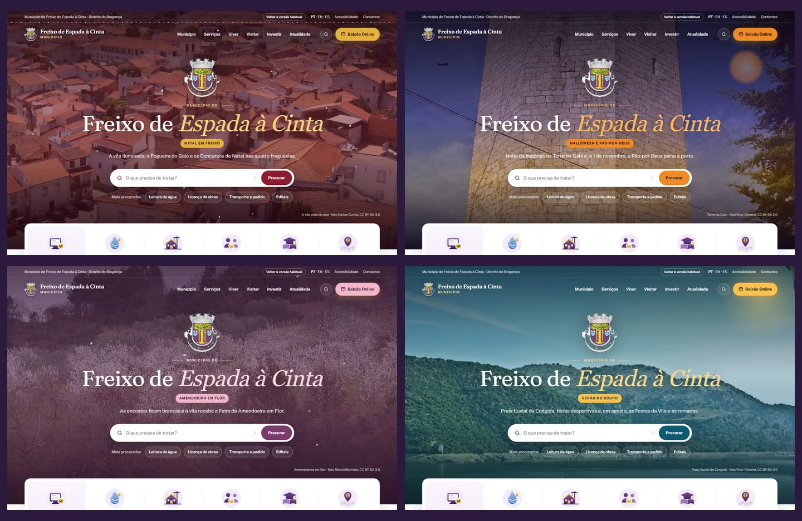
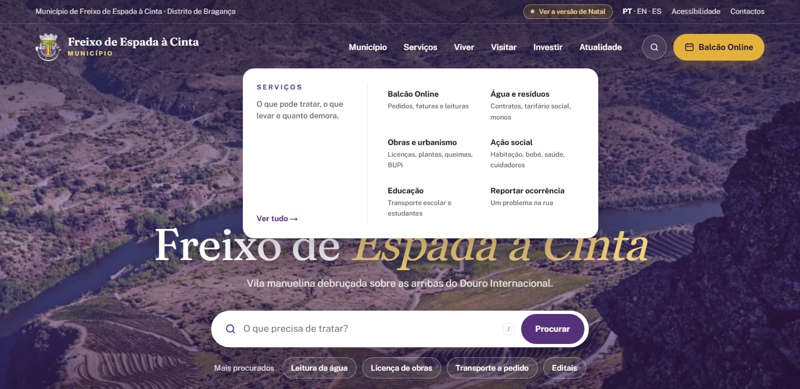
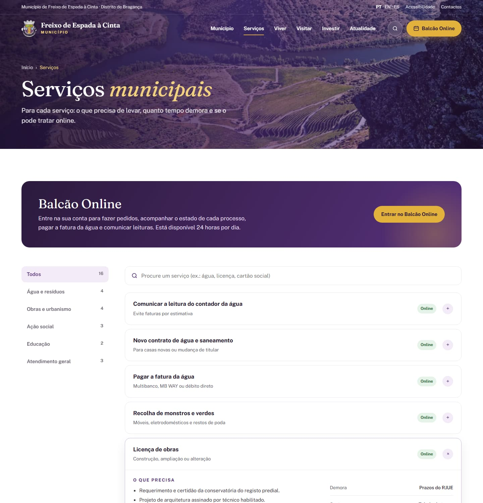
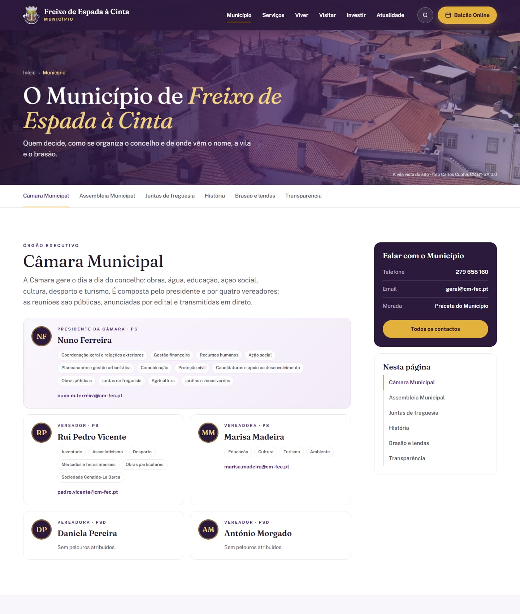
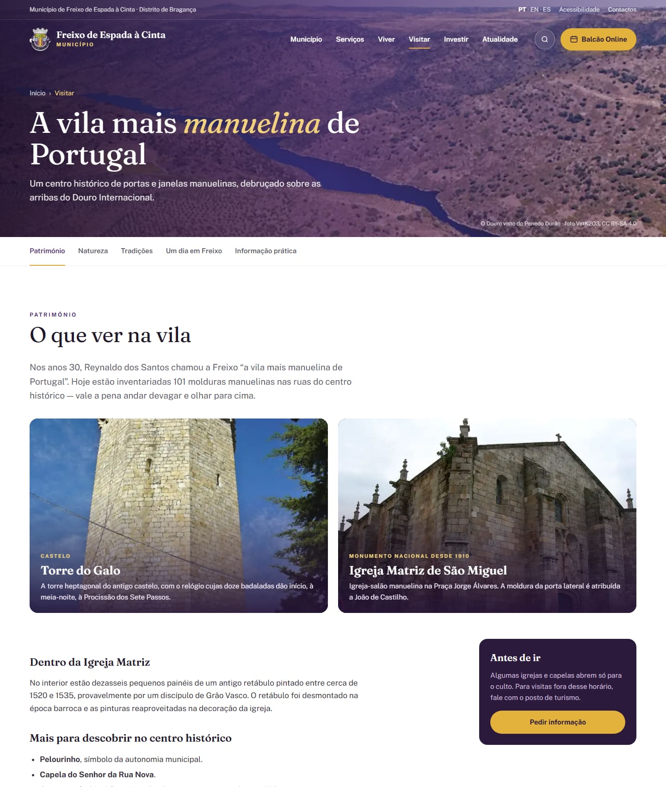
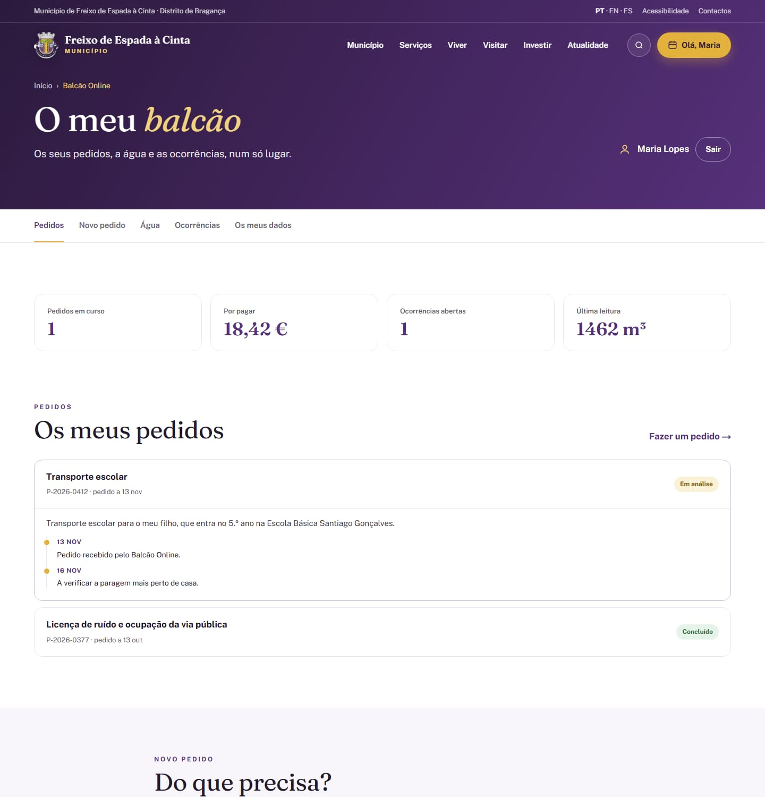
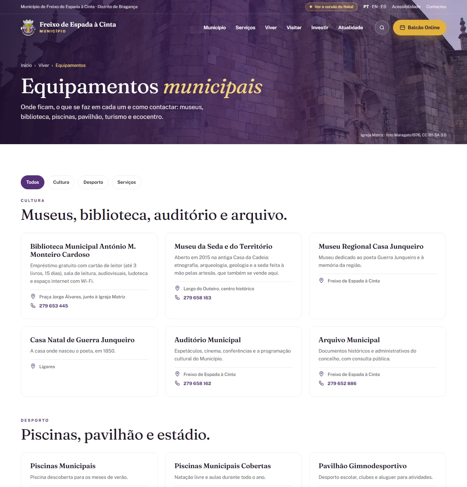
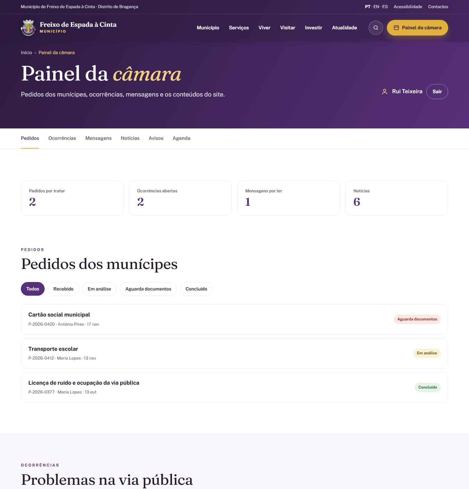
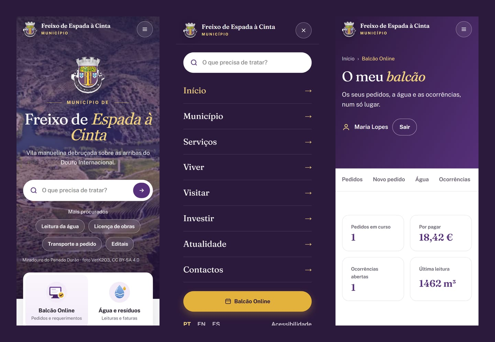

<div align="center">


# Freixo de Espada à Cinta

**Proposta de redesign do site do Município de Freixo de Espada à Cinta: o brasão do concelho, as arribas do Douro Internacional e um Balcão Online onde os munícipes tratam de tudo sem sair de casa**


[Funcionalidades](#-funcionalidades) · [O design](#-o-design) · [Épocas](#-versões-por-época) · [Capturas](#-capturas) · [Tecnologias](#-tecnologias) · [SEO e desempenho](#-seo-e-desempenho) · [Como pôr a correr](#-como-pôr-a-correr) · [API](#-api)

</div>

<br>


## 🏛️ Sobre o projeto

Proposta de redesign do site de uma câmara municipal, feita como trabalho de portefólio para mostrar a clientes. **Não é oficial nem tem ligação ao Município.** Antes do código houve três direções de design em imagem (editorial, imersiva e painel); esta é a imersiva, a escolhida.

O site usa o **brasão verdadeiro** do concelho e tira dele as cores: o **púrpura** do campo e o **ouro** do freixo e das espadas. As fotografias são do próprio concelho (Penedo Durão, Torre do Galo, Igreja Matriz, Congida, seda e amendoeiras) e os factos — freguesias, residentes dos Censos 2011 e 2021, forais, Monumento Nacional, Guerra Junqueiro, Procissão dos Sete Passos — vêm da Wikipedia.

A informação prática foi tirada do **site atual do Município** e reorganizada: os contactos, o executivo e os pelouros, a Assembleia, as quatro juntas com morada, telefone e horário, os apoios sociais com os seus regulamentos, os 13 equipamentos municipais, o ecocentro, a recolha de monos e as festas do ano. No site atual muita desta informação está escondida em menus sem página, com acentos partidos, agenda parada em 2023 e endereços sem nome; aqui cada coisa tem uma página e um caminho claro.

As **notícias recentes, os avisos, os prazos e os pedidos são de exemplo**. As datas são calculadas a partir de hoje, por isso há sempre notícias recentes, eventos nas próximas semanas e um aviso em curso. Funciona **sem base de dados**: tudo vive em memória, com repositórios prontos a trocar por uma base de dados real.

## ✨ Funcionalidades

<table>
  <tr>
    <th width="33%">Para quem visita</th>
    <th width="33%">Para o munícipe</th>
    <th width="33%">Para a câmara</th>
  </tr>
  <tr valign="top">
    <td>
      • Pesquisa “O que precisa de tratar?” logo à entrada, com a tecla <kbd>/</kbd><br>
      • Menu com submenus: cada secção mostra as páginas que tem, com uma frase sobre cada<br>
      • “O que lhe está a acontecer?”: vou ter um bebé, vou fazer obras, mudei-me… leva aos serviços certos<br>
      • Versão do site para cada época, a escolher na barra de cima<br>
      • Seis serviços com ícones ilustrados em púrpura e ouro<br>
      • “Hoje no concelho”: o aviso mais importante, se os Paços estão abertos agora e o próximo evento<br>
      • Ficha do concelho e as quatro freguesias<br>
      • Catálogo de 20 serviços com pesquisa e categorias: o que levar, quanto demora, se é online<br>
      • Executivo com pelouros, Assembleia e as quatro juntas com contactos e horários<br>
      • Oito apoios do Município e 13 equipamentos com morada e telefone<br>
      • Notícias com filtros, agenda, avisos à população e editais<br>
      • Guias para viver, visitar e investir no concelho<br>
      • Mensagem ao Município, ocorrências na via pública e newsletter<br>
      • Mapa do OpenStreetMap que só carrega se for pedido
    </td>
    <td>
      • Criar conta e entrar no Balcão Online<br>
      • Pedidos de serviço com o estado e o histórico passo a passo<br>
      • Novo pedido com o serviço já escolhido a partir do catálogo<br>
      • Faturas da água e pagamento (de demonstração)<br>
      • Comunicar a leitura do contador, com a última leitura como mínimo<br>
      • Ocorrências que reportou e em que estado estão<br>
      • Alterar os dados e a palavra-passe
    </td>
    <td>
      • Resumo: pedidos por tratar, ocorrências abertas e mensagens por ler<br>
      • Pedidos filtrados por estado, com mudança de estado e nota para o munícipe<br>
      • Ocorrências na via pública e o seu estado<br>
      • Mensagens do formulário de contacto<br>
      • Publicar, esconder e apagar notícias<br>
      • Publicar e retirar avisos (com destaque na página inicial)<br>
      • Acrescentar e apagar eventos da agenda
    </td>
  </tr>
</table>

## 🧭 O design

- **As cores do brasão.** Púrpura e ouro em todo o site, com o branco e um lilás muito claro por baixo; o verde, o azul e a prata ficam só no próprio brasão.
- **Destaque imersivo.** O Douro visto do Penedo Durão ocupa o ecrã inteiro com um véu púrpura; o brasão ao centro, o nome em Fraunces com “Espada à Cinta” a dourado e a pesquisa por baixo.
- **Serviços a flutuar.** Uma barra branca com seis ícones ilustrados, desenhados para o site, sobe por cima da fotografia.
- **Navbar que se adapta.** Transparente por cima da fotografia, ganha fundo ao descer; abaixo dos 1180 px passa a um menu de ecrã inteiro com pesquisa, Balcão Online e idiomas.
- **Animações discretas.** O destaque entra peça a peça (brasão, título, pesquisa), a fotografia aproxima-se devagar, as secções aparecem ao descer e o ponto dos Paços do Concelho pulsa quando estão abertos. Tudo para quando o sistema pede menos movimento.
- **Informação primeiro.** Cada página interior tem um índice das secções que acompanha a leitura, e caixas laterais com o que é preciso saber de seguida.

## 🎄 Versões por época

O site tem uma versão para cada época do ano: **Natal**, **Halloween e Pão-por-Deus**, **Carnaval**, **Amendoeira em Flor**, **Páscoa** e **Verão**. Quando uma época se aproxima, aparece na barra de cima, ao lado de PT · EN · ES, a opção *Ver a versão de Natal* (ou da época que for). Quem escolhe é o visitante: a escolha fica guardada e pode voltar à versão habitual com um clique.

Cada versão muda as cores (mantendo o brasão), a fotografia do destaque, a frase e acrescenta um destaque com o que acontece no concelho nessa altura — a iluminação e a Fogueira do Galo no Natal, o Enterro do Entrudo no Largo do Outeiro, a Feira da Amendoeira em Flor, a Procissão dos Sete Passos, as Festas da Vila. As decorações são poucas e discretas (neve leve, pétalas, três morcegos, um sol) e só aparecem no destaque. As datas da Páscoa e do Carnaval são calculadas para cada ano. Para pré-visualizar: `/?epoca=natal`, `halloween`, `carnaval`, `amendoeira`, `pascoa`, `verao` ou `normal`.



<table>
  <tr>
    <td width="50%"><br><sub><b>Natal</b> · o destaque da época, com o que acontece no concelho</sub></td>
    <td width="50%"><br><sub><b>Menu</b> · cada secção com as suas páginas</sub></td>
  </tr>
</table>

## 📸 Capturas

<table>
  <tr>
    <td width="50%"><br><sub><b>Início</b> · serviços, hoje no concelho, ficha e notícias</sub></td>
    <td width="50%"><br><sub><b>Serviços</b> · pesquisa, categorias e cada serviço aberto</sub></td>
  </tr>
  <tr>
    <td><br><sub><b>Município</b> · Câmara, Assembleia, freguesias, história e brasão</sub></td>
    <td><br><sub><b>Visitar</b> · a vila mais manuelina de Portugal</sub></td>
  </tr>
  <tr>
    <td><br><sub><b>Atualidade</b> · notícias, agenda, avisos e editais</sub></td>
    <td><br><sub><b>Notícia</b> · texto, resumo e outras notícias</sub></td>
  </tr>
  <tr>
    <td><br><sub><b>Contactos</b> · telefones, email, emergência e juntas</sub></td>
    <td><br><sub><b>Balcão Online</b> · pedidos, água e ocorrências do munícipe</sub></td>
  </tr>
  <tr>
    <td><br><sub><b>Equipamentos</b> · museus, piscinas, biblioteca e ecocentro</sub></td>
    <td><br><sub><b>Câmara Municipal</b> · executivo e pelouros</sub></td>
  </tr>
  <tr>
    <td colspan="2"><br><sub><b>Painel da câmara</b> · pedidos, ocorrências, mensagens e conteúdos</sub></td>
  </tr>
</table>

<p align="center"></p>

## 🛠️ Tecnologias

| | |
| --- | --- |
| **Servidor** | Node.js 22+ e Express 5, páginas geradas no servidor (o HTML chega completo, sem framework no browser) |
| **Sessão** | JWT: token de acesso curto e refresh token numa cookie `httpOnly`, renovado em cada uso; um refresh repetido termina todas as sessões |
| **Validação** | express-validator em todas as entradas da API, com o erro junto a cada campo do formulário |
| **Segurança** | helmet com Content Security Policy sem scripts inline e só o OpenStreetMap como iframe, express-rate-limit no login e nos formulários públicos |
| **Browser** | JavaScript em módulos ES, um por página, sem bibliotecas |
| **Dados** | Repositórios em memória com a mesma interface de uma base de dados (`findAll`, `findById`, `create`, `update`, `remove`) |

## 🚀 SEO e desempenho

| Página (telemóvel) | Desempenho | Acessibilidade | Boas práticas | SEO |
| --- | :-: | :-: | :-: | :-: |
| Início | 97 | 100 | 100 | 100 |
| Início · versão de Natal | 97 | 100 | 100 | 100 |
| Equipamentos | 98 | 100 | 100 | 100 |
| Início (computador) | 100 | 100 | 100 | 100 |
| Município | 96 | 100 | 100 | 100 |
| Serviços | 98 | 100 | 100 | 100 |
| Viver | 97 | 100 | 100 | 100 |
| Visitar | 95 | 100 | 100 | 100 |
| Investir | 98 | 100 | 100 | 100 |
| Atualidade | 96 | 100 | 100 | 100 |
| Notícia | 97 | 100 | 100 | 100 |
| Contactos | 97 | 100 | 100 | 100 |

- Título, descrição, canonical, Open Graph e Twitter Card em todas as páginas; `robots.txt` e `sitemap.xml` com as notícias publicadas
- JSON-LD: `GovernmentOrganization` com horário e localização, `WebSite` com pesquisa, `GovernmentService` para o catálogo, `NewsArticle`, `Event`, `TouristAttraction` e `BreadcrumbList`
- Fotografias locais em webp com `srcset` (480 a 1600 px), largura e altura reservadas e `preload` da imagem principal; a do destaque leva uma desfocagem ligeira por baixo do véu púrpura, que não se vê e poupa metade do peso
- Fontes locais (Fraunces e Public Sans) com `font-display: optional` e letras de reserva com as mesmas medidas
- O mapa de terceiros só carrega com um clique; o Balcão Online e o painel não são indexados

## ▶️ Como pôr a correr

```bash
npm install
cp .env.example .env
npm run dev
```

Abre em `http://localhost:3008`. Contas para experimentar:

| Perfil | Email | Palavra-passe |
| --- | --- | --- |
| Munícipe (Lagoaça) | `maria@exemplo.pt` | `freixo2026` |
| Funcionário da câmara | `camara@exemplo.pt` | `freixo2026` |

## 🔌 API

| Método | Rota | Quem | O que faz |
| --- | --- | --- | --- |
| `GET` | `/api/servicos` · `noticias` · `noticias/:slug` · `agenda` · `avisos` · `editais` | todos | Conteúdos públicos |
| `POST` | `/api/mensagens` · `ocorrencias` · `newsletter` | todos | Formulários públicos |
| `POST` | `/api/auth/register` · `login` · `refresh` · `logout` | todos | Sessão |
| `GET` `PATCH` | `/api/auth/me` · `/me/password` | sessão | Dados da conta |
| `GET` | `/api/balcao/resumo` | munícipe | Pedidos, ocorrências, faturas e leituras |
| `POST` | `/api/balcao/pedidos` | munícipe | Novo pedido de serviço |
| `POST` | `/api/balcao/faturas/:id/pagar` | munícipe | Pagamento de demonstração |
| `POST` | `/api/balcao/leituras` | munícipe | Leitura do contador |
| `GET` | `/api/admin/resumo` | câmara | Contagens |
| `GET` `PATCH` | `/api/admin/pedidos` · `/:id` | câmara | Pedidos e mudança de estado |
| `GET` `PATCH` | `/api/admin/ocorrencias` · `/:id` | câmara | Ocorrências |
| `GET` `POST` | `/api/admin/mensagens` · `/:id/lida` | câmara | Mensagens de contacto |
| `GET` `POST` `PATCH` `DELETE` | `/api/admin/noticias` | câmara | Notícias |
| `GET` `POST` `DELETE` | `/api/admin/avisos` · `/api/admin/agenda` | câmara | Avisos e eventos |

---

<sub>Proposta não oficial, sem ligação ao Município de Freixo de Espada à Cinta. O brasão pertence ao Município. Fotografias via Wikimedia Commons: Penedo Durão e rio Douro — VetK2O3, CC BY-SA 4.0 · Torre do Galo e praia da Congida — Vitor Oliveira, CC BY-SA 2.0 · Igreja Matriz — Maragato1976, CC BY-SA 3.0 · A vila vista do alto — Carlos Cunha, CC BY-SA 3.0 · Casulos de seda — Guy Moll, CC BY 2.0 · Amendoeiras em flor — ManuelBarreira, CC BY-SA 3.0.</sub>
