# Ideias de sites

Mockups de design de cada ideia. Quando uma ideia for escolhida, ganha a sua própria pasta na raiz do repositório com o código completo.

Os designs 07–12 usam fotografias do [Unsplash](https://unsplash.com/license) (uso gratuito, inclusive comercial). Para regenerar uma imagem, abrir o `design.html` no browser ou usar o Chrome em modo headless.

---

## 01 · Barbearia — *Navalha & Co.*
Site de marcações online para barbearia/cabeleireiro.

- Marcação em 3 passos (serviço → barbeiro → horário) com horários ocupados bloqueados
- Área de cliente: histórico e cancelamento de marcações
- Painel admin: agenda por barbeiro, serviços e preços
- Perfis: `cliente`, `barbeiro`, `admin`

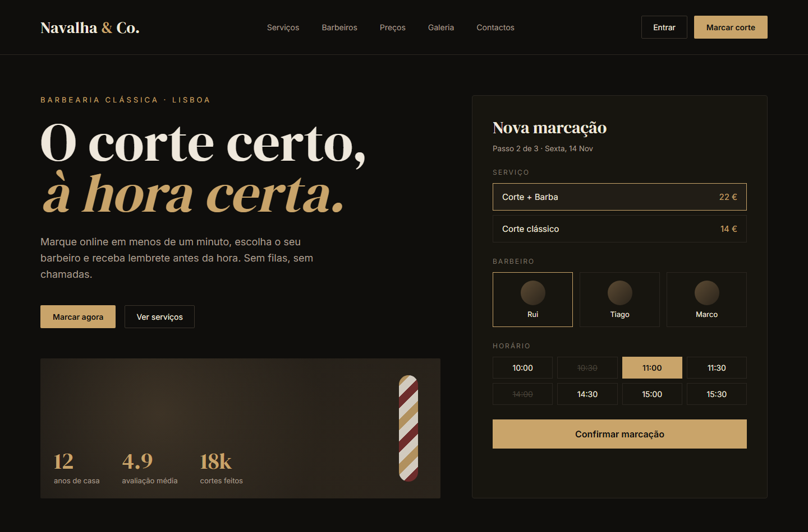

## 02 · Restaurante — *Brasa*
Site de restaurante com menu, reservas de mesa e take-away.

- Menu por categorias com carrinho de take-away
- Reservas com verificação de lotação por horário
- Painel admin: reservas do dia, estado das encomendas, gestão do menu
- Perfis: `cliente`, `staff`, `admin`

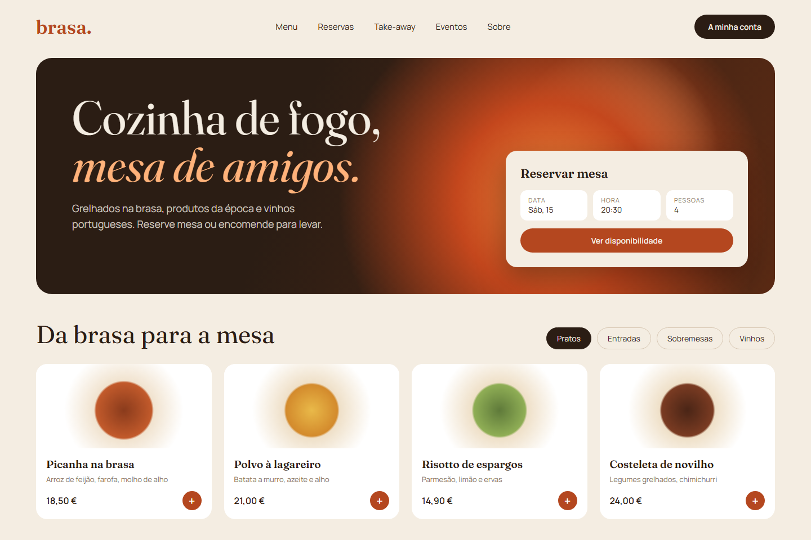

## 03 · Imobiliária — *Morada*
Portal de imóveis com pesquisa, filtros e área de agente.

- Pesquisa por localização, tipo, tipologia e preço
- Favoritos e pedidos de contacto para utilizadores registados
- Área do agente: criar/editar imóveis e responder a pedidos
- Perfis: `utilizador`, `agente`, `admin`

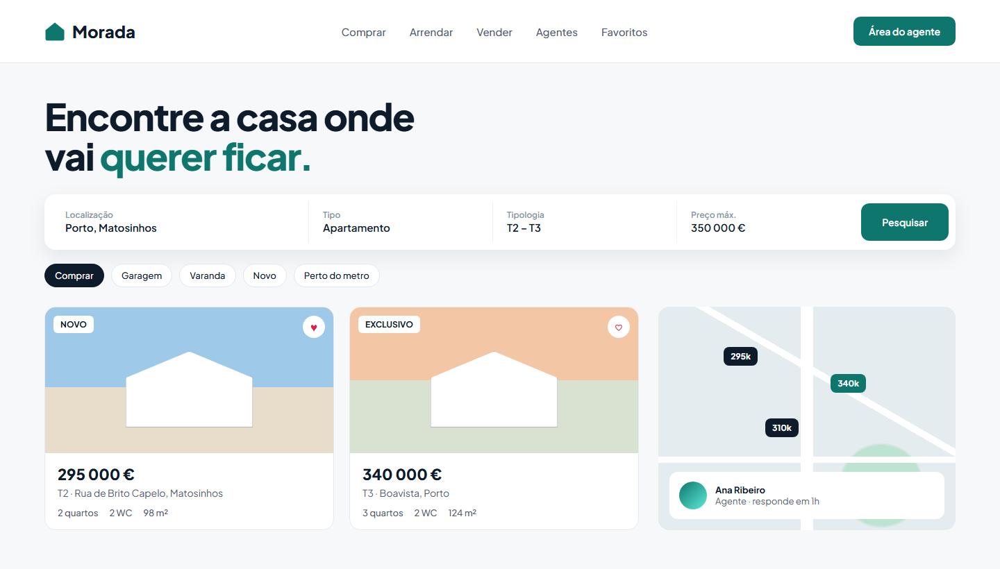

## 04 · Ginásio — *Pulse*
Site de ginásio com planos, horário de aulas e área de sócio.

- Planos de subscrição e reserva de vagas em aulas (com lista de espera)
- Área de sócio: treinos, estatísticas e sequência
- Painel de treinador/admin: aulas, lotação e sócios
- Perfis: `socio`, `treinador`, `admin`

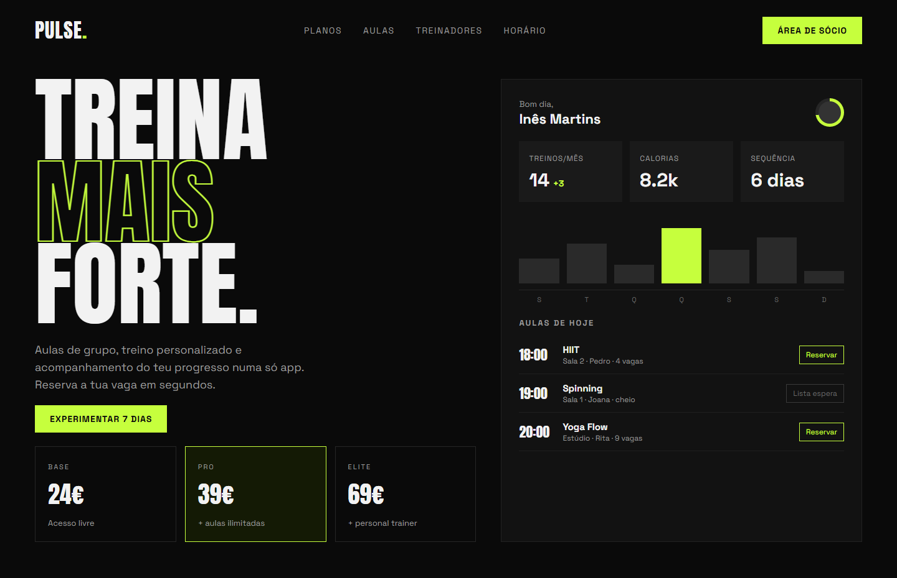

## 05 · Loja online — *Atelier*
E-commerce minimalista de produtos artesanais.

- Catálogo com filtros, carrinho e checkout (pagamento simulado)
- Conta de cliente: encomendas e moradas
- Painel admin: produtos, stock e encomendas
- Perfis: `cliente`, `admin`

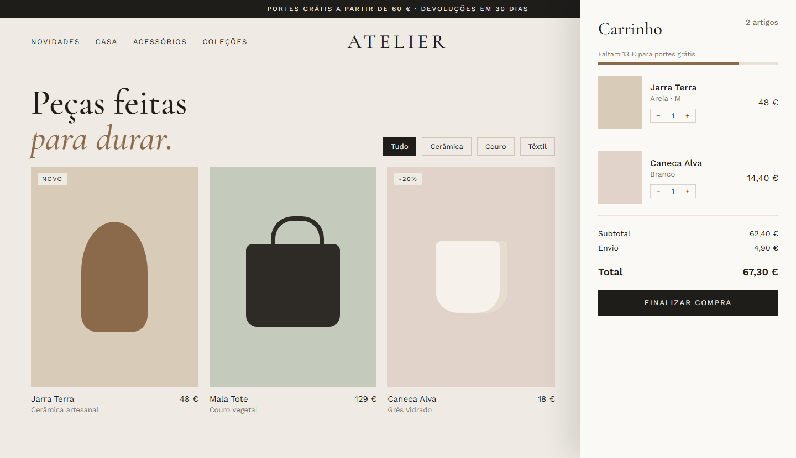

## 06 · Cursos online — *Saber+*
Plataforma de cursos com progresso de aulas e certificados.

- Catálogo de cursos, inscrição e progresso por aula
- Painel do aluno com objetivo semanal e próximas aulas
- Área do formador: criar cursos, módulos e quizzes
- Perfis: `aluno`, `formador`, `admin`

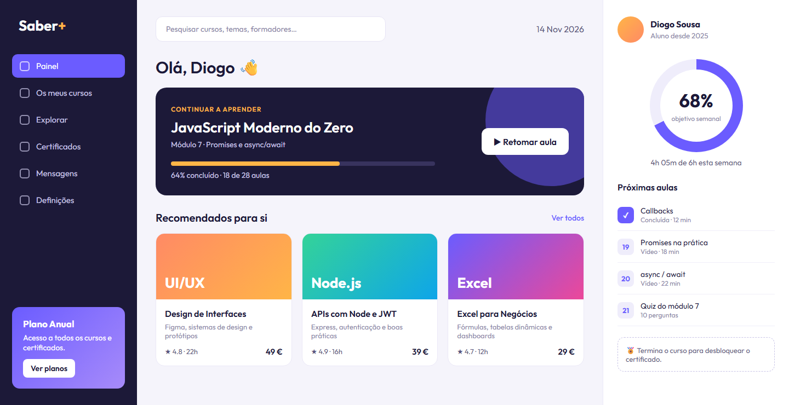

---

# Segunda ronda (07–12)

## 07 · Clínica dentária — *Lumen Dental*
Site de clínica com marcação de consultas e área do paciente.

- Marcação online com vagas em tempo real e lembretes
- Área do paciente: consultas, faturas e plano de tratamento
- Painel da clínica: agenda por médico, pacientes e tratamentos
- Perfis: `paciente`, `medico`, `admin`

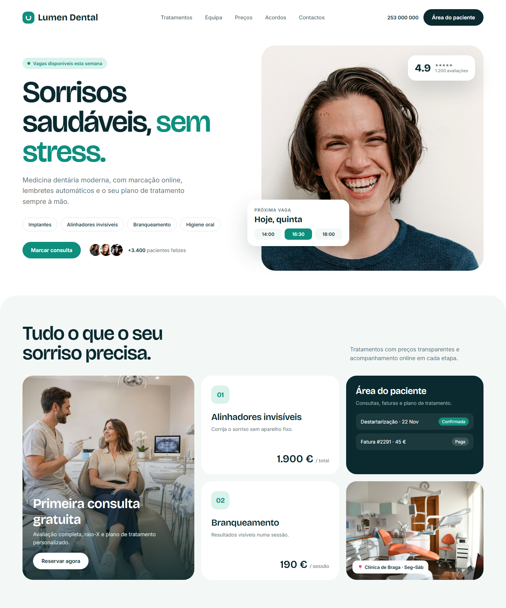

## 08 · Alojamento local — *Maré*
Site de reservas diretas para casas de férias, sem comissões de plataformas.

- Pesquisa por datas e hóspedes com calendário de disponibilidade
- Reservas com extras (experiências) e check-in online
- Painel do proprietário: calendário, preços por época e reservas
- Perfis: `hospede`, `proprietario`, `admin`

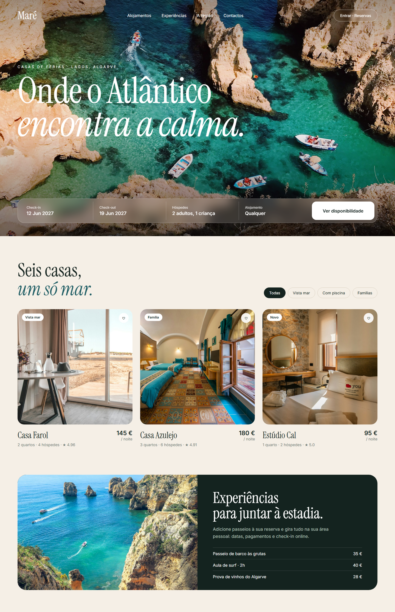

## 09 · Bilheteira de eventos — *Palco*
Plataforma de venda de bilhetes para concertos e festivais.

- Eventos por cidade/categoria, tipos de bilhete e contagem decrescente
- Bilhetes com código QR na conta do utilizador e revenda segura
- Painel do promotor: criar eventos, lotação e validação de entradas
- Perfis: `cliente`, `promotor`, `admin`

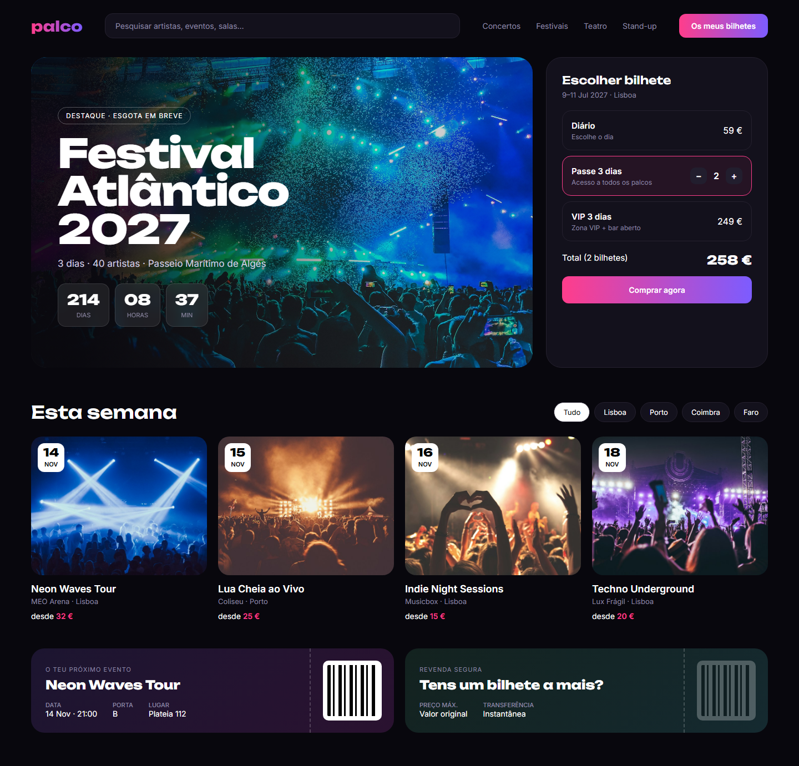

## 10 · Pet shop + veterinário — *Patinhas*
Loja de animais com serviços marcáveis e ficha de cada animal.

- Loja online por espécie, carrinho e encomendas
- Marcação de banhos, consultas e hotel canino
- Perfil do animal: vacinas, desparasitações e próximas consultas
- Perfis: `cliente`, `veterinario`, `admin`

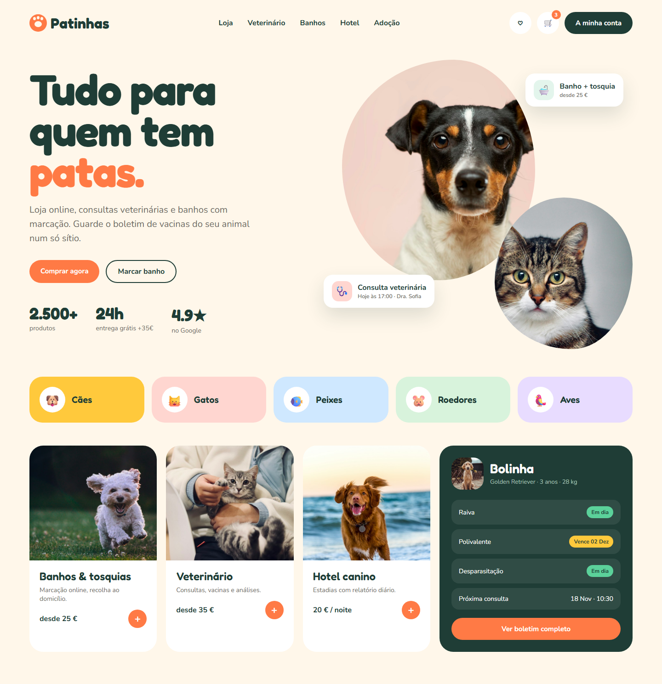

## 11 · Estúdio criativo — *Lente Studio*
Portefólio de fotografia/vídeo com galerias privadas para clientes.

- Portefólio de projetos e pedidos de orçamento
- Galerias privadas protegidas por login para o cliente ver e descarregar fotos
- Painel do estúdio: projetos, galerias e pedidos
- Perfis: `cliente`, `admin`

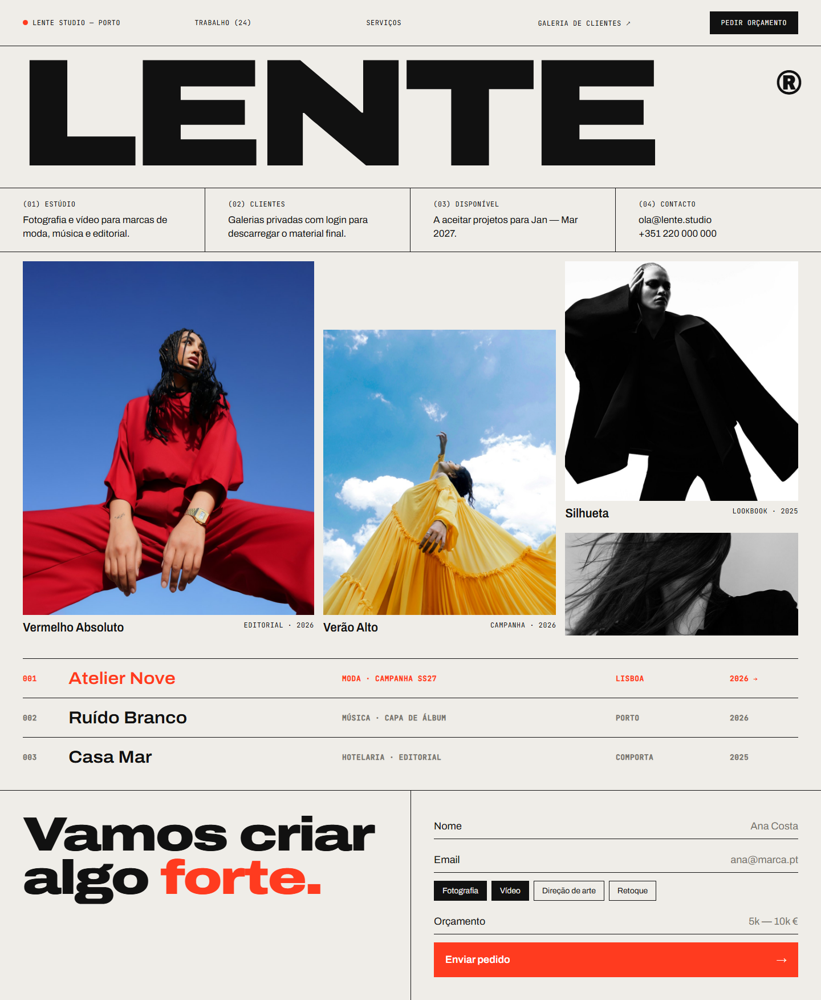

## 12 · Padaria & café — *Fornada*
Encomendas para levantar no dia seguinte e cabazes por subscrição.

- Catálogo do dia com quantidades e escolha da hora de levantamento
- Subscrições semanais com pausa/cancelamento na conta
- Painel da padaria: produção do dia seguinte e encomendas por hora
- Perfis: `cliente`, `staff`, `admin`

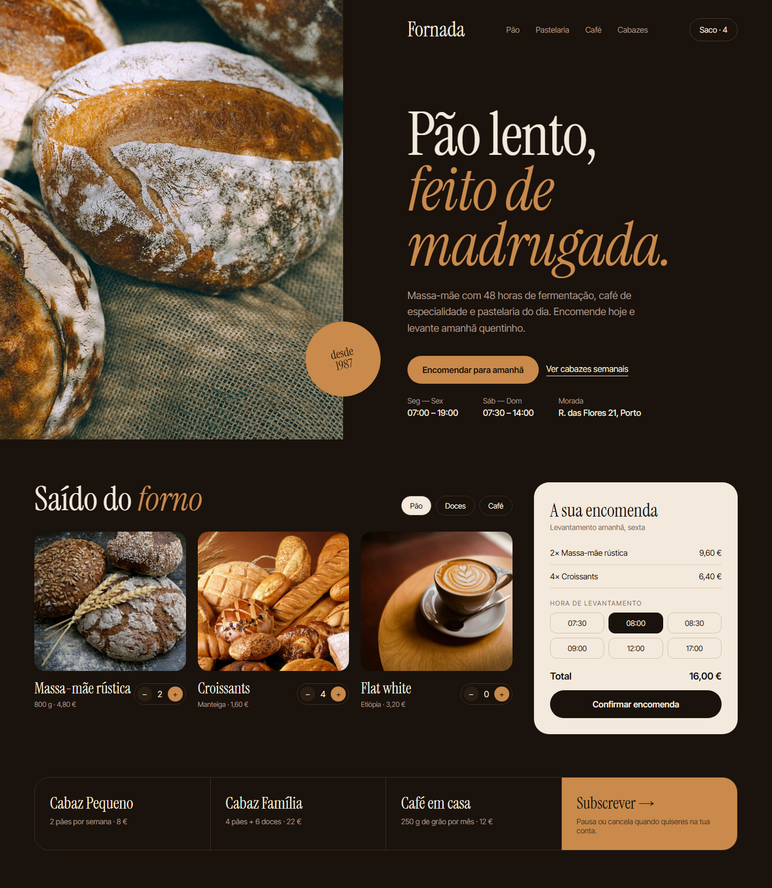
