<div align="center">


# Lente Studio

**Estúdio de fotografia e vídeo no Porto — portefólio e galerias privadas para clientes**


[Funcionalidades](#-funcionalidades) · [Capturas](#-capturas) · [Tecnologias](#-tecnologias) · [Como pôr a correr](#-como-pôr-a-correr) · [API](#-api)

</div>

<br>

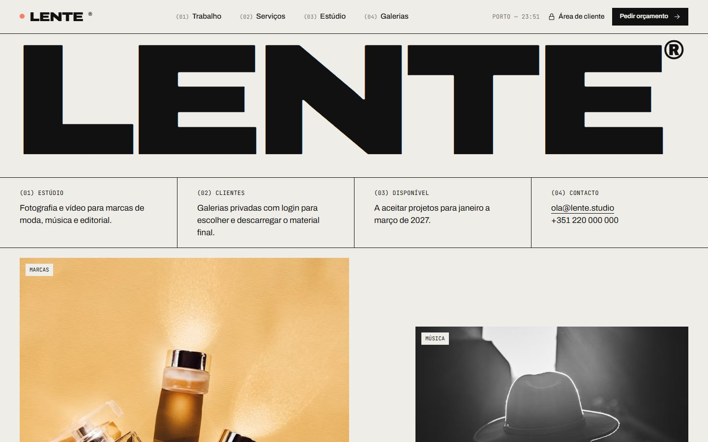

## 📷 Sobre o projeto

O Lente Studio é o site de um **estúdio de fotografia e vídeo** que trabalha com marcas de moda, música, editorial e hotelaria. Mostra o portefólio, os serviços com preços de referência, a equipa e o espaço, e recebe pedidos de orçamento.

A parte mais importante é a **área de cliente**: cada cliente entra com email e palavra-passe e vê só as suas galerias privadas, onde marca as fotografias favoritas para retoque e descarrega o material final quando o estúdio o liberta. O estúdio gere tudo num painel: pedidos, galerias, clientes e projetos.

Funciona **sem base de dados**: os dados vivem em memória e já trazem projetos, galerias, pedidos e contas de exemplo, mas o backend está completo — login com JWT, permissões por perfil, validação e regras de acesso às galerias.

O design é editorial e tipográfico: letra larga em negrito, detalhes em mono, linhas finas e um vermelho forte como única cor.

## ✨ Funcionalidades

<table>
  <tr>
    <th width="33%">Para quem visita</th>
    <th width="33%">Para o cliente</th>
    <th width="33%">Para o estúdio</th>
  </tr>
  <tr valign="top">
    <td>
      • Portefólio com filtros por categoria<br>
      • Vista em grelha ou em lista<br>
      • Página de cada projeto com galeria<br>
      • Serviços com preços e processo<br>
      • Equipa, espaço e equipamento<br>
      • Pedido de orçamento guiado<br>
      • Newsletter
    </td>
    <td>
      • Entrar na área de cliente<br>
      • Ver só as suas galerias<br>
      • Fotografias em ecrã inteiro<br>
      • Marcar favoritas para retoque<br>
      • Filtrar só as favoritas<br>
      • Descarregar uma, as favoritas ou tudo<br>
      • Aviso de quando a galeria expira
    </td>
    <td>
      • Resumo com pedidos e downloads<br>
      • Mudar o estado dos pedidos<br>
      • Criar galerias para clientes<br>
      • Ativar o download quando aprovado<br>
      • Prolongar ou apagar galerias<br>
      • Criar acessos de clientes<br>
      • Publicar e destacar projetos
    </td>
  </tr>
</table>

## 📸 Capturas

| Trabalho | Projeto |
|---|---|
| 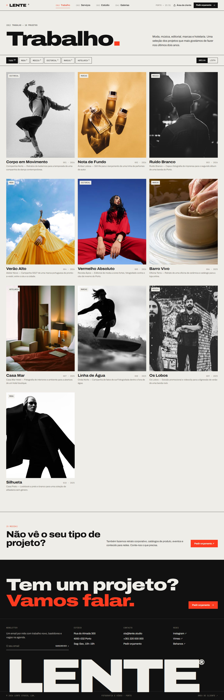 | 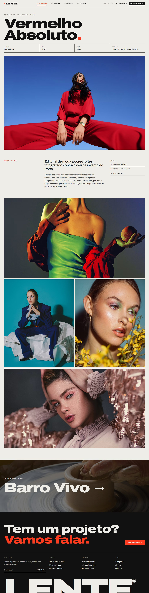 |
| **Serviços** | **Estúdio** |
| 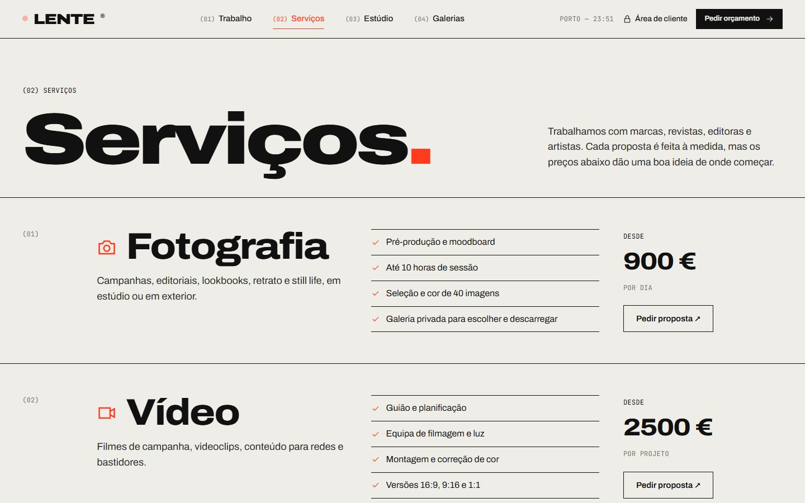 | 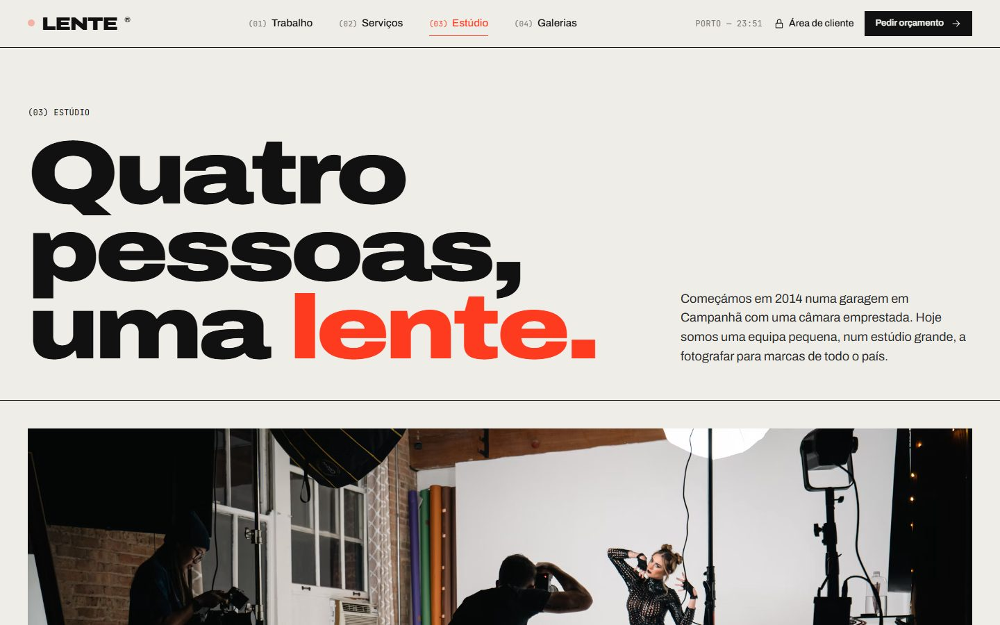 |
| **Pedir orçamento** | **Entrar** |
| 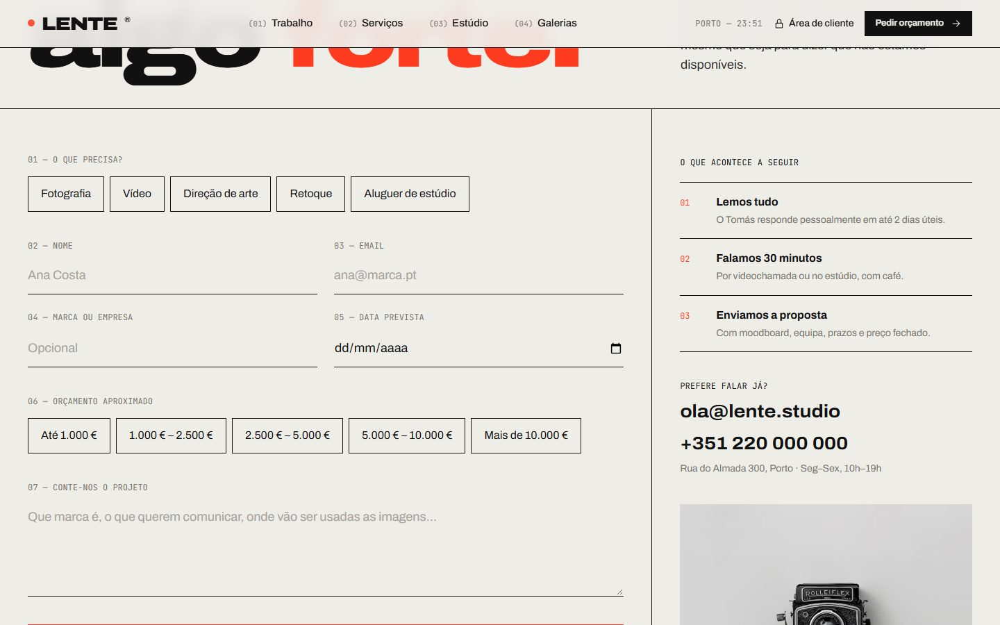 | 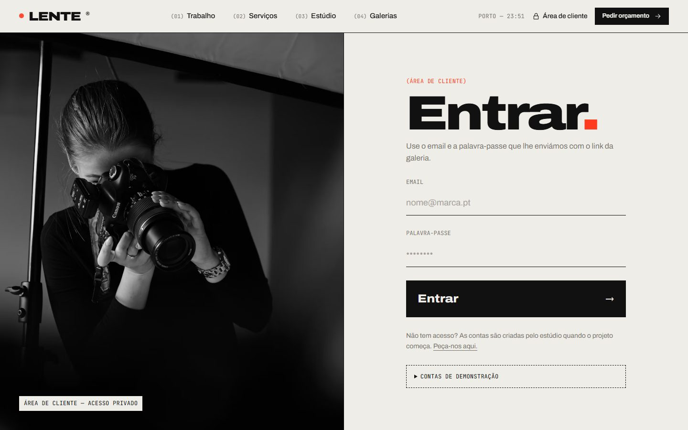 |
| **As minhas galerias** | **Galeria privada** |
| 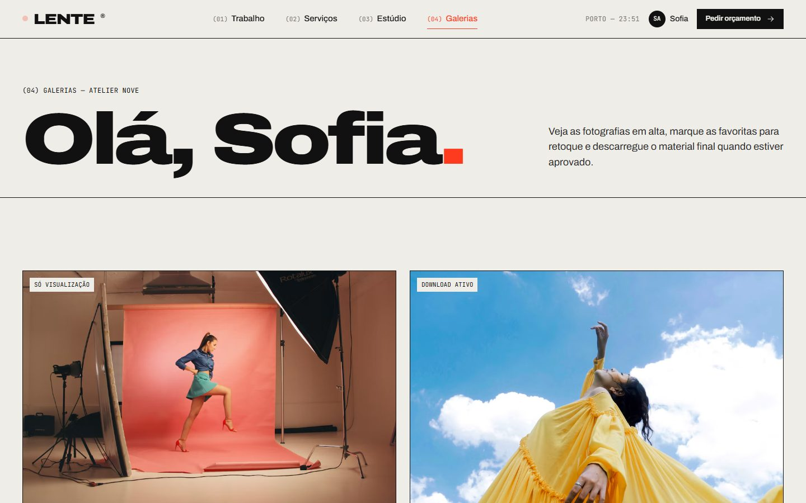 | 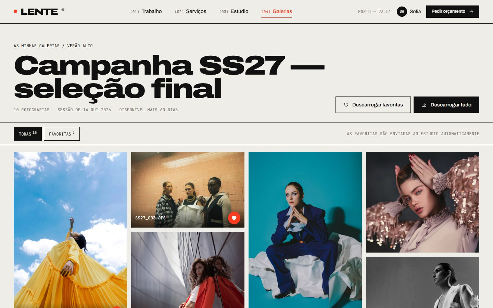 |
| **Painel do estúdio** | **Página inicial completa** |
| 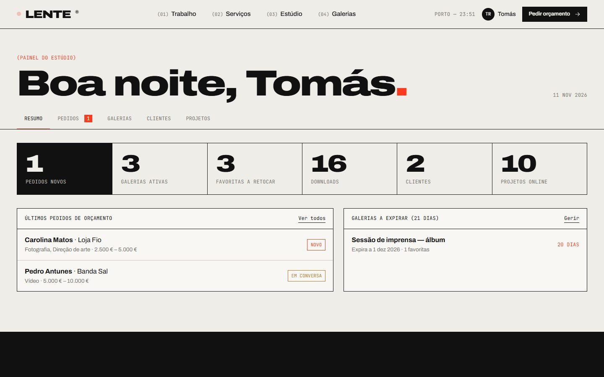 | 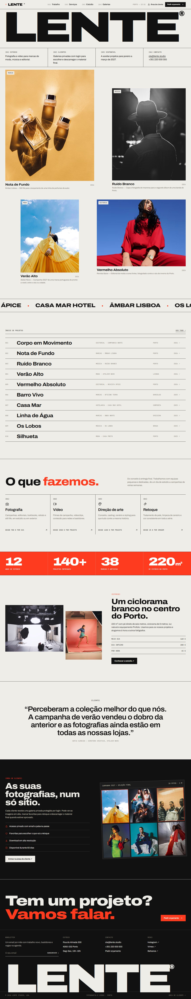 |

### 📱 No telemóvel

Todas as páginas são responsivas (testadas de 360 px a 1920 px). No telemóvel a navegação abre um menu em ecrã inteiro.

<p align="center">
  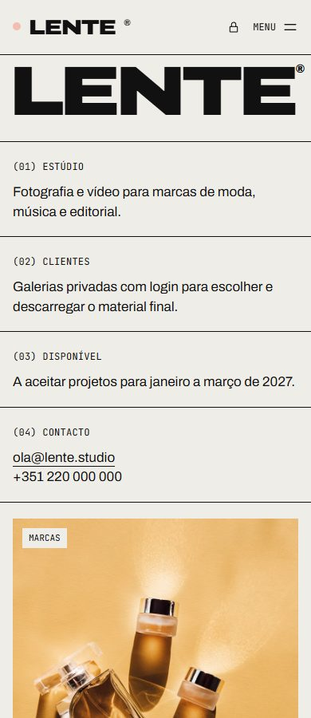
  &nbsp;&nbsp;
  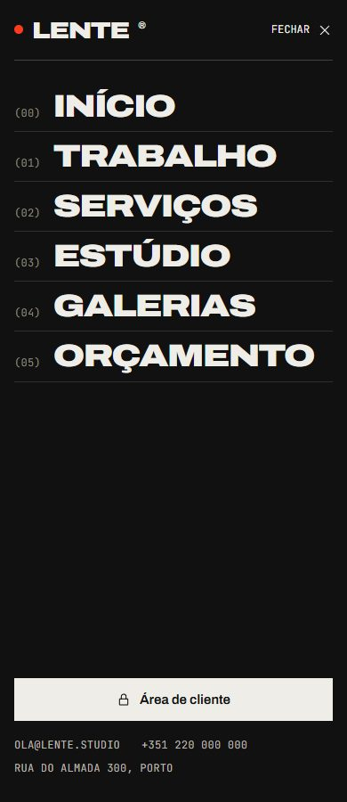
</p>

## 🧰 Tecnologias

| | Tecnologia | Para quê |
|---|---|---|
| ⚙️ | **Node.js 22+** e **Express 5** | Servidor, API e páginas |
| 🔐 | **jsonwebtoken** e **bcryptjs** | Login com access token e refresh token, palavras-passe cifradas |
| 🛡️ | **helmet**, **express-rate-limit**, **cors** | Cabeçalhos de segurança, CSP e limite de tentativas |
| ✅ | **zod** | Validação de todos os pedidos, com mensagens em português |
| 🎨 | **HTML, CSS e JavaScript** | Frontend sem build, com módulos ES e ícones SVG próprios |
| 🔤 | **Archivo** e **JetBrains Mono** | Tipografia (Google Fonts) |

## 🚀 Como pôr a correr

Precisa do [Node.js](https://nodejs.org) 22 ou mais recente.

```bash
cd lente
npm install
cp .env.example .env
npm run dev
```

Abrir **<http://localhost:3000>**. O `npm run dev` reinicia o servidor sempre que um ficheiro muda; em produção usar `npm start`.

### Contas de demonstração

Todas com a palavra-passe `lente1234` (também aparecem na página de entrar).

| Email | Perfil | Abre em |
|---|---|---|
| `cliente@lente.pt` | Cliente — Atelier Nove | 2 galerias (uma com download, outra só para ver) |
| `banda@lente.pt` | Cliente — Ruído Branco | 1 galeria |
| `estudio@lente.pt` | Administração | Painel do estúdio |

> [!NOTE]
> Os dados estão em memória, por isso tudo volta ao estado inicial quando o servidor reinicia.

> [!TIP]
> Não há registo público: as contas de cliente são criadas pelo estúdio no painel, separador **Clientes**.

## 🔌 API

Todas as rotas começam por `/api`. As marcadas com 🔒 precisam do cabeçalho `Authorization: Bearer <accessToken>`.

<details>
<summary><strong>Autenticação</strong></summary>

| Método | Rota | Descrição |
|---|---|---|
| POST | `/auth/login` | Entrar |
| POST | `/auth/refresh` | Novo access token a partir do cookie de refresh |
| POST | `/auth/logout` | Terminar sessão |
| GET / PATCH | `/auth/me` 🔒 | Ver e editar os dados da conta |
| PATCH | `/auth/me/password` 🔒 | Mudar a palavra-passe |

</details>

<details>
<summary><strong>Portefólio e orçamentos</strong></summary>

| Método | Rota | Descrição |
|---|---|---|
| GET | `/projects?category&featured` | Projetos publicados e categorias |
| GET | `/projects/:slug` | Detalhe de um projeto e o seguinte |
| GET | `/services` | Serviços e preços de referência |
| GET | `/quotes/options` | Serviços e escalões de orçamento do formulário |
| POST | `/quotes` | Enviar pedido de orçamento |
| POST | `/newsletter` | Subscrever a newsletter |

</details>

<details>
<summary><strong>Galerias do cliente</strong></summary>

| Método | Rota | Descrição |
|---|---|---|
| GET | `/galleries` 🔒 | Galerias do cliente (o admin vê todas) |
| GET | `/galleries/:id` 🔒 | Fotografias de uma galeria |
| POST | `/galleries/:id/photos/:photoId/favorite` 🔒 | Marcar ou tirar das favoritas |
| POST | `/galleries/:id/download` 🔒 | Links em alta resolução (todas ou só algumas) |

</details>

<details>
<summary><strong>Painel do estúdio</strong> (só admin)</summary>

| Método | Rota | Descrição |
|---|---|---|
| GET | `/admin/overview` 🔒 | Números, últimos pedidos e galerias a expirar |
| GET / PATCH | `/admin/quotes[/:id]` 🔒 | Listar pedidos e mudar o estado |
| GET / POST | `/admin/clients` 🔒 | Listar e criar acessos de clientes |
| GET / POST | `/admin/galleries` 🔒 | Listar e criar galerias |
| PATCH / DELETE | `/admin/galleries/:id` 🔒 | Ativar download, prolongar ou apagar |
| GET / PATCH | `/admin/projects[/:id]` 🔒 | Publicar e destacar projetos |

</details>

### 🔐 Regras de acesso às galerias

- Um cliente só vê as suas galerias; as dos outros respondem como se não existissem.
- Depois da data de expiração a galeria fecha para o cliente, mas o estúdio continua a vê-la e pode prolongá-la.
- O download só funciona quando o estúdio o ativa; antes disso o cliente pode ver e escolher favoritas.
- O login usa access token de 15 minutos e refresh token de 7 dias num cookie `httpOnly`, renovado automaticamente.

## 📋 Antes de ir para produção

- [ ] Definir `JWT_ACCESS_SECRET` e `JWT_REFRESH_SECRET` longos no `.env` e `NODE_ENV=production`
- [ ] Servir com HTTPS — em produção o cookie de refresh só viaja por ligação segura
- [ ] Guardar as fotografias num serviço de ficheiros (S3, Cloudinary…) e gerar ZIPs para "descarregar tudo"
- [ ] Enviar email ao cliente quando uma galeria é criada e ao estúdio quando chega um pedido
- [ ] Trocar as fotografias de exemplo pelo portefólio real

## 🙏 Créditos

Fotografias do [Unsplash](https://unsplash.com/license), de uso gratuito.
