# Maré — casas de férias em Lagos

Site de **reservas diretas para alojamento local**: seis casas de férias no Algarve, com pesquisa por datas, calendário de disponibilidade, reserva com experiências, área do hóspede e painel de gestão para a proprietária.

Não usa base de dados: os dados vivem em memória (com exemplos já carregados), mas toda a lógica de backend está pronta — login com JWT, permissões por perfil, validação, preços por época, disponibilidade e regras de cancelamento. Para ligar uma base de dados basta trocar a camada `src/repositories/`.

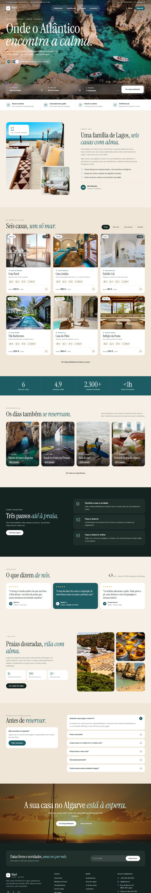

## Páginas

| Página | Endereço | O que faz |
|---|---|---|
| Início | `/` | Pesquisa por datas, casas com filtros, experiências e guia da região |
| Alojamentos | `/alojamentos` | Lista com filtros por datas, hóspedes e tipo, e disponibilidade em tempo real |
| Casa | `/alojamentos/:slug` | Galeria, comodidades, calendário com preço por noite, avaliações e caixa de reserva |
| Reserva | `/reserva` | Confirmação da estadia, experiências extra, dados do hóspede e condições |
| Entrar | `/entrar` | Login e criação de conta |
| A minha conta | `/conta` | Reservas, check-in online, juntar experiências, cancelar e editar dados |
| Painel | `/painel` | Pedidos por confirmar, reservas, preços das casas, bloqueio de datas e mensagens |
| Experiências | `/experiencias` | Passeios e atividades que se juntam à reserva |
| A região | `/regiao` | Guia de praias, restaurantes e informação prática |
| Contactos | `/contactos` | Formulário de contacto (as mensagens aparecem no painel) |

| | |
|---|---|
| 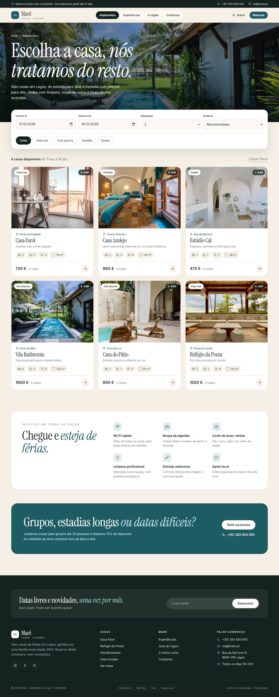 | 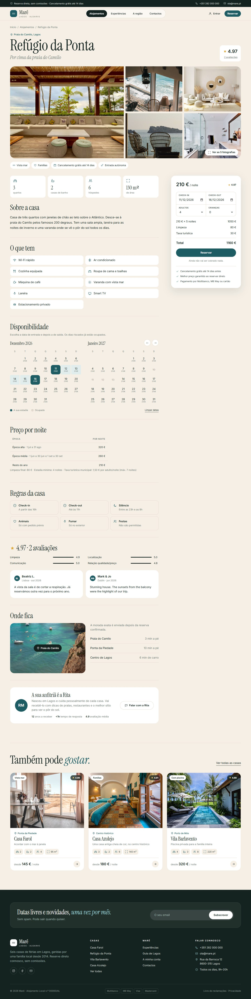 |
| 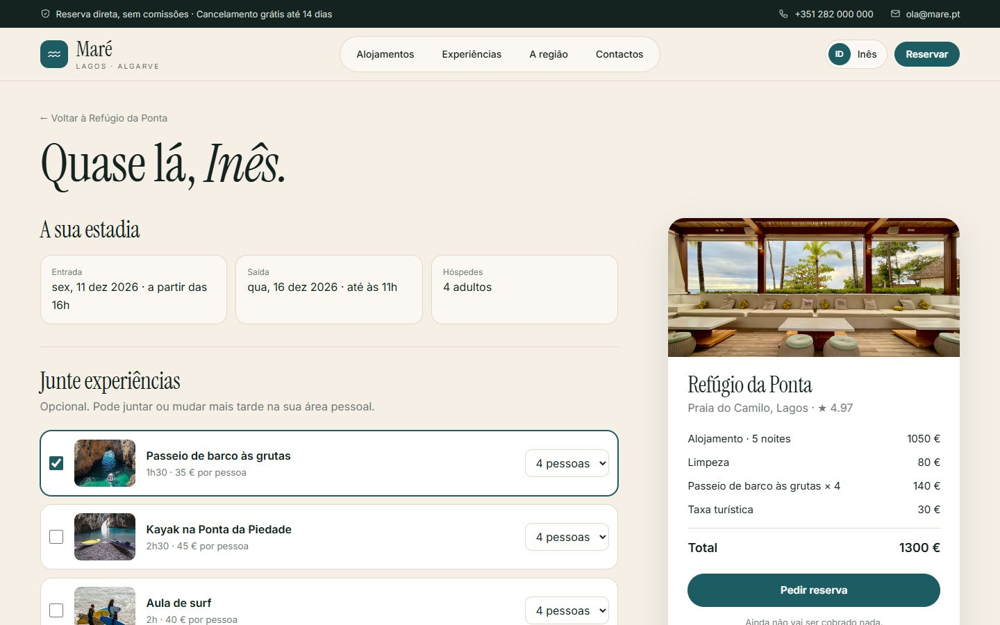 | 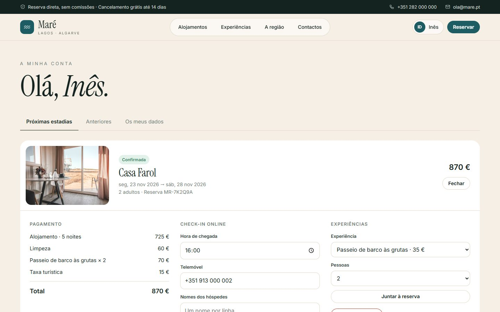 |
| 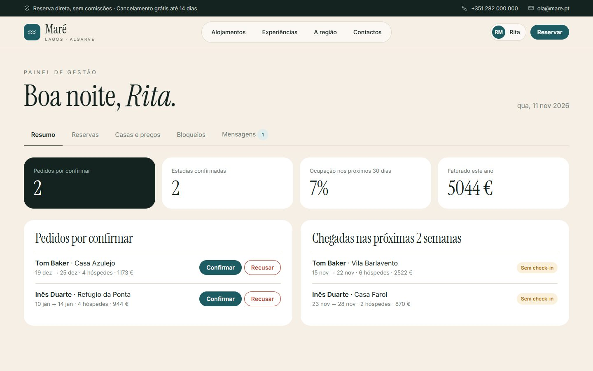 | 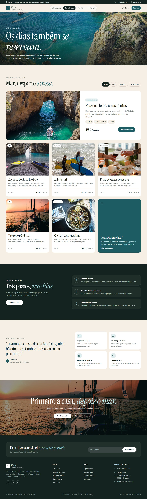 |
| 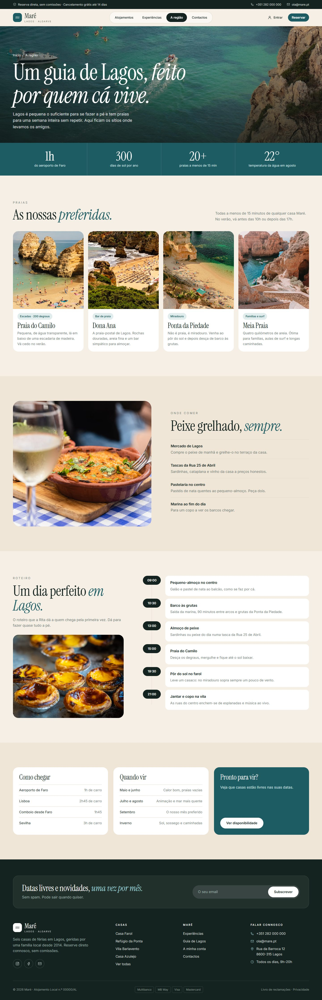 | 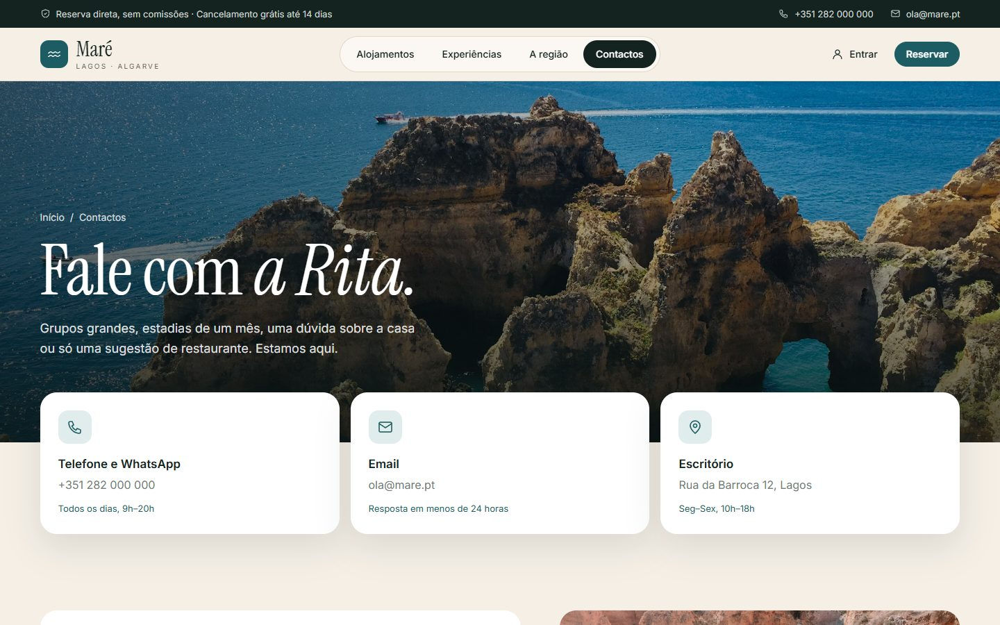 |

### Telemóvel

Todas as páginas são responsivas (testadas de 360 px a 1920 px). No telemóvel a navegação passa para um menu lateral e a página de cada casa ganha uma barra fixa para reservar.

<p align="center">
  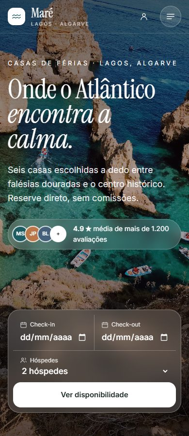
  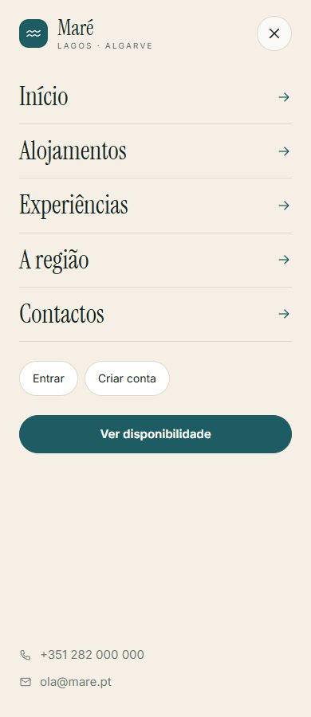
</p>

## Stack

| Parte | Tecnologia |
|---|---|
| Servidor | Node.js 22+ e Express 5 |
| Autenticação | `jsonwebtoken` (access token + refresh token) e `bcryptjs` |
| Segurança | `helmet` (com CSP), `express-rate-limit`, `cors`, `cookie-parser` |
| Validação | `zod` (mensagens em português) |
| Dados | Repositórios em memória com dados de exemplo |
| Frontend | HTML, CSS e JavaScript (módulos ES), sem build |
| Tipografia | Instrument Serif e Inter (Google Fonts) |

## Como pôr a correr

Precisa do [Node.js](https://nodejs.org) 22 ou mais recente.

```bash
cd mare
npm install
cp .env.example .env
npm run dev
```

Abrir <http://localhost:3000>. O `npm run dev` reinicia o servidor sempre que um ficheiro muda; em produção usar `npm start`.

### Contas de demonstração

Todas com a palavra-passe `mare1234` (também aparecem na página de entrar):

| Email | Perfil | Vê |
|---|---|---|
| `hospede@mare.pt` | hóspede | A minha conta |
| `dono@mare.pt` | proprietária | Painel de gestão das suas casas |
| `admin@mare.pt` | administração | Painel de gestão de todas as casas |

Como os dados estão em memória, tudo volta ao estado inicial quando o servidor reinicia.

## Estrutura

```
mare/
├── docs/                   # Capturas usadas neste README
├── public/                 # Frontend servido pelo Express
│   ├── css/                # base, layout, componentes e uma folha por página
│   ├── js/
│   │   ├── api.js          # fetch com token e renovação automática da sessão
│   │   ├── session.js      # login, registo, logout e páginas protegidas
│   │   ├── layout.js       # navbar, menu de telemóvel e rodapé
│   │   ├── icons.js        # ícones SVG usados no site
│   │   ├── calendar.js     # calendário de disponibilidade
│   │   └── pages/          # um ficheiro por página
│   └── *.html
└── src/
    ├── config/env.js       # variáveis de ambiente
    ├── data/seed.js        # casas, experiências, utilizadores e reservas de exemplo
    ├── repositories/       # acesso a dados (trocar aqui pela base de dados)
    ├── services/           # preços, disponibilidade, reservas, auth e painel
    ├── controllers/
    ├── routes/
    ├── middleware/         # auth (JWT e perfis), validação e erros
    ├── validation/         # esquemas zod
    ├── app.js
    └── server.js
```

## API

Todas as rotas estão em `/api`. As marcadas com 🔒 precisam do cabeçalho `Authorization: Bearer <accessToken>`.

| Método | Rota | Descrição |
|---|---|---|
| POST | `/auth/register` | Criar conta (perfil `hospede`) |
| POST | `/auth/login` | Entrar |
| POST | `/auth/refresh` | Novo access token a partir do cookie de refresh |
| POST | `/auth/logout` | Terminar sessão |
| GET / PATCH | `/auth/me` 🔒 | Ver e editar os dados da conta |
| PATCH | `/auth/me/password` 🔒 | Mudar a palavra-passe |
| GET | `/properties?checkIn&checkOut&guests&tag` | Casas com disponibilidade e preço para as datas |
| GET | `/properties/:slug` | Detalhe de uma casa |
| GET | `/properties/:slug/calendar?from&to` | Preço e disponibilidade por noite |
| GET | `/experiences` | Experiências |
| POST | `/bookings/quote` | Calcular o preço de uma estadia |
| POST | `/bookings` 🔒 | Criar reserva |
| GET | `/bookings/mine` 🔒 | Reservas do utilizador |
| GET | `/bookings/:code` 🔒 | Detalhe de uma reserva |
| POST | `/bookings/:code/cancel` 🔒 | Cancelar |
| POST | `/bookings/:code/checkin` 🔒 | Check-in online |
| POST | `/bookings/:code/extras` 🔒 | Juntar uma experiência |
| GET | `/owner/overview` 🔒 | Resumo do painel (proprietária e admin) |
| GET / PATCH | `/owner/bookings[/:code]` 🔒 | Listar e mudar o estado das reservas |
| GET / PATCH | `/owner/properties[/:id]` 🔒 | Preços, limpeza, estadia mínima e visibilidade |
| GET / POST / DELETE | `/owner/blocks[/:id]` 🔒 | Bloquear datas |
| GET / PATCH | `/owner/messages[/:id]` 🔒 | Mensagens do formulário de contacto |
| POST | `/contact` | Enviar mensagem |
| POST | `/newsletter` | Subscrever a newsletter (formulário do rodapé) |

### Como funciona o login

- O **access token** dura 15 minutos e fica no `localStorage`; vai em cada pedido protegido.
- O **refresh token** dura 7 dias e fica num cookie `httpOnly` limitado a `/api/auth`, por isso o JavaScript da página não lhe consegue tocar.
- Quando o access token expira, `public/js/api.js` pede um novo ao `/auth/refresh` e repete o pedido sem o utilizador dar por nada.
- Cada refresh gera um token novo e invalida o anterior. Se um token já usado aparecer outra vez, todas as sessões desse utilizador são terminadas.

## Ligar uma base de dados

Toda a leitura e escrita passa pelos repositórios em `src/repositories/index.js`, criados com `createRepository()`. Cada um tem os mesmos métodos assíncronos:

```js
findAll(filter)   findById(id)   findOne(predicate)   create(data)   update(id, changes)   remove(id)
```

Para usar MongoDB, PostgreSQL ou outra, basta escrever uma versão destes métodos para cada coleção e trocar as exportações em `index.js`. Os serviços, rotas e frontend continuam iguais. Os dados de exemplo de `src/data/seed.js` servem de referência para o formato das tabelas.

## Antes de ir para produção

- Definir `JWT_ACCESS_SECRET` e `JWT_REFRESH_SECRET` longos no `.env` e `NODE_ENV=production` (o servidor recusa arrancar sem eles).
- Servir com HTTPS — em produção o cookie de refresh só é enviado por ligação segura.
- **Pagamentos:** as reservas ficam `pendente` até a proprietária confirmar. O sítio natural para ligar Stripe, Easypay ou MB Way é `createBooking` em `src/services/booking.service.js`, ou a confirmação em `changeStatus` (`src/services/owner.service.js`).
- **Emails:** enviar confirmação ao hóspede nos mesmos dois sítios e avisar a proprietária em `src/routes/contact.routes.js`.
- Trocar as fotografias pelas das casas reais e o número de registo de Alojamento Local no rodapé (`public/js/layout.js`).

## Créditos

Fotografias do [Unsplash](https://unsplash.com/license), de uso gratuito.
