<div align="center">


# Pilha

**Estúdio de marcas e sites (fictício) em Lisboa. Os serviços são blocos coloridos que caem do topo da página, ficam empilhados no chão e se podem arrastar e atirar: cada bloco abre o serviço ou um trabalho.**


[Funcionalidades](#-funcionalidades) · [O design](#-o-design) · [Capturas](#-capturas) · [Tecnologias](#-tecnologias) · [Lighthouse](#-seo-e-desempenho) · [Como pôr a correr](#-como-pôr-a-correr) · [API](#-api)

</div>

<br>

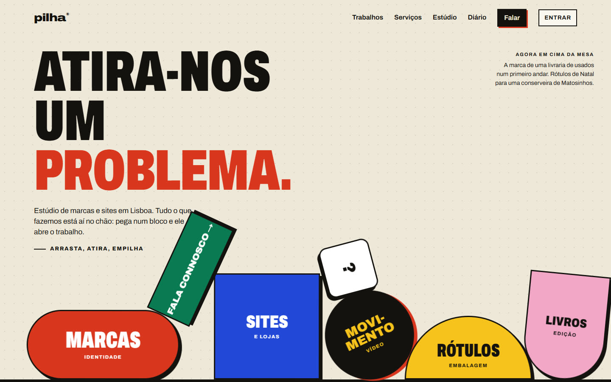

## 🧱 Sobre o projeto

A Pilha é um estúdio inventado que faz marcas, sites e lojas, movimento, rótulos e livros. O site tem três partes: as **páginas públicas** (geradas no servidor), a **área de cliente**, onde cada cliente acompanha o seu projeto, aprova provas e fala com o estúdio, e o **painel do estúdio**, onde a equipa gere os pedidos de orçamento, os projetos, os trabalhos publicados e o diário.

**Dados fictícios.** O estúdio, as pessoas, os clientes, os trabalhos e os textos foram inventados para a demonstração. As imagens dos trabalhos não são fotografias: são composições desenhadas em HTML e SVG e fotografadas para webp pelo script em `scripts/imagens`. As datas são calculadas a partir do dia em que o servidor arranca, por isso a demonstração parece sempre atual. Funciona **sem base de dados**: os dados vivem em memória, em repositórios prontos a trocar por uma base de dados real.

## ✨ Funcionalidades

<table>
  <tr>
    <th width="33%">Para quem visita</th>
    <th width="33%">Para o cliente</th>
    <th width="33%">Para o estúdio</th>
  </tr>
  <tr valign="top">
    <td>
      • A pilha: 7 blocos com física a sério que caem, se arrastam, se atiram e voltam a cair<br>
      • Um toque num bloco abre o serviço; o “?” abre um trabalho ao calhas; “Fala connosco” abre o contacto<br>
      • Teclado: cada bloco é um link e a barra de espaços dá-lhe um pulo; “Voltar a empilhar” deixa-os cair de novo<br>
      • “Agora em cima da mesa”: os projetos em curso, sem nomes de clientes<br>
      • Trabalhos com filtro por bloco e página de cada projeto, com pormenores e o próximo trabalho<br>
      • Serviços com o que inclui, prazo habitual e ordem de grandeza do preço<br>
      • Estúdio (pessoas, fases, onde estamos) e diário<br>
      • Formulário de briefing: escolher os blocos, contar o problema, orçamento e prazo; recebe uma referência
    </td>
    <td>
      • Entrar com email e palavra-passe<br>
      • As seis fases do projeto como uma fila de blocos: as feitas, a atual (que salta) e as datas previstas<br>
      • Provas com imagem, nota do estúdio e versão<br>
      • Aprovar ou pedir alterações (o comentário é obrigatório para pedir alterações)<br>
      • Histórico de decisões com o comentário dado<br>
      • Mensagens com o estúdio, marcadas como lidas ao abrir<br>
      • Vários projetos no mesmo acesso, com contador do que falta responder
    </td>
    <td>
      • Pedidos de briefing com estado (novo, em conversa, recusado) e nota interna<br>
      • “Aceitar e criar projeto”: cria o projeto e, se o cliente não tiver conta, uma conta com palavra-passe provisória mostrada uma única vez<br>
      • Projetos: mudar a fase, enviar provas (da biblioteca de imagens), responder ao cliente, ver o que está por aprovar e as mensagens novas<br>
      • Trabalhos publicados: criar, editar, publicar ou esconder, destacar na página inicial, apagar<br>
      • Diário: criar, editar, publicar ou guardar como rascunho, apagar
    </td>
  </tr>
</table>

## 🎨 O design

- **A pilha é o site.** Fundo creme pontilhado, o título enorme “ATIRA-NOS UM PROBLEMA.” em Archivo condensada e, no chão da página, os cinco serviços como blocos de formas diferentes: Marcas é uma pastilha vermelha, Sites um quadrado azul, Movimento um círculo preto, Rótulos um arco amarelo, Livros uma etiqueta cor-de-rosa. Juntam-se “Fala connosco →” e “?”.
- **Física a sério.** Os blocos são corpos rígidos do [Matter.js](https://brm.io/matter-js/) com a mesma forma que o desenho (arcos e cantos arredondados incluídos). O HTML acompanha cada corpo, por isso os blocos continuam a ser links normais, com foco e leitores de ecrã. A física só corre enquanto a pilha está à vista e para quando todos os blocos assentam.
- **Os blocos repetem-se em todo o site.** As etiquetas de serviço, os filtros dos trabalhos, os blocos para escolher no formulário, o “próximo trabalho”, as fases da área de cliente e os separadores do painel usam as mesmas formas e cores.
- **Bordas pretas e sombras duras.** Tudo tem contorno de 3 px e sombra deslocada sem desfoque, como peças de papel recortado. Ao passar por cima, os cartões endireitam-se e levantam-se.
- **Uma só letra.** Archivo variável (largura de 62 % a 125 %): muito estreita e pesada nos títulos, normal nos textos, larga no logótipo.
- **Sem fotografias de pessoas.** As pessoas do estúdio são fictícias e aparecem como o bloco que mais desenham, com as iniciais.

## 📸 Capturas

<table>
  <tr>
    <td width="50%">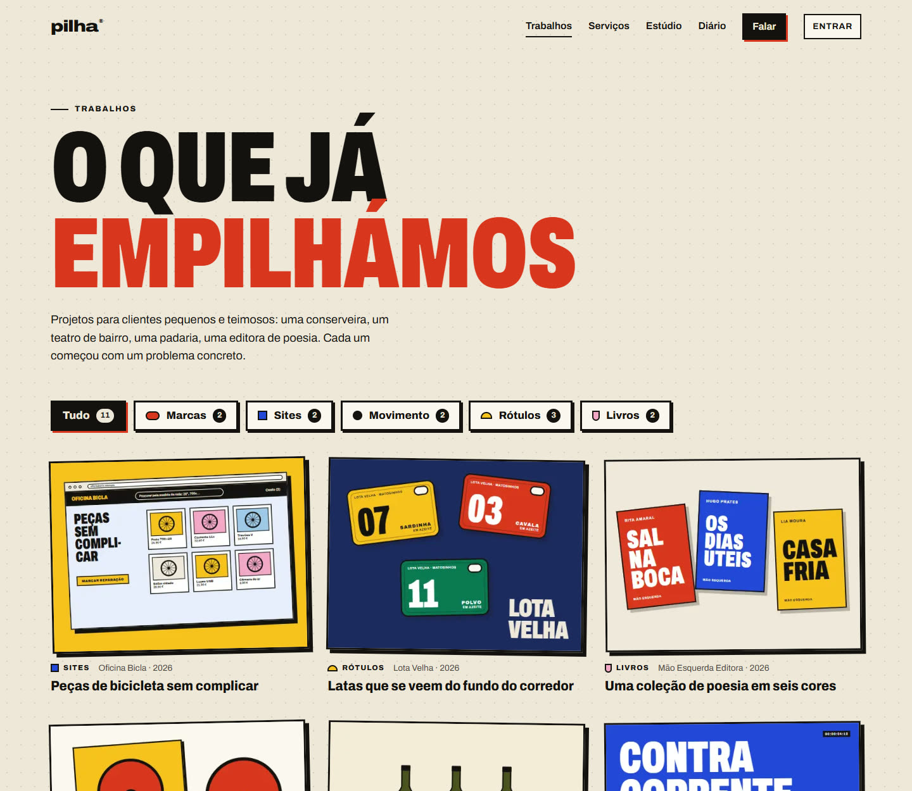<br><sub><b>Trabalhos</b> · filtro por bloco e cartões que se endireitam</sub></td>
    <td width="50%">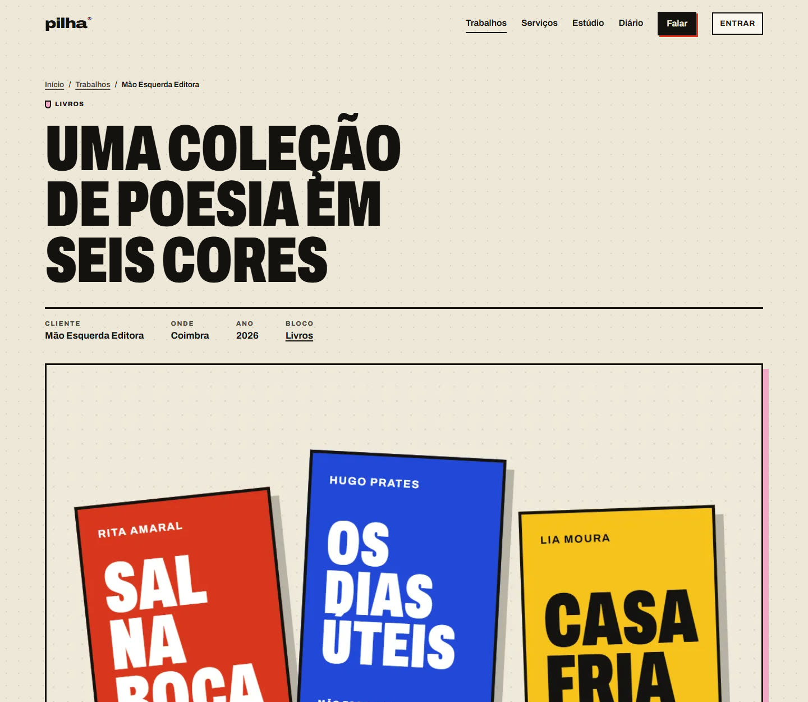<br><sub><b>Um trabalho</b> · capa, texto, pormenores e o próximo</sub></td>
  </tr>
  <tr>
    <td>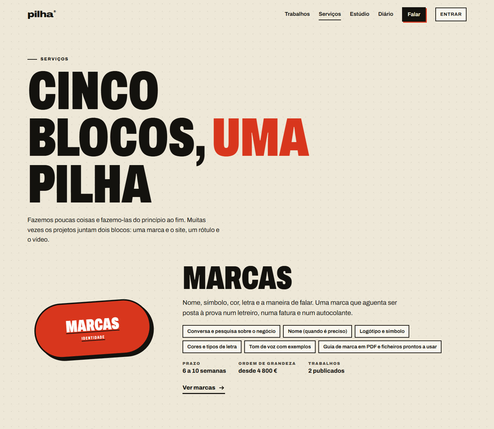<br><sub><b>Serviços</b> · cinco blocos, o que inclui, prazo e preço</sub></td>
    <td>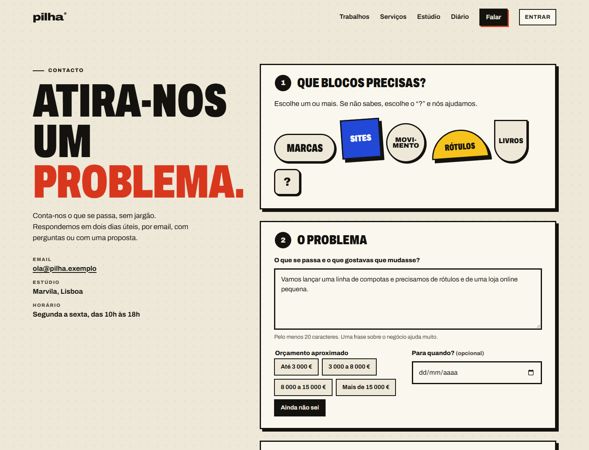<br><sub><b>Briefing</b> · escolher os blocos e contar o problema</sub></td>
  </tr>
  <tr>
    <td>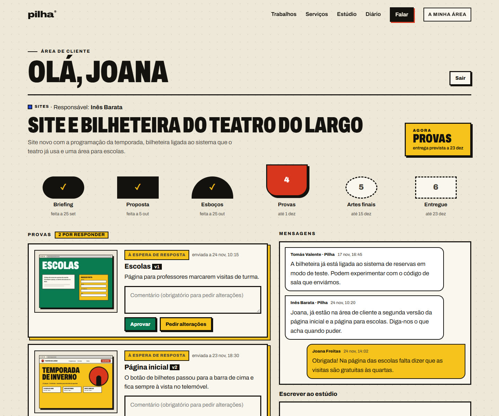<br><sub><b>Área de cliente</b> · fases, provas para aprovar e mensagens</sub></td>
    <td>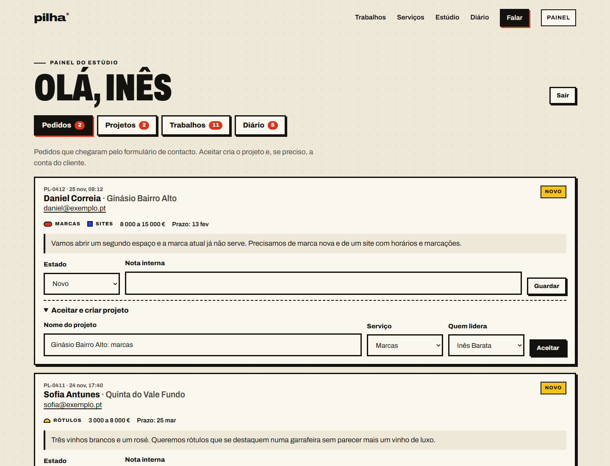<br><sub><b>Painel</b> · pedidos de briefing, aceitar e criar projeto</sub></td>
  </tr>
  <tr>
    <td>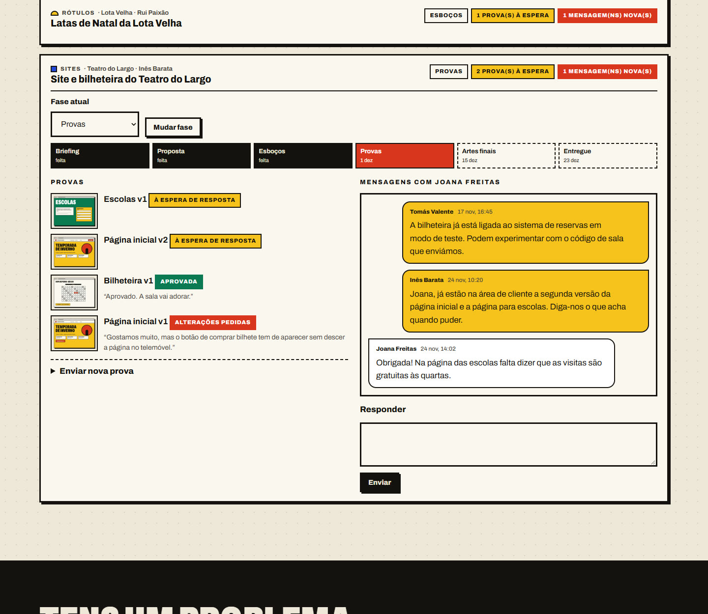<br><sub><b>Projeto no painel</b> · fase, provas e mensagens com o cliente</sub></td>
    <td>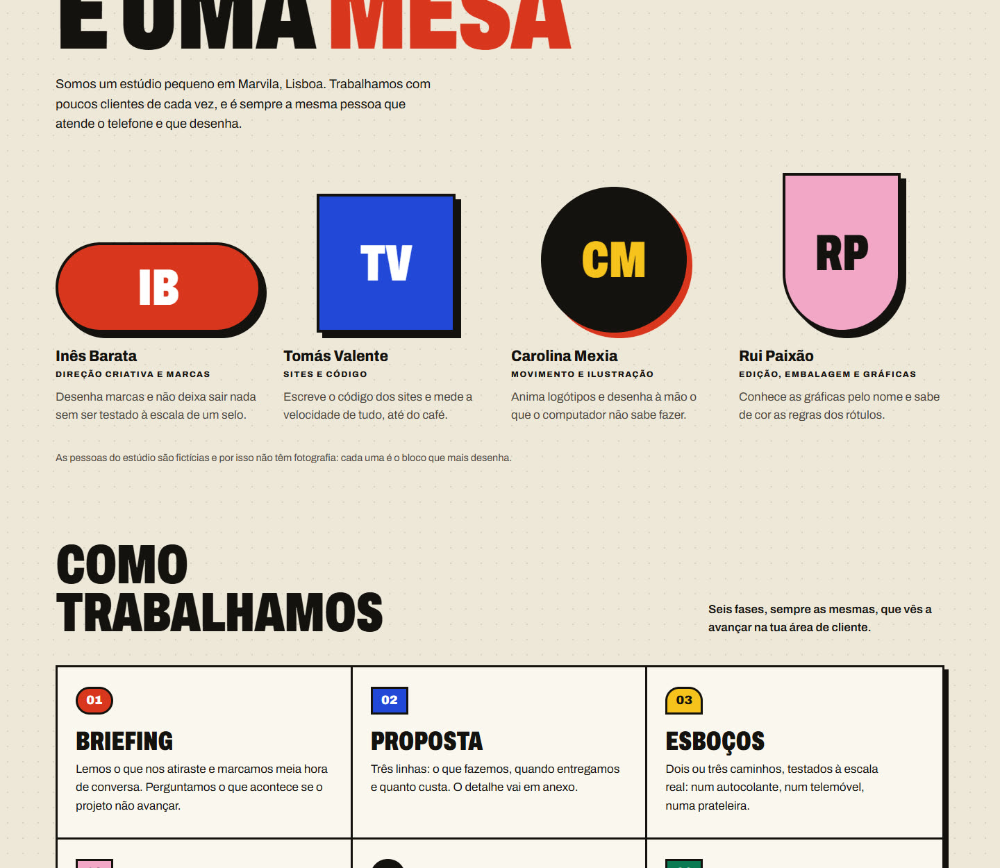<br><sub><b>Estúdio</b> · as pessoas como blocos e as seis fases</sub></td>
  </tr>
</table>

<p align="center">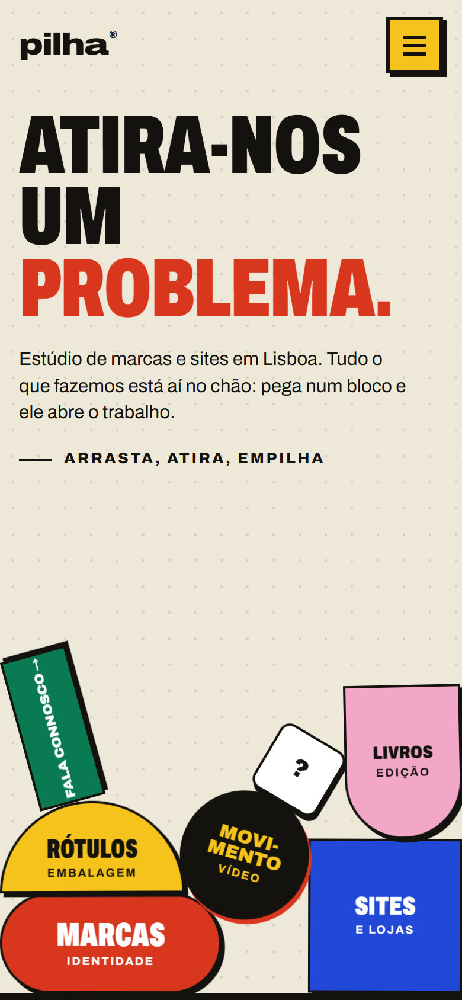 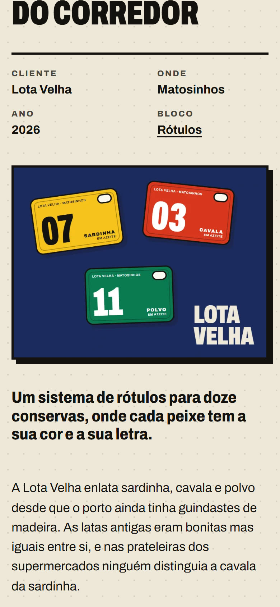 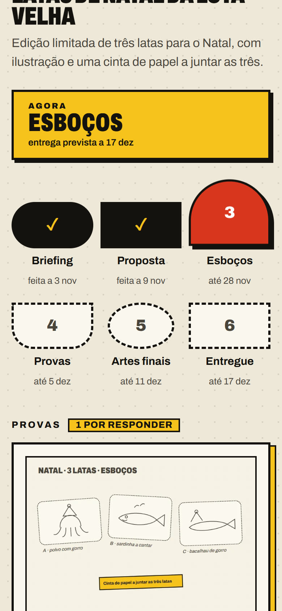</p>

## 🛠️ Tecnologias

| | |
| --- | --- |
| **Servidor** | Node.js 22+ e Express 5 em ES Modules, páginas públicas geradas no servidor |
| **Sessão** | JWT de 15 minutos e refresh token numa cookie `httpOnly` `SameSite=Strict`, rodado a cada uso (um refresh repetido termina todas as sessões da conta) |
| **Perfis** | `cliente` e `estudio`, com o perfil relido em cada pedido; o cliente só vê os seus projetos |
| **Validação** | express-validator em todas as entradas, com o erro junto a cada campo |
| **Segurança** | helmet (CSP sem scripts inline, HSTS em produção), express-rate-limit, bcryptjs, campo-armadilha e tempo mínimo no formulário de briefing |
| **Física** | Matter.js, servido pelo próprio site e carregado só na página inicial |
| **Browser** | JavaScript em módulos ES, um por página, sem frameworks |
| **Dados** | Repositórios em memória (`findAll`, `findById`, `create`, `update`, `remove`), datas calculadas a partir de hoje |
| **Imagens** | webp em 480, 800 e 1200 px com `srcset`, medidas reservadas e preload da principal |
| **Testes** | `node:test` com os fluxos principais (`npm test`) |

## 🚀 SEO e desempenho

Medido com o Lighthouse (Chrome sem janela), em telemóvel e computador:

| Página | Telemóvel | Computador |
| --- | :-: | :-: |
| Início (a pilha) | 100 · 100 · 100 · 100 | 100 · 100 · 100 · 100 |
| Trabalhos | 97 · 100 · 100 · 100 | 100 · 100 · 100 · 100 |
| Um trabalho | 99 · 100 · 100 · 100 | 100 · 100 · 100 · 100 |
| Serviços | 99 · 100 · 100 · 100 | 100 · 100 · 100 · 100 |
| Um serviço | 100 · 100 · 100 · 100 | 100 · 100 · 100 · 100 |
| Estúdio | 100 · 100 · 100 · 100 | 100 · 100 · 100 · 100 |
| Diário | 100 · 100 · 100 · 100 | 100 · 100 · 100 · 100 |
| Uma entrada do diário | 100 · 100 · 100 · 100 | 100 · 100 · 100 · 100 |
| Contacto | 100 · 100 · 100 · 100 | 100 · 100 · 100 · 100 |

<sub>Desempenho · Acessibilidade · Boas práticas · SEO. A página de entrar tem SEO 66 de propósito: está marcada com `noindex` por ser privada.</sub>

- Título, descrição, canonical, Open Graph e Twitter Card em todas as páginas; a página de cada trabalho partilha a própria capa
- JSON-LD: `WebSite`, `ProfessionalService` com o catálogo dos cinco serviços, `Service`, `CreativeWork` para cada trabalho, `BlogPosting` no diário, `AboutPage`, `ContactPage`, `ItemList` e `BreadcrumbList`
- `robots.txt` e `sitemap.xml` com os trabalhos e as entradas publicadas; entrar, área de cliente e painel com `noindex` e `no-store`
- Fonte local (Archivo variável, 90 KB) com `font-display: optional` e letras de reserva com medidas ajustadas; um só CSS
- A pilha não mexe no layout: os blocos movem-se só com `transform`, por isso não há saltos (CLS 0)
- Respeita `prefers-reduced-motion`: a pilha aparece já assente, sem queda, e as animações decorativas param

## ▶️ Como pôr a correr

```bash
npm install
cp .env.example .env
npm run dev
```

Abre em `http://localhost:3011`. Para correr os testes: `npm test`. Para gerar de novo as imagens: `node scripts/imagens/gerar.mjs` (precisa do Google Chrome).

| Perfil | Email | Palavra-passe |
| --- | --- | --- |
| Cliente com o site do teatro (provas por aprovar) | `teatro@cliente.exemplo` | `pilha-cliente-2026` |
| Cliente com os rótulos de Natal | `lota@cliente.exemplo` | `pilha-cliente-2026` |
| Cliente com uma marca a começar | `sotao@cliente.exemplo` | `pilha-cliente-2026` |
| Estúdio | `ines@pilha.exemplo` | `pilha-estudio-2026` |
| Estúdio | `tomas@pilha.exemplo` | `pilha-estudio-2026` |

Os dados voltam ao início sempre que o servidor reinicia.

## 🔌 API

| Método | Rota | Quem | O que faz |
| --- | --- | --- | --- |
| `POST` | `/api/auth/login` | Todos | Entrar; devolve o token e põe o refresh token na cookie |
| `POST` | `/api/auth/refresh` | Com cookie | Renova a sessão e roda o refresh token |
| `POST` | `/api/auth/logout` | Com cookie | Termina a sessão |
| `GET` | `/api/auth/me` | Com sessão | Dados da conta |
| `PATCH` | `/api/auth/me/password` | Com sessão | Mudar a palavra-passe (termina as outras sessões) |
| `GET` | `/api/trabalhos?tipo=` | Público | Trabalhos publicados, filtráveis por serviço |
| `GET` | `/api/diario` | Público | Entradas publicadas do diário |
| `POST` | `/api/briefing` | Público | Enviar um pedido de orçamento; devolve a referência |
| `GET` | `/api/cliente/projetos` | Cliente | Os seus projetos, com fases, provas e mensagens |
| `POST` | `/api/cliente/provas/:id/decisao` | Cliente | Aprovar ou pedir alterações a uma prova |
| `POST` | `/api/cliente/projetos/:id/mensagens` | Cliente | Escrever ao estúdio |
| `POST` | `/api/cliente/projetos/:id/lidas` | Cliente | Marcar as mensagens como lidas |
| `GET` | `/api/estudio/opcoes` | Estúdio | Listas para os formulários do painel |
| `GET` | `/api/estudio/pedidos` | Estúdio | Pedidos de briefing |
| `PATCH` | `/api/estudio/pedidos/:id` | Estúdio | Mudar o estado e a nota interna |
| `POST` | `/api/estudio/pedidos/:id/aceitar` | Estúdio | Criar o projeto (e a conta do cliente, se não existir) |
| `GET` | `/api/estudio/projetos` | Estúdio | Todos os projetos |
| `PATCH` | `/api/estudio/projetos/:id/fase` | Estúdio | Mudar a fase |
| `POST` | `/api/estudio/projetos/:id/provas` | Estúdio | Enviar uma prova ao cliente |
| `POST` | `/api/estudio/projetos/:id/mensagens` | Estúdio | Responder ao cliente |
| `POST` | `/api/estudio/projetos/:id/lidas` | Estúdio | Marcar as mensagens como lidas |
| `GET` `POST` `PUT` `DELETE` | `/api/estudio/trabalhos[/:id]` | Estúdio | Gerir os trabalhos publicados |
| `GET` `POST` `PUT` `DELETE` | `/api/estudio/diario[/:id]` | Estúdio | Gerir o diário |
| `GET` | `/api/estudio/clientes` | Estúdio | Lista de clientes |

## 📁 Estrutura

```
pilha/
├── src/
│   ├── config/        # estúdio, serviços (forma e cor de cada bloco), fases, imagens
│   ├── data/seed.js   # dados fictícios com datas a partir de hoje
│   ├── repositories/  # repositórios em memória
│   ├── services/      # regras: autenticação, projetos, pedidos, conteúdos
│   ├── routes/        # API e páginas
│   ├── seo/           # cabeçalho e JSON-LD
│   └── views/         # HTML das páginas
├── public/
│   ├── css/           # base, componentes e um ficheiro por página (servidos juntos)
│   ├── js/            # módulos do browser; pages/pilha.js é a física da página inicial
│   ├── fonts/ img/
├── scripts/imagens/   # composições dos trabalhos e o gerador de webp
└── test/              # testes dos fluxos
```

<sub>Estúdio, pessoas, clientes e trabalhos fictícios. As imagens são composições originais feitas para este projeto. Archivo é distribuída pela Omnibus-Type sob a SIL Open Font License; Matter.js sob a licença MIT.</sub>
