<div align="center">


# Planta

**Site de uma arquiteta em que a página inicial é a planta do atelier: cada divisão é um projeto e, ao passar por cima, aparece a casa construída**


[Funcionalidades](#-funcionalidades) · [O design](#-o-design) · [Capturas](#-capturas) · [Tecnologias](#-tecnologias) · [SEO e desempenho](#-seo-e-desempenho) · [Como pôr a correr](#-como-pôr-a-correr) · [API](#-api)

</div>

<br>

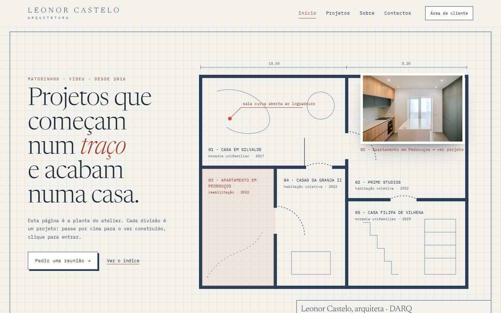

## 📐 Sobre o projeto

Redesign do site de um atelier de arquitetura, feito como exercício. A arquiteta, **Leonor Castelo**, é fictícia, tal como as moradas, os contactos e o percurso; os cinco projetos e as suas fotografias são de um atelier real do Grande Porto e são usados aqui só para mostrar o design.

O site é todo uma **folha de desenho técnico**: papel quadriculado, moldura, cotas, rosa dos ventos e um **carimbo** no canto de cada página com o número do desenho e a escala. A página inicial é a **planta do atelier**: cada divisão é um projeto, e passar por cima de uma divisão mostra a fotografia da casa construída, presa por cima da planta.

Dentro de cada projeto, a casa lê-se **pela planta verdadeira**: pinos numerados em cima do desenho mostram a fotografia e a explicação de cada sítio. Os clientes têm uma **área de cliente** que é o caderno do projeto (as cinco fases, como folhas numeradas A-100 a A-500, as reuniões, os desenhos entregues e as mensagens) e a arquiteta tem uma **mesa de trabalho** com os pedidos que chegam pelo site, as obras em curso e o portefólio.

Funciona **sem base de dados**: os dados vivem em memória e as datas são calculadas a partir de hoje, por isso há sempre pedidos recentes e reuniões marcadas para os próximos dias.

## ✨ Funcionalidades

<table>
  <tr>
    <th width="33%">Para quem visita</th>
    <th width="33%">Para o cliente</th>
    <th width="33%">Para a arquiteta</th>
  </tr>
  <tr valign="top">
    <td>
      • Planta interativa: cada divisão é um projeto, com a fotografia ao passar por cima<br>
      • Índice de projetos com a fotografia a aparecer na linha<br>
      • Catálogo filtrado por moradias, reabilitação e habitação coletiva<br>
      • Página de cada projeto com ficha técnica, história e galeria ampliável<br>
      • Planta do projeto com pinos que mostram cada sítio<br>
      • Teclas N e P para passar ao projeto seguinte ou anterior<br>
      • Pedido de reunião: o que tem, onde e o orçamento, com folha de "recebido"<br>
      • Esquema com os dois escritórios
    </td>
    <td>
      • Criar conta e entrar<br>
      • As cinco fases do projeto, com a que está em curso destacada<br>
      • Próximas reuniões e confirmação de presença<br>
      • Desenhos entregues em cada fase<br>
      • Mensagens com a arquiteta
    </td>
    <td>
      • Resumo: pedidos novos, mensagens por ler e próxima reunião<br>
      • Caixa de pedidos com filtros por estado, notas internas e mudança de estado<br>
      • Obras: avançar ou recuar de fase, marcar reuniões e responder a mensagens<br>
      • Portefólio: esconder projetos e mudar a ordem (é a ordem das divisões na planta)
    </td>
  </tr>
</table>

## 🧭 O design

- **Uma folha de desenho.** Fundo quadriculado, moldura fina à volta de cada cabeçalho e um carimbo de desenho técnico no canto (`LC-001 · início`, escala `1:100`). As letras são uma serifa fina para os títulos e uma mono para tudo o resto, como as legendas de uma planta.
- **A planta é o menu.** Desenhada em SVG com paredes, portas com o arco de abertura, uma escada, mobiliário e as cotas por cima. Cada divisão é um link; ao passar o rato (ou com o teclado) a divisão fica sombreada e a fotografia do projeto troca sem piscar, porque só muda depois de a nova estar carregada. No telemóvel as divisões mostram só o número, e os nomes continuam lá para os leitores de ecrã.
- **Ler a casa pela planta.** Na página de cada projeto, os pinos em cima da planta verdadeira mostram a nota e a fotografia de cada sítio; o pino escolhido pulsa.
- **Cinco folhas.** As fases de um projeto aparecem como folhas de papel quadriculado ligeiramente tortas, numeradas como num caderno de obra. A área de cliente usa as mesmas folhas, com a fase em curso a vermelho.
- **Pormenores**: a porta desenhada no "próximo projeto" abre ao passar o rato, a rota entre os dois escritórios anda, e o pedido enviado recebe um carimbo de "recebido" com o número do pedido.
- **Animações tranquilas**, e todas respeitam `prefers-reduced-motion`.

## 📸 Capturas

<table>
  <tr>
    <td width="50%">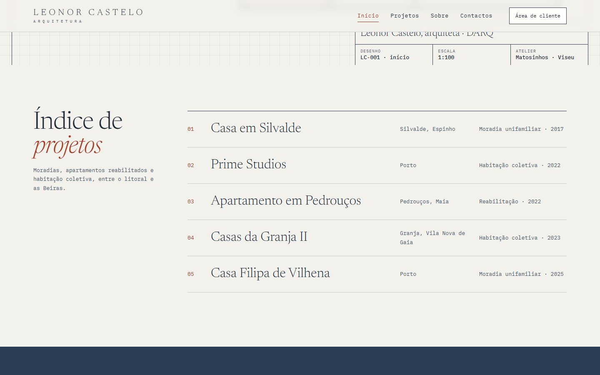<br><sub><b>Índice</b> · a fotografia aparece na linha ao passar o rato</sub></td>
    <td width="50%">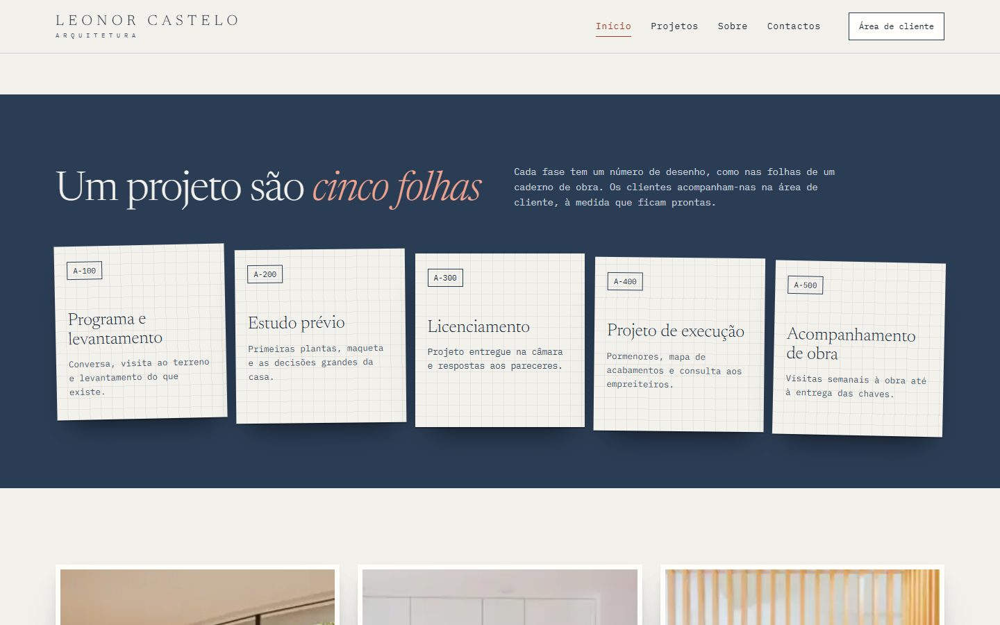<br><sub><b>Cinco folhas</b> · as fases de um projeto</sub></td>
  </tr>
  <tr>
    <td>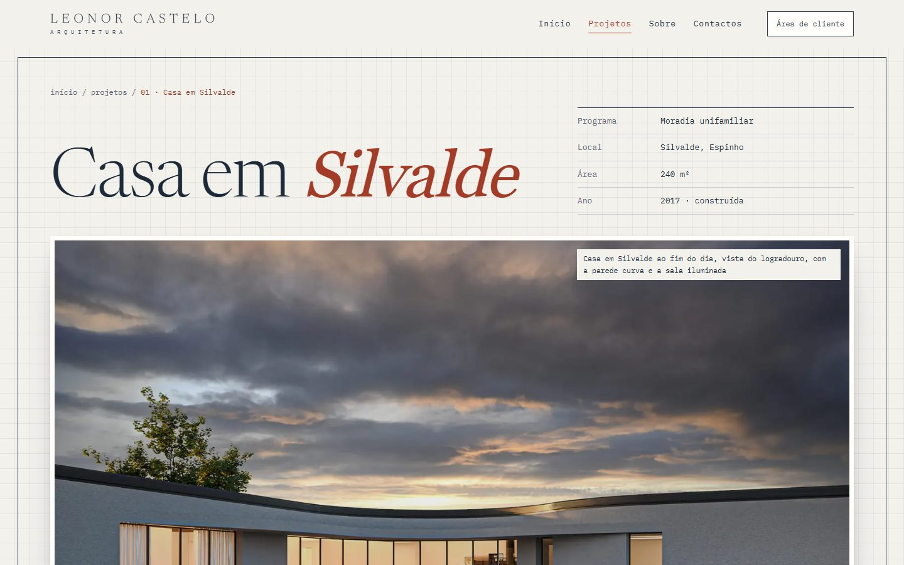<br><sub><b>Projeto</b> · ficha técnica e fotografia</sub></td>
    <td>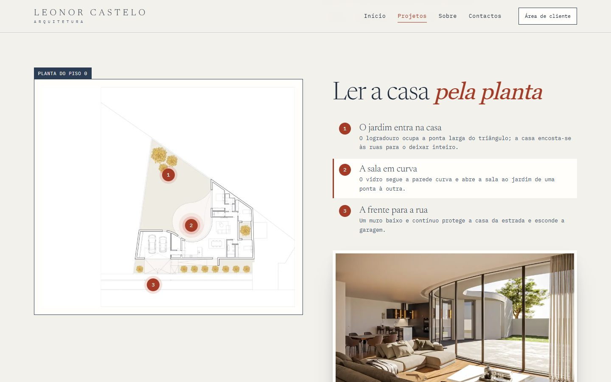<br><sub><b>Ler a casa pela planta</b> · cada pino mostra um sítio</sub></td>
  </tr>
  <tr>
    <td>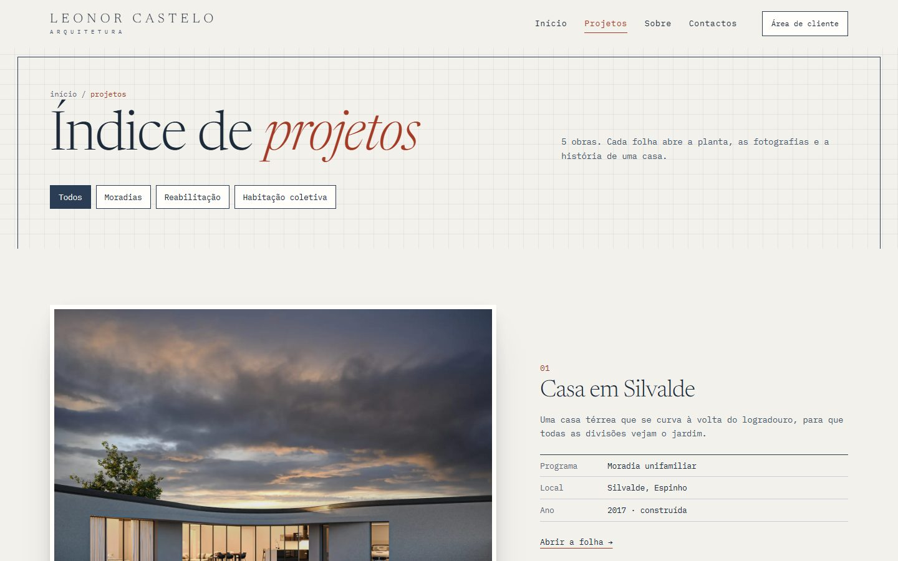<br><sub><b>Projetos</b> · filtros por tipo</sub></td>
    <td>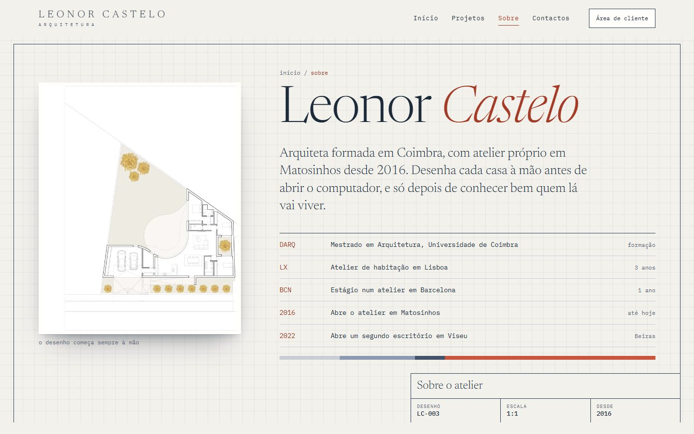<br><sub><b>Sobre</b> · o percurso da arquiteta</sub></td>
  </tr>
  <tr>
    <td>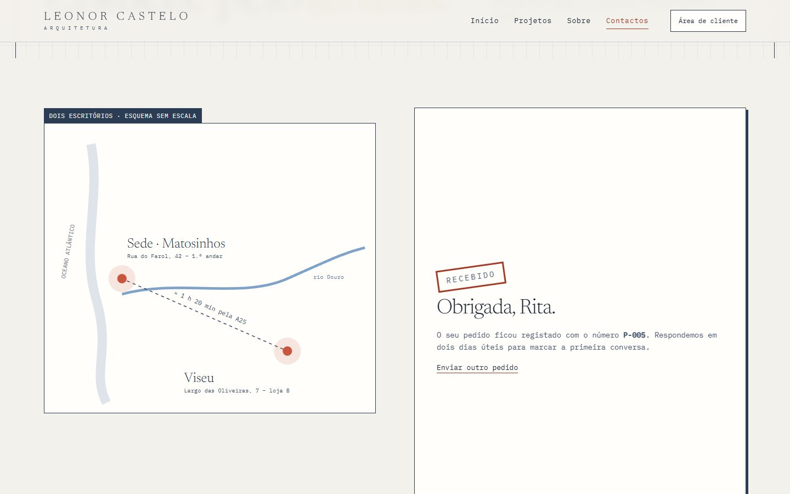<br><sub><b>Contactos</b> · o pedido recebe um carimbo</sub></td>
    <td>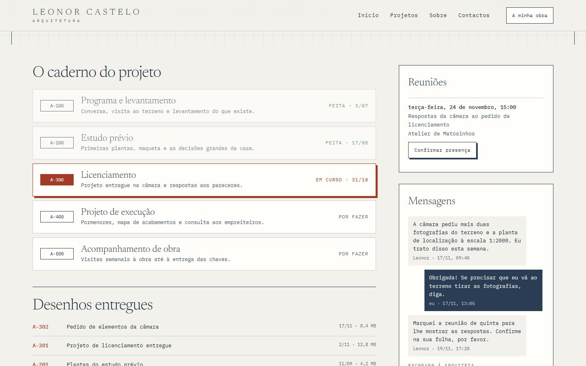<br><sub><b>A minha obra</b> · fases, reuniões e mensagens</sub></td>
  </tr>
  <tr>
    <td colspan="2">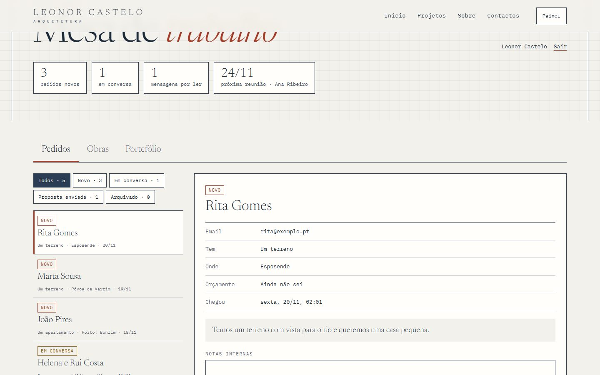<br><sub><b>Mesa de trabalho</b> · pedidos, obras e portefólio</sub></td>
  </tr>
</table>

<p align="center">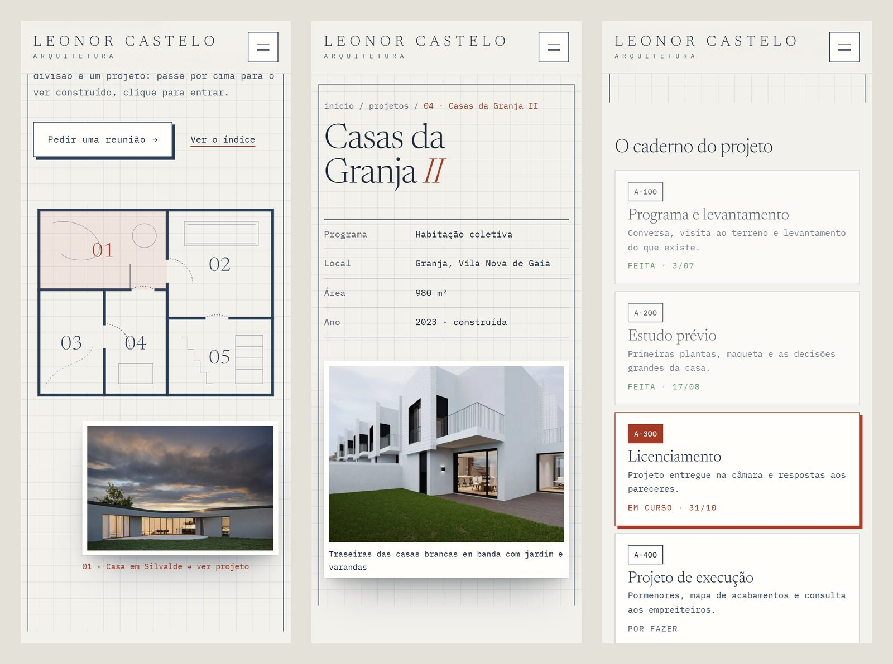</p>

## 🛠️ Tecnologias

- **Node.js 22+ e Express 5**, com páginas geradas no servidor (o HTML chega completo, sem framework no browser)
- **JWT**: token de acesso curto e refresh token numa cookie `httpOnly`, renovado em cada uso; um refresh repetido termina todas as sessões
- **express-validator** em todas as entradas da API, com as mensagens de erro junto a cada campo
- **helmet** com Content Security Policy sem scripts inline, **express-rate-limit** no login e no formulário de pedidos, **compression**
- **JavaScript em módulos ES** por página, sem bibliotecas
- Repositórios em memória com a mesma interface de uma base de dados (`findAll`, `findById`, `create`, `update`, `remove`)

```
planta/
├── src/
│   ├── config/        env, dados do atelier e fases do projeto
│   ├── data/          dados iniciais e manifesto das fotografias
│   ├── routes/        páginas, API pública, conta, painel, autenticação, CSS
│   ├── services/      projetos, pedidos, obras, autenticação
│   ├── views/         documento e páginas
│   └── seo/           head e JSON-LD
└── public/
    ├── css/           base, componentes e uma folha por página (servidas juntas)
    ├── js/            um módulo por página
    ├── img/           fotografias em webp, três tamanhos cada
    └── fonts/         Newsreader e IBM Plex Mono
```

## 🚀 SEO e desempenho

| Página | Desempenho | Acessibilidade | Boas práticas | SEO |
| --- | :-: | :-: | :-: | :-: |
| Início (telemóvel) | 97 | 100 | 100 | 100 |
| Início (computador) | 100 | 100 | 100 | 100 |
| Projetos (telemóvel) | 96 | 100 | 100 | 100 |
| Casa em Silvalde (telemóvel) | 96 | 100 | 100 | 100 |
| Sobre (telemóvel) | 98 | 100 | 100 | 100 |
| Contactos (telemóvel) | 98 | 100 | 100 | 100 |

- Título, descrição, canonical, Open Graph e Twitter Card em todas as páginas; `robots.txt` e `sitemap.xml` gerados a partir dos projetos publicados
- JSON-LD: `ProfessionalService` com os dois escritórios, `CreativeWork` em cada projeto, `Person`, `ItemList` e `BreadcrumbList`
- Fotografias em webp com `srcset` em três larguras, largura e altura reservadas e `preload` da imagem principal
- Fontes locais com `font-display: optional` e letras de reserva com as mesmas medidas, para a página não saltar
- Um só ficheiro de CSS; a área de cliente e o painel não são indexados

## ▶️ Como pôr a correr

```bash
npm install
cp .env.example .env
npm run dev
```

Abre em `http://localhost:3007`. Contas para experimentar:

| Perfil | Email | Palavra-passe |
| --- | --- | --- |
| Arquiteta | `leonor@leonorcastelo.pt` | `planta2026` |
| Cliente com obra | `ana@exemplo.pt` | `cliente2026` |
| Cliente no início | `tiago@exemplo.pt` | `cliente2026` |

## 🔌 API

| Método | Rota | Quem | O que faz |
| --- | --- | --- | --- |
| `GET` | `/api/projetos` | todos | Projetos publicados |
| `POST` | `/api/pedidos` | todos | Pedido de reunião |
| `POST` | `/api/auth/register` · `login` · `refresh` · `logout` | todos | Sessão |
| `GET` `PATCH` | `/api/auth/me` | sessão | Dados da conta |
| `GET` | `/api/conta/obra` | cliente | A obra, com fases, reuniões, desenhos e mensagens |
| `POST` | `/api/conta/obra/mensagens` | cliente | Escrever à arquiteta |
| `POST` | `/api/conta/obra/reunioes/:id/confirmar` | cliente | Confirmar presença |
| `GET` | `/api/admin/resumo` | arquiteta | Contagens e próximas reuniões |
| `GET` `PATCH` | `/api/admin/pedidos` · `/:id` | arquiteta | Pedidos, estado e notas |
| `GET` | `/api/admin/obras` | arquiteta | Todas as obras |
| `POST` | `/api/admin/obras/:id/fase` · `reunioes` · `mensagens` · `lida` | arquiteta | Gerir uma obra |
| `GET` `PATCH` | `/api/admin/projetos` · `/:id` | arquiteta | Portefólio e publicação |
| `POST` | `/api/admin/projetos/:id/mover` | arquiteta | Mudar a ordem |

---

<sub>A arquiteta, as moradas e os contactos são fictícios. As fotografias e os desenhos dos projetos pertencem ao atelier que os fez e estão aqui só como exemplo de conteúdo.</sub>
