<div align="center">


# Rotação

**Loja de discos e salas de ensaio em Lisboa — caixotes para folhear num gira-discos 3D, pré-escuta de cada faixa e salas marcadas numa mesa de mistura**


[Funcionalidades](#-funcionalidades) · [O gira-discos 3D](#-o-gira-discos-3d) · [Capturas](#-capturas) · [Tecnologias](#-tecnologias) · [SEO e desempenho](#-seo-e-desempenho) · [Como pôr a correr](#-como-pôr-a-correr) · [API](#-api)

</div>

<br>

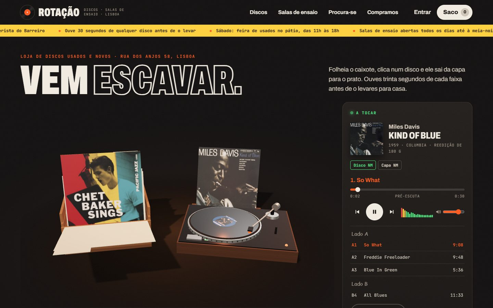

## 💿 Sobre o projeto

A Rotação é uma **loja de discos de vinil no Intendente**, em Lisboa, com três **salas de ensaio** no piso de baixo. O site faz o que se faz numa loja de discos a sério: **escavar caixotes**, tirar um disco que chamou a atenção, pô-lo no prato e ouvir antes de levar.

A página inicial é um **gira-discos em 3D** (three.js). Há um caixote de madeira com os discos de pé e separadores de cartão por género. Folheia-se com as setas, a arrastar ou pelos separadores, e os discos de trás tombam para a frente. Clicar na capa levantada tira o disco do caixote: a capa vai para a prateleira, o vinil sai, pousa no prato, o braço baixa e começa a tocar. A agulha vai andando para o centro à medida que a música avança, e a luz por baixo do prato respira com os graves.

Os discos são **álbuns famosos** — Miles Davis, Amália, Marvin Gaye, Pink Floyd, José Afonso, Elis & Tom, Daft Punk e mais 21. Cada faixa tem uma **pré-escuta oficial de 30 segundos** do iTunes / Apple Music, com a capa original. Quem compra um disco fica com ele na **sua discoteca**, onde o pode pôr a tocar no seu próprio gira-discos.

O resto do design vem do mesmo mundo: capas com o vinil a espreitar e **preços escritos à mão** em autocolantes fluorescentes, estado do disco explicado em linguagem de loja (“VG — estala aqui e ali, faz parte”), as **salas marcadas numa mesa de mistura** (cada canal é uma sala, as horas acendem como LEDs e o fader desce até à hora escolhida), a **lista de procura numa parede de cortiça** e o rodapé desenhado como a **contracapa de um disco**, com lado A e lado B.

Funciona **sem base de dados**: os dados vivem em memória e já trazem 28 discos, 3 salas com marcações para a semana, cartões na parede da procura, encomendas e contas de exemplo, mas o backend está completo — login com JWT, stock, encomendas, marcações sem sobreposição, cancelamentos com prazo e painel da loja.

## ✨ Funcionalidades

<table>
  <tr>
    <th width="33%">Para quem visita</th>
    <th width="33%">Para o cliente</th>
    <th width="33%">Para a loja</th>
  </tr>
  <tr valign="top">
    <td>
      • Gira-discos 3D com caixote para folhear<br>
      • Pré-escuta de 30 s de cada faixa<br>
      • Mini leitor que segue pela página<br>
      • Caixotes com filtros e vista em lista<br>
      • Página de cada disco com os lados A a D<br>
      • Salas na mesa de mistura, com as horas livres<br>
      • Parede da lista de procura<br>
      • Pedido de avaliação de coleções<br>
      • Link para partilhar o disco no prato
    </td>
    <td>
      • Criar conta (com a banda, para as salas)<br>
      • Saco com preços e stock do servidor<br>
      • Envio ou levantamento na loja<br>
      • A minha discoteca, no meu gira-discos<br>
      • Faixas completas para quem tem o disco<br>
      • Marcar e cancelar salas (até 24 h antes)<br>
      • Pendurar e tirar discos da parede<br>
      • Dados, morada e palavra-passe
    </td>
    <td>
      • Resumo do dia: salas, encomendas e stock<br>
      • Estado das encomendas (cancelar devolve o stock)<br>
      • Preço, stock e destaques na própria tabela<br>
      • Marcações de cada dia e cancelamentos<br>
      • Marcar um disco da procura como encontrado (guardado 48 h)<br>
      • Pedidos de avaliação com data marcada
    </td>
  </tr>
</table>

## 🎛️ O gira-discos 3D

- **Cena**: caixote com ripas e estêncil pintado que muda com o género, gira-discos com prato, estroboscópio, braço com contrapeso, botões 33/45 e luz de presença, e uma prateleira atrás para a capa do disco que está a tocar. Tudo construído com geometria do three.js, sem modelos externos.
- **Texturas desenhadas no momento** em `<canvas>`: veio da madeira, contracapa com a lista de faixas, separadores escritos a marcador e o vinil com sulcos, **separações entre as faixas do lado A** (pela duração de cada uma) e rótulo com a capa.
- **Animações**: os discos caem para dentro do caixote ao abrir, os da frente tombam quando se folheia, o escolhido levanta-se, a capa voa em arco até à prateleira, o vinil desliza para fora e pousa no prato. Trocar de disco faz o caminho inverso: o anterior volta para a capa e para o seu lugar no caixote.
- **Som**: um só leitor (Web Audio) para a página toda. O braço acompanha a música, o LED e a luz do prato reagem aos graves e o painel mostra um medidor. O botão de 45 rotações acelera o prato e o som.
- **Rato, toque e teclado**: clicar, arrastar para folhear, ← → para folhear, Enter para tocar, espaço para pausar.
- **Leve**: o three.js vai num ficheiro só com as peças usadas (138 KB com gzip, `npm run vendor`). No computador só carrega depois do primeiro gesto (rato, scroll ou teclado); no telemóvel carrega com o botão “Abrir o caixote”. Desenha só quando alguma coisa mexe, pára quando sai do ecrã e respeita `prefers-reduced-motion`.
- **Partilhar**: `/#tocar=kind-of-blue` abre a página já com esse disco no prato.

> [!NOTE]
> **Pré-escutas e faixas completas.** As capas e as pré-escutas de 30 s são as oficiais do iTunes / Apple Music (pesquisadas pelo `npm run catalogo`, que grava `src/data/itunes.json`). As faixas completas **não vêm no repositório**, porque são música com direitos de autor. O site já está preparado para elas: cada faixa tem um campo `full` no servidor e `GET /api/discos/:id/faixas/:n/completa` só devolve o endereço a quem comprou o disco. Basta a loja preencher esse campo com os ficheiros que tem licença para distribuir. Sem eles, a discoteca toca as pré-escutas.

## 📸 Capturas

| Os caixotes | Vista em lista |
|---|---|
| 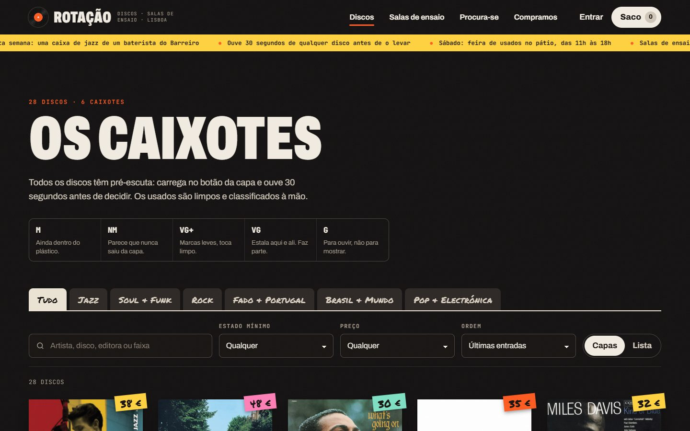 | 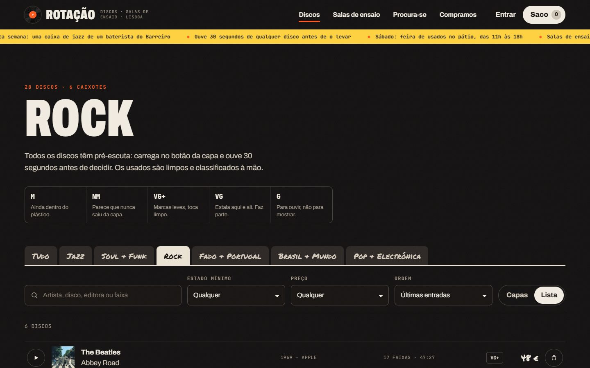 |
| **Um disco** | **Salas de ensaio** |
| 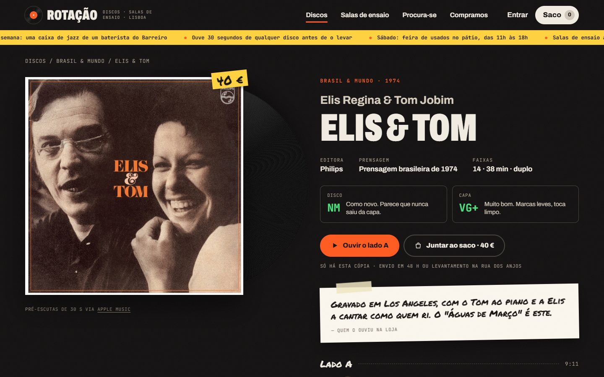 | 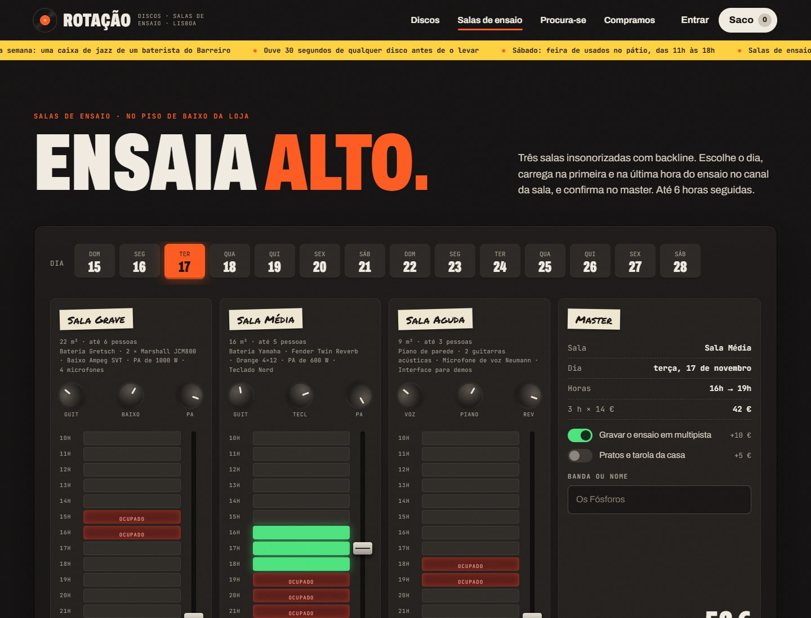 |
| **Procura-se** | **Compramos discos** |
| 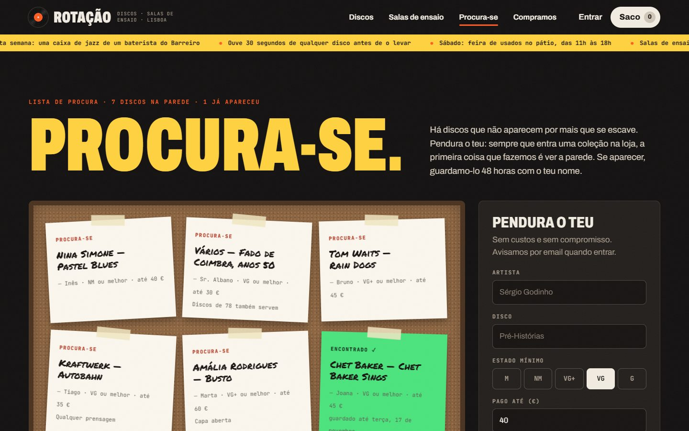 | 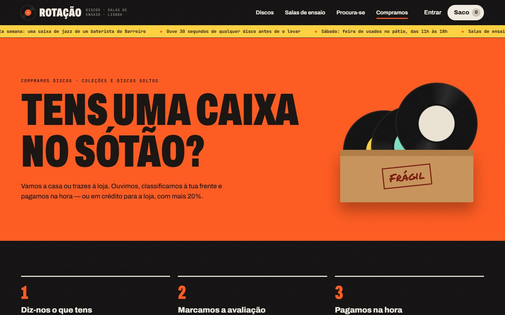 |
| **Saco** | **Entrar** |
| 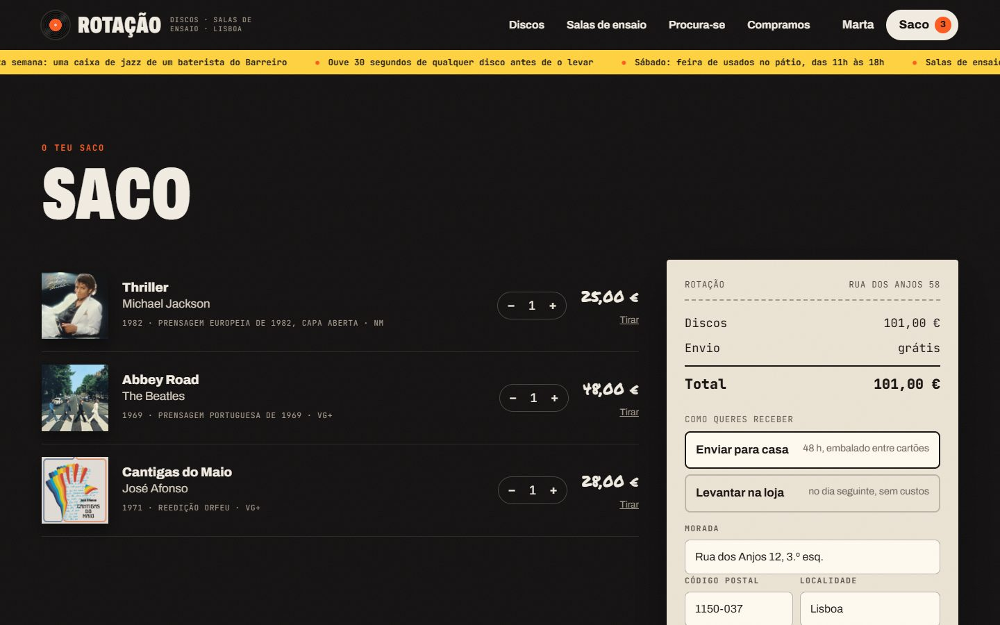 | 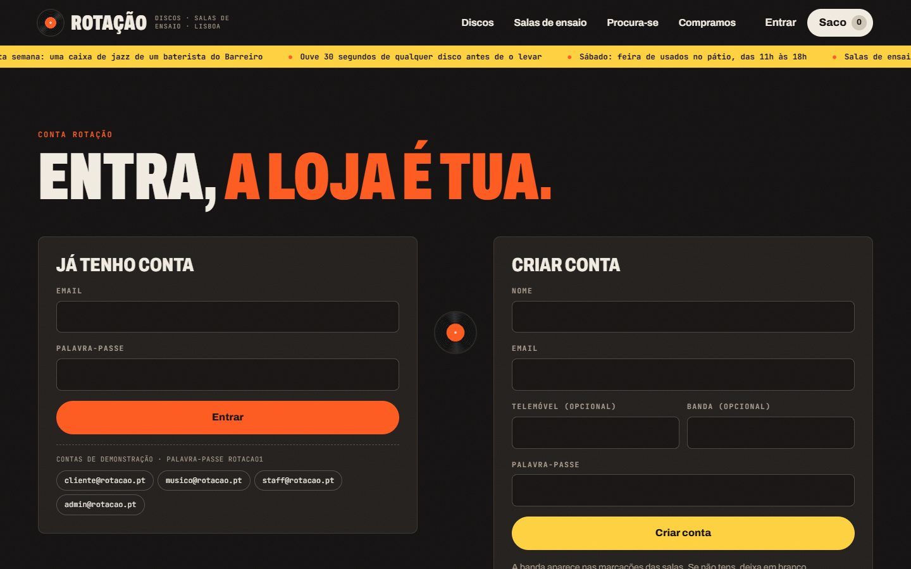 |
| **A minha discoteca** | **Painel da loja** |
| 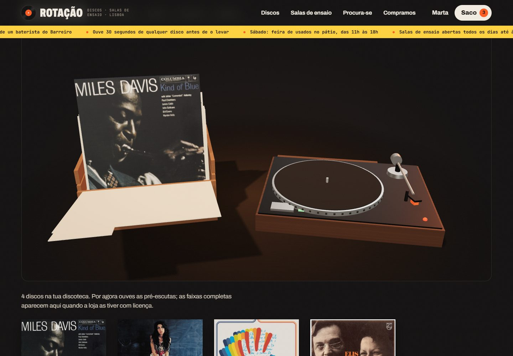 | 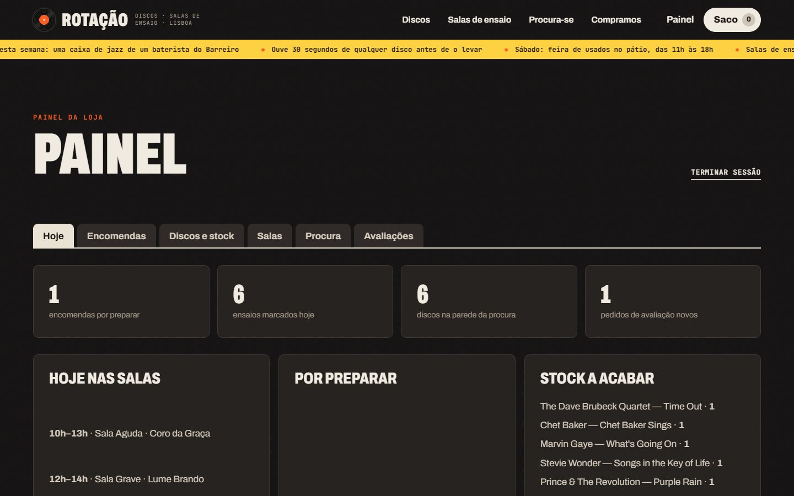 |

<details>
<summary><strong>Página inicial completa</strong></summary>

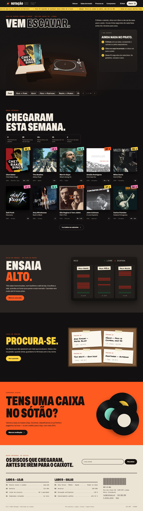

</details>

### 📱 No telemóvel

Todas as páginas são responsivas (testadas de 360 px a 1920 px). No telemóvel o caixote fica à frente e o gira-discos atrás, em diagonal.

<p align="center">
  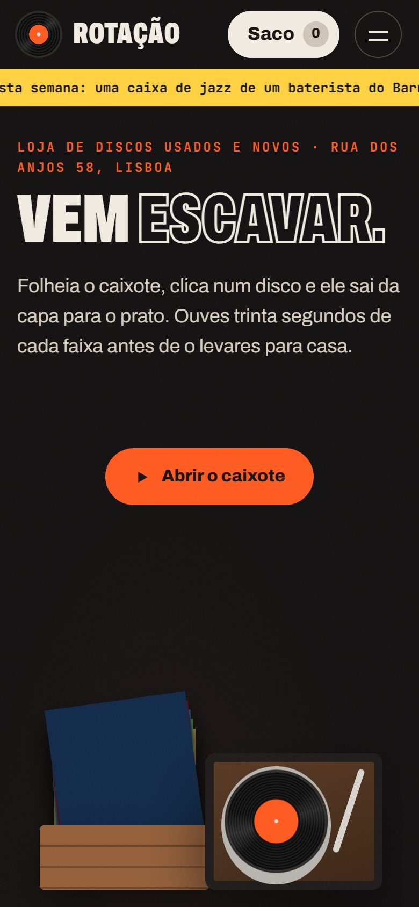
  &nbsp;
  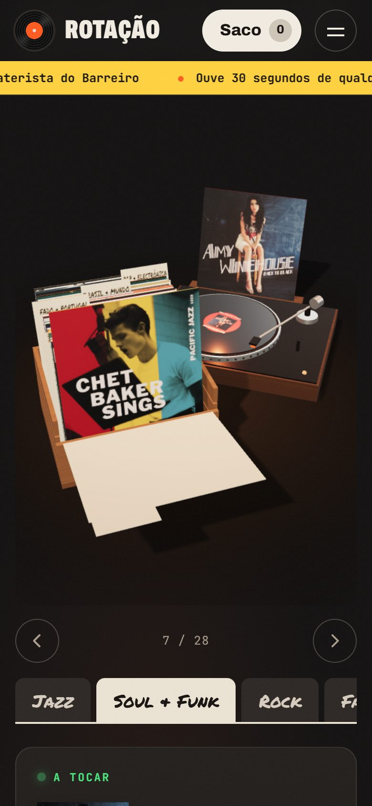
  &nbsp;
  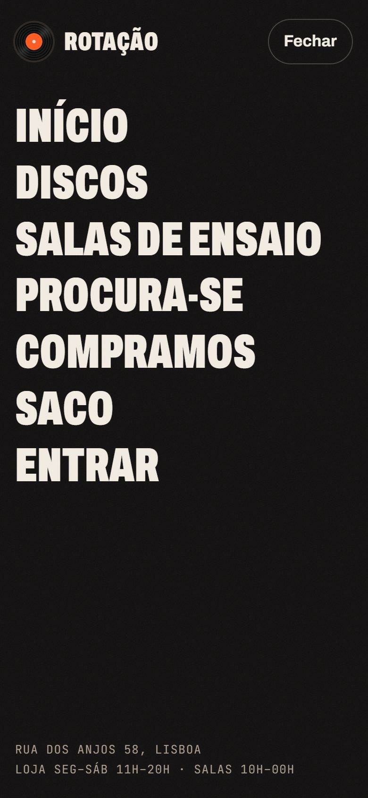
</p>

## 🧰 Tecnologias

| | Tecnologia | Para quê |
|---|---|---|
| ⚙️ | **Node.js 22+** e **Express 5** | Servidor, API e páginas desenhadas no servidor |
| 🔐 | **jsonwebtoken** e **bcryptjs** | Login com access token e refresh token, palavras-passe cifradas |
| 🛡️ | **helmet**, **express-rate-limit**, **cors** | Cabeçalhos de segurança, CSP e limite de tentativas |
| ✅ | **express-validator** | Validação de todos os pedidos, com mensagens em português |
| 🧊 | **three.js** | Caixote, gira-discos e animações em 3D |
| 🔊 | **Web Audio API** | Leitor único, medidor e luzes ao ritmo da música |
| 🍎 | **iTunes Search API** | Capas e pré-escutas oficiais de 30 s |
| 🎨 | **HTML, CSS e JavaScript** | Frontend sem build; os mesmos módulos formatam no servidor e no browser |
| 🗜️ | **compression** | Respostas comprimidas com gzip |
| 🔤 | **Archivo**, **JetBrains Mono** e **Permanent Marker** | Tipografia, servida pelo próprio site |

## 📈 SEO e desempenho

Resultados do Lighthouse 12 (telemóvel com rede 4G lenta simulada / computador):

| Página | Desempenho | Acessibilidade | Boas práticas | SEO |
|---|:---:|:---:|:---:|:---:|
| Início | 97 / 96 | 100 | 100 | 100 |
| Discos | 97 | 100 | 100 | 100 |
| Um disco | 95 | 100 | 100 | 100 |
| Salas | 98 | 100 | 100 | 100 |
| Procura | 98 | 100 | 100 | 100 |
| Compramos | 98 | 100 | 100 | 100 |

**SEO**

- Todas as páginas públicas são desenhadas no servidor: os discos, as faixas e as salas chegam completos no HTML.
- Título, descrição, `canonical`, Open Graph e Twitter Card em cada página; cada disco usa a capa como imagem de partilha. Os caixotes filtrados por género (`/discos?caixote=jazz`) têm título próprio; os filtros de pesquisa, estado e preço ficam com `noindex`.
- Dados estruturados (JSON-LD): `MusicStore`, `Product` com `MusicAlbum`, faixas, estado (novo/usado) e disponibilidade para cada disco, `Service` com preço à hora para cada sala, `FAQPage` e `BreadcrumbList`.
- `/sitemap.xml` gerado a partir do catálogo e `/robots.txt` que deixa de fora a API, o saco, a conta e o painel.
- O endereço público vem de `SITE_URL` no `.env`.

**Desempenho e acessibilidade**

- CSS comum e da página juntos num só pedido, com cache longa em produção.
- O 3D carrega depois da página: no computador ao primeiro gesto, no telemóvel com um botão. Até lá aparece um desenho do caixote e do gira-discos feito em CSS.
- Fontes servidas pelo site, com `preload` e fontes de reserva com medidas parecidas.
- Capas com `srcset`, `sizes` e dimensões; a primeira capa é pré-carregada.
- Filtros dos caixotes funcionam sem JavaScript (formulário normal) e com JavaScript (sem recarregar a página).
- Contraste AA, navegação por teclado (também no gira-discos), foco visível e `prefers-reduced-motion`.

## 🚀 Como pôr a correr

Precisa do [Node.js](https://nodejs.org) 22 ou mais recente.

```bash
cd rotacao
npm install
cp .env.example .env
npm run dev
```

Abrir **<http://localhost:3000>**. O `npm run dev` reinicia o servidor sempre que um ficheiro muda; em produção usar `npm start`.

| Comando | O que faz |
|---|---|
| `npm run catalogo` | Vai buscar ao iTunes as capas, faixas e pré-escutas dos discos de `src/data/records.js` |
| `npm run vendor` | Volta a gerar `public/vendor/three.min.js` só com as peças do three.js usadas |

### Contas de demonstração

Todas com a palavra-passe `rotacao1` (também aparecem na página de entrar).

| Email | Perfil | Para ver |
|---|---|---|
| `cliente@rotacao.pt` | Cliente | Discoteca com quatro discos, encomendas e procura |
| `musico@rotacao.pt` | Cliente com banda | Marcações nas salas (Os Fósforos) |
| `staff@rotacao.pt` | Loja | Painel |
| `admin@rotacao.pt` | Loja | Painel |

> [!NOTE]
> Os dados estão em memória, por isso tudo volta ao estado inicial quando o servidor reinicia.

## 🔌 API

Todas as rotas começam por `/api`. As marcadas com 🔒 precisam do cabeçalho `Authorization: Bearer <accessToken>`.

<details>
<summary><strong>Autenticação</strong></summary>

| Método | Rota | Descrição |
|---|---|---|
| POST | `/auth/register` | Criar conta |
| POST | `/auth/login` | Entrar |
| POST | `/auth/refresh` | Novo access token a partir do cookie de refresh |
| POST | `/auth/logout` | Terminar sessão |
| GET / PATCH | `/auth/me` 🔒 | Ver e editar dados, banda e morada |
| PATCH | `/auth/me/password` 🔒 | Mudar a palavra-passe |

</details>

<details>
<summary><strong>Discos</strong></summary>

| Método | Rota | Descrição |
|---|---|---|
| GET | `/discos?caixote&estado&ate&q&ordem` | Lista de discos com filtros |
| GET | `/discos/catalogo` | Caixotes e estados, com contagens |
| GET | `/discos/:id` | Detalhe, lados e discos do mesmo caixote |
| GET | `/discoteca` 🔒 | Os discos que já comprei |
| GET | `/discos/:id/faixas/:n/completa` 🔒 | Endereço da faixa completa (só para quem tem o disco) |

</details>

<details>
<summary><strong>Encomendas</strong></summary>

| Método | Rota | Descrição |
|---|---|---|
| POST | `/encomendas/orcamento` | Calcular o saco (preços, stock e envio) |
| POST | `/encomendas` 🔒 | Encomendar (verifica stock e desconta-o) |
| GET | `/encomendas` 🔒 | As minhas encomendas |

</details>

<details>
<summary><strong>Salas, procura e compras</strong></summary>

| Método | Rota | Descrição |
|---|---|---|
| GET | `/salas?data` | Salas com o estado de cada hora do dia |
| POST | `/salas/reservas` 🔒 | Marcar (sem sobreposições, até 6 h seguidas) |
| GET | `/salas/reservas` 🔒 | As minhas marcações |
| DELETE | `/salas/reservas/:id` 🔒 | Cancelar até 24 h antes |
| GET | `/procura` | Parede da procura (só o primeiro nome) |
| GET | `/procura/minha` 🔒 | Os meus discos na parede |
| POST | `/procura` 🔒 | Pendurar um disco |
| DELETE | `/procura/:id` 🔒 | Tirar da parede |
| POST | `/compramos` | Pedido de avaliação de uma coleção |
| POST | `/newsletter` | Subscrever as novas entradas |

</details>

<details>
<summary><strong>Painel</strong> (perfis <code>staff</code> e <code>admin</code>)</summary>

| Método | Rota | Descrição |
|---|---|---|
| GET | `/admin/resumo` 🔒 | Encomendas por preparar, salas de hoje, stock a acabar |
| GET | `/admin/encomendas` 🔒 | Encomendas com cliente |
| PATCH | `/admin/encomendas/:id` 🔒 | Mudar o estado (cancelar devolve o stock) |
| GET | `/admin/discos` 🔒 | Discos com stock |
| PATCH | `/admin/discos/:id` 🔒 | Preço, stock e destaque |
| GET | `/admin/salas?data` 🔒 | Marcações de um dia |
| DELETE | `/admin/salas/reservas/:id` 🔒 | Cancelar uma marcação |
| GET | `/admin/procura` 🔒 | Parede completa e discos em stock |
| PATCH | `/admin/procura/:id` 🔒 | Marcar como encontrado (guarda 48 h) ou fechar |
| GET | `/admin/avaliacoes` 🔒 | Pedidos de avaliação |
| PATCH | `/admin/avaliacoes/:id` 🔒 | Estado e data da avaliação |

</details>

Os erros de validação respondem com `400` e a lista de campos:

```json
{
  "error": "Há campos por corrigir",
  "details": [{ "field": "hours", "message": "Entre 1 e 6 horas seguidas" }]
}
```
